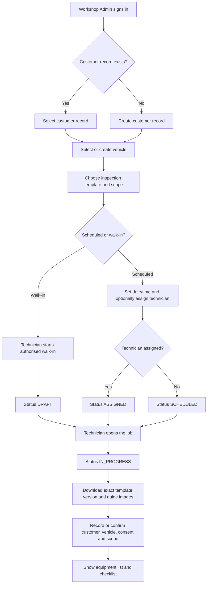
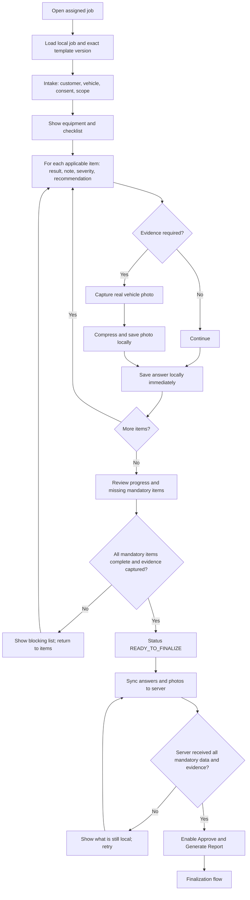
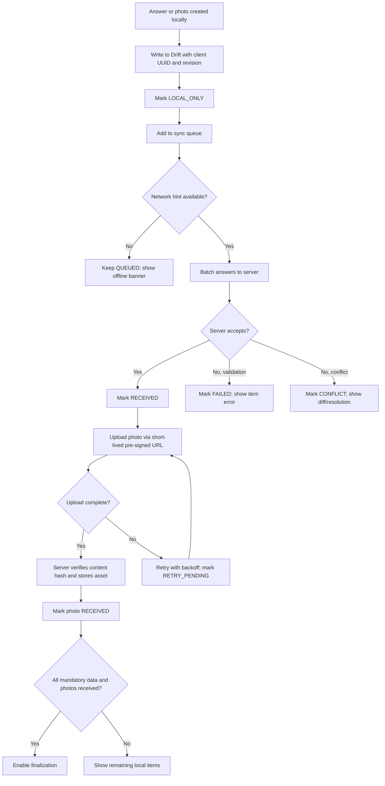
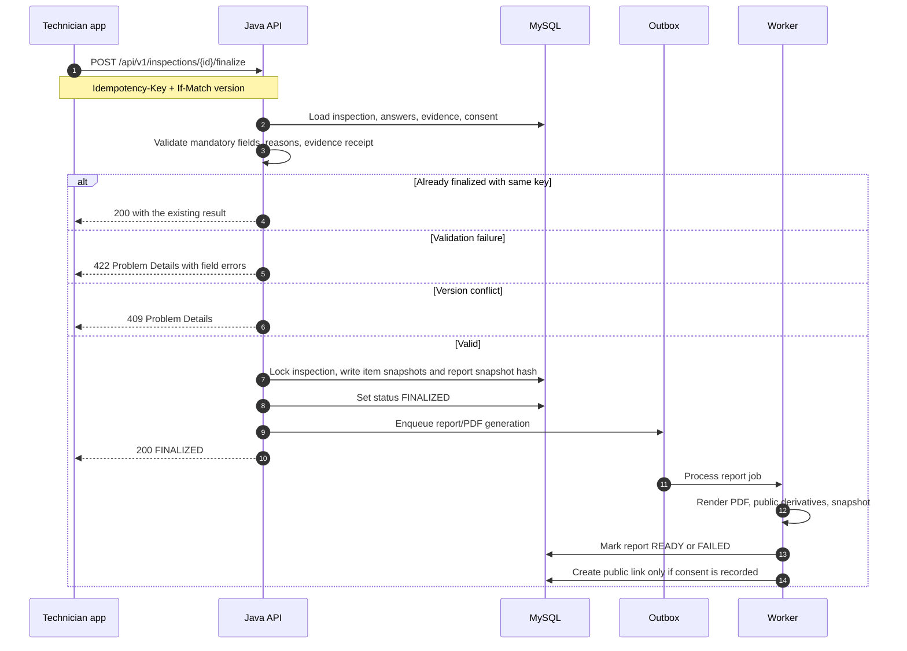
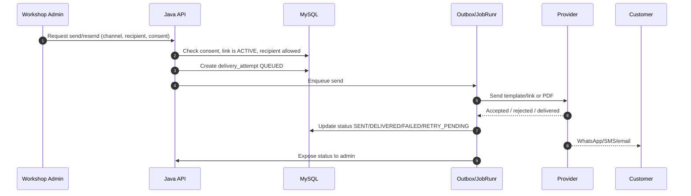
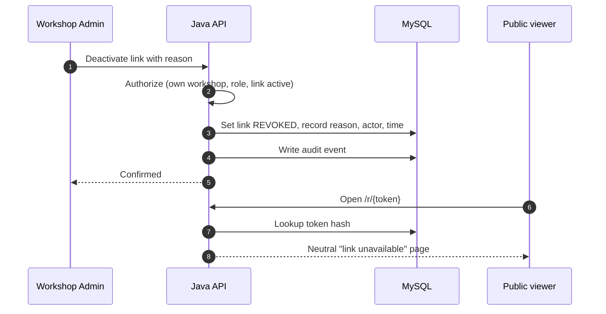
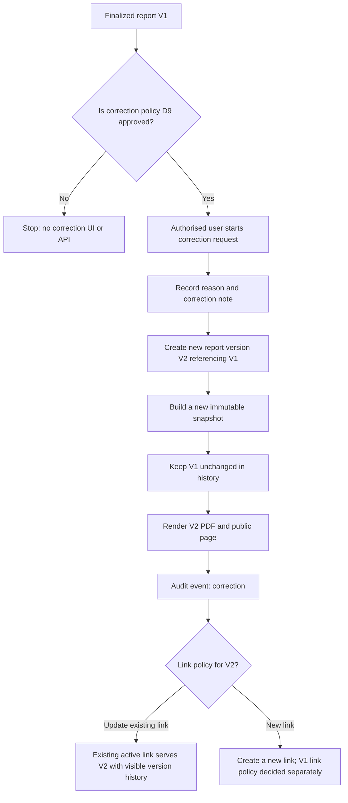

# Workflows, Statuses and Error Cases (Phase 0 Proposal)

**Project:** TrueReport  
**Document:** 04-workflows.md  
**Status:** Proposed for product-owner approval. Diagrams are design proposals, not implemented behaviour.

---

## 1. Scope of this document

This document covers the full Version 1 workflow:

1. Job creation and assignment.
2. Technician inspection, including offline work.
3. Offline sync and photo upload.
4. Finalization and server-side locking.
5. Report and public-link generation.
6. Delivery by WhatsApp, SMS and email.
7. Link revocation.
8. Correction and new report version.

It also defines the inspection statuses, link states, delivery states and the main error cases.

**Hard rules from `master.md`:**

- No manager role.
- No second-person review.
- No approval queue.
- No resubmission workflow.
- No Admin editing of finalized findings.
- No customer app, portal or login.
- No in-platform payments.
- Finalized findings can never be edited by anyone.

---

## 2. Status models

### 2.1 Inspection status

| Status | Meaning | Who can set it |
|---|---|---|
| `DRAFT` | Job exists but is not scheduled or assigned; walk-in work may start here. | Workshop Admin, Technician (authorised walk-in) |
| `SCHEDULED` | Appointment exists; technician may or may not be assigned. | Workshop Admin |
| `ASSIGNED` | A technician is assigned; work has not started. | Workshop Admin |
| `IN_PROGRESS` | Technician has opened the job and started the inspection. | Technician |
| `READY_TO_FINALIZE` | Technician has reviewed the inspection; mandatory checks pass locally; server has all mandatory data and evidence. | Technician |
| `FINALIZED` | Server has locked the inspection and built the immutable snapshot. | Server only |
| `CANCELLED` | Job cancelled before finalization. | Workshop Admin; Platform Admin only with an approved policy **[ASSUMPTION]** |

There is **no** `PENDING_REVIEW`, `APPROVED`, `REJECTED` or `RESUBMITTED` status.

### 2.2 Report generation state (internal)

This is separate from the inspection status. It describes the server-side report job. **[RECOMMENDATION]**

| State | Meaning |
|---|---|
| `NOT_STARTED` | No report has been requested. |
| `QUEUED` | Finalization succeeded; report/PDF job is queued. |
| `GENERATING` | Worker is building the snapshot, PDF and public derivatives. |
| `READY` | Report and PDF are ready; link may be active if consent exists. |
| `FAILED` | Generation failed; report remains finalized; retry and alert. |

A PDF failure must not un-finalize the inspection. The findings are already locked.

### 2.3 Public-link state

| State | Meaning |
|---|---|
| `NOT_CREATED` | No link exists (not finalized, or consent missing). |
| `PENDING_CONSENT` | Finalized report exists, but public-link consent is not recorded. The link is not active. |
| `ACTIVE` | Link is active and serves the public report. |
| `REVOKED` | Link is revoked; neutral response only. |

The link is active only when the required customer consent is recorded. **Reactivation is not defined in `master.md`; treat it as open.**

### 2.4 Delivery state

| State | Meaning |
|---|---|
| `QUEUED` | Message is queued for sending. |
| `SENT` | Provider accepted the message. |
| `DELIVERED` | Provider confirms delivery (only if the provider supplies it). |
| `FAILED` | Provider rejected or the send failed. |
| `RETRY_PENDING` | A retry is scheduled. |

Delivery status is separate from inspection status and report status. A failed message never changes the report.

### 2.5 Local sync state (technician app)

| State | Meaning |
|---|---|
| `LOCAL_ONLY` | Saved on the phone; not yet queued. |
| `QUEUED` | In the upload/sync queue. |
| `UPLOADING` | Transfer in progress. |
| `RECEIVED` | Server confirmed receipt. |
| `FAILED` | Transfer failed; retry available. |
| `CONFLICT` | Server rejected the write because the job changed or a newer version exists. |

The UI must show **“Saved on this phone”** and **“Received by server”** separately. It must never show “submitted” or “finalized” before the server confirms.

---

## 3. Status transition table

| From | To | Trigger | Guard / rule |
|---|---|---|---|
| — | `DRAFT` | Workshop Admin creates a job; technician starts an authorised walk-in. | Customer/vehicle record exists; workshop active; template selected. |
| `DRAFT` | `SCHEDULED` | Appointment date/time set. | Template version is available. |
| `DRAFT` | `ASSIGNED` | Technician assigned immediately. | Technician active and in the same workshop. |
| `DRAFT` | `IN_PROGRESS` | Technician opens an authorised walk-in job. | Technician is authorised to start walk-ins. |
| `SCHEDULED` | `ASSIGNED` | Technician assigned. | Technician active and in the same workshop. |
| `SCHEDULED` | `IN_PROGRESS` | Technician opens the job. | Assignment or workshop policy permits it. |
| `ASSIGNED` | `IN_PROGRESS` | Technician opens the job. | Assignment still valid. |
| `IN_PROGRESS` | `READY_TO_FINALIZE` | Technician reviews and all local mandatory checks pass. | No blocking validation errors; mandatory evidence captured locally. |
| `READY_TO_FINALIZE` | `IN_PROGRESS` | Technician goes back to edit. | Before server finalization only. |
| `READY_TO_FINALIZE` | `FINALIZED` | Technician presses Approve & Generate Report; server validates and locks. | Mandatory data and required photos received by server; consent rules satisfied; idempotency key present. |
| `DRAFT`, `SCHEDULED`, `ASSIGNED`, `IN_PROGRESS`, `READY_TO_FINALIZE` | `CANCELLED` | Workshop Admin cancels. | Reason recorded; no finalized report exists. |
| `FINALIZED` | — | No transition. | Immutable. A correction creates a new report version, not an edit. |

**Illegal transitions:** `FINALIZED` back to any editable state; `CANCELLED` to `FINALIZED`; `READY_TO_FINALIZE` to `FINALIZED` when the server has not received mandatory data/evidence.

---

## 4. Flow 1 — Job creation and assignment



### 4.1 Notes

- The template version is pinned when the inspection starts. A later template publication does not change this job.
- The technician must confirm the scope and any customer instructions before starting.
- The equipment list is shown for the selected template/service.
- If a needed make, model, checklist item or dropdown value is missing, the app offers a safe fallback or “Other”. The technician must still be able to report a real vehicle.

### 4.2 Error cases

| Error | Handling |
|---|---|
| Workshop is disabled | Block job creation; show a neutral “workshop unavailable” message to staff. |
| Customer/vehicle duplicate suspected | Warn and allow selection of the existing record; do not silently merge. |
| No published template | Block the start; tell the Workshop Admin to publish a template. |
| Template retired while offline | On sync, reject the start or offer the nearest published version with an audit note. Do not silently switch. |
| Technician disabled or transferred | Block assignment; if already assigned offline, return a conflict and require reassignment. |
| Walk-in not authorised | Technician cannot start; show a clear permission message. |
| Invalid phone/email | Validate format; allow saving only if the delivery channel is not required yet. |
| Missing consent | Allow the job to proceed, but the public link cannot become active. |
| Server unavailable | Save locally if the job was already downloaded; otherwise show retry. |

---

## 5. Flow 2 — Technician inspection, including offline work



### 5.1 Item-level rules

- Each answer is written to the local database immediately with a client revision number.
- A result of “Not checked”, “Not applicable” or “Could not verify” may require a reason. “Not checked” and “Could not verify” require a reason.
- A “defect found” result should record severity and a recommendation where the template requires it.
- A guide image must never be displayed as if it were evidence of the inspected vehicle.
- A real evidence photo must be linked to the item it supports.
- If a check is unsafe or the equipment is unavailable, the technician records the limitation. The app must not force unsafe work.
- The app must not force every item to require a photo unless the platform/template explicitly does so.

### 5.2 Error cases

| Error | Handling |
|---|---|
| Required answer missing | Block finalization; show the item and category. |
| Required photo missing | Block finalization; show the item. |
| “Not checked”/“Could not verify” without reason | Block finalization. |
| “Not applicable” without reason | Block if the template requires a reason. |
| Photo capture permission denied | Explain and offer settings guidance; allow a limitation record only if the template permits. |
| Camera/app killed during capture | Draft and already-saved photos survive; the unsaved capture is lost and must be retaken. |
| App killed during inspection | All saved answers and queued photos survive; reopen the local draft. |
| Template version changed on server | Do not silently switch; show a conflict and keep the pinned version. |
| Job reassigned while offline | On sync, return a conflict; show “this job was reassigned”; do not overwrite. |
| Job cancelled while offline | On sync, return a conflict; preserve the local copy for audit/support. |
| Duplicate item answers | Use the client revision/idempotent upsert; keep the latest accepted revision. |
| Device storage full | Warn before capture; block new photos; allow sync/cleanup. |
| Low battery/background limits | Save immediately; resume on app open. |

---

## 6. Flow 3 — Offline sync and photo upload



### 6.1 Offline rules

1. When a job is assigned or opened, the app downloads the job and the **exact checklist/template version** plus guide images.
2. Every answer is written locally immediately with a client revision number.
3. Photos are captured, compressed, saved locally and added to an upload queue. Target size is roughly 1–2 MB each, to be verified by real tests. **[OPEN — D11]**
4. Answers sync as batches of idempotent upserts keyed by client-generated UUIDs.
5. Photos upload through short-lived pre-signed URLs. Resumable/chunked upload is added only if tests show it is needed.
6. The UI always shows “Saved on this phone” and “Received by server” per item and overall.
7. Finalize is enabled only when mandatory data and required photos have been **received by the server**.
8. Conflicts are detected by version and shown to the technician. The app never silently overwrites.
9. A different user on the same device must not see the previous user’s offline data.
10. “Submitted” is never shown before the server confirms.

### 6.2 Conflict resolution

| Conflict | Resolution |
|---|---|
| Job reassigned | Stop editing; show reassignment; require the new assignee to continue. The old technician’s local data is preserved for audit but not applied. |
| Job cancelled | Stop; show cancelled; preserve local data for support. |
| Newer server revision of the same answer | Show both versions and let the technician choose the correct one, or fetch the server version; never silently overwrite. |
| Photo hash mismatch | Reject the upload; require re-upload. |
| Template version mismatch | Keep the pinned version; do not migrate answers automatically. |

---

## 7. Flow 4 — Finalization



### 7.1 Finalization preconditions

- All mandatory items have an accepted result.
- “Not checked” and “Could not verify” have reasons.
- Required evidence photos have been received by the server.
- Required customer/vehicle fields are present.
- The technician has recorded the required consent.
- The inspection is in `READY_TO_FINALIZE`.
- The technician is the current assignee or otherwise authorised.
- The request carries an idempotency key and a version.

### 7.2 What finalization does

1. Validates and locks the inspection.
2. Copies the exact item wording, answers, severities, translations and template version into immutable snapshots.
3. Builds the report snapshot and stores its hash.
4. Sets the inspection to `FINALIZED`.
5. Enqueues PDF and public-report generation.
6. Writes an audit event.
7. Returns the finalized result to the technician.

### 7.3 Error cases

| Error | HTTP / behaviour |
|---|---|
| Double submit | Same idempotency key returns the same result; no duplicate report. |
| Timeout after server commit | Retry with the same key returns the existing result. |
| Validation failure | 422 with problem details; inspection remains editable. |
| Stale version | 409; reload and show the difference. |
| Not the assignee | 403; show the current assignee. |
| Already finalized by someone else | 409; open the finalized report read-only. |
| Required photo not received | 422; list missing evidence. |
| Consent missing | Finalization may still succeed, but the public link stays inactive until consent is recorded. **[ASSUMPTION — confirm whether consent is a finalization precondition or only a link precondition]** |
| PDF render failure | Report stays finalized; generation marked `FAILED`; retry and alert. |
| Storage failure | Same as PDF failure; no data loss; retry. |

---

## 8. Flow 5 — Report and public-link generation

```mermaid
flowchart TD
    A[Inspection FINALIZED] --> B[Build immutable report snapshot]
    B --> C[Store snapshot JSON and hash]
    C --> D[Generate bilingual PDF from snapshot]
    D --> E{PDF generated?}
    E -- No --> F[Mark report FAILED; retry; alert]
    F --> D
    E -- Yes --> G[Store PDF privately; generate public image derivatives]
    G --> H{Public-link consent recorded?}
    H -- No --> I[Link state PENDING_CONSENT; no active URL]
    H -- Yes --> J[Generate 256-bit random token]
    J --> K[Store only a hash of the token]
    K --> L[Create URL /r/{token}]
    L --> M[Link state ACTIVE]
    M --> N[Public page renders allowlisted snapshot only]
    N --> O[noindex; neutral metadata; no customer data]
```

### 8.1 Report snapshot rules

- The snapshot is built once at finalization.
- The public page and PDF render only from the snapshot, never by joining live catalogue tables.
- The report version and publication date are visible.
- The public page uses an allowlist serializer.
- The public page must not expose original high-resolution evidence files.
- There is no search indexing.
- Invalid or revoked links show a neutral message with no vehicle information.
- The public page must offer English and Arabic.
- The report must not use a single unexplained numerical condition score as the primary summary. Show coverage, findings and limitations instead.

### 8.2 Consent gate

- Consent to create a publicly accessible link is separate from consent to send a message.
- Record when and how consent was obtained, the wording/version, and who captured it.
- The link is active only when the required consent is recorded.
- If consent is missing, the report can still exist internally, but there is no active public URL.
- Consent withdrawal and link revocation policy must be reviewed by counsel. **[OPEN]**

### 8.3 Error cases

| Error | Handling |
|---|---|
| Snapshot build fails | Finalization should fail atomically or roll back; no half-finalized state. |
| PDF fails | Report remains finalized; retry; notify operations. |
| Image derivative fails | Keep the report; retry; do not publish the original. |
| Token collision | Regenerate; collisions are extremely unlikely but must be handled. |
| Consent missing | No active link; show “consent required” to the Workshop Admin. |
| Consent recorded after finalization | Link can be created/activated after the fact, with an audit event. **[ASSUMPTION]** |
| Public route 404 | Neutral page; no report data. |
| Rate limit exceeded | 429 with a neutral message; do not reveal whether a token exists. |
| Search engine crawler | `noindex` and neutral metadata; do not rely on robots.txt alone. |

---

## 9. Flow 6 — Delivery by WhatsApp, SMS and email



### 9.1 Channel rules

**WhatsApp**

- Only contact a person with a valid phone number/username and recorded opt-in.
- Outside the 24-hour customer-service window, use an approved message template.
- The template must be neutral and must not expose private findings or full VIN.
- Respect opt-out immediately.
- Store the template name/version and provider message ID.

**SMS**

- Use an approved sender ID/provider as required in the UAE. **[OPEN — provider and sender-ID registration not researched]**
- Keep the message short and neutral.
- Do not include customer name, full VIN or findings.

**Email**

- Send the PDF as an attachment or a secure link, depending on the approved delivery policy.
- Use SPF/DKIM/DMARC and a reputable provider. **[OPEN]**
- A bounced email is a delivery failure, not a report failure.

### 9.2 Error cases

| Error | Handling |
|---|---|
| No consent for the channel | Block the send; show why. |
| Invalid phone/email | Block; ask staff to correct the record. |
| WhatsApp template rejected/paused | Mark failed; alert operations; use another approved template or manual fallback. |
| WhatsApp opt-out | Suppress all future messages; record. |
| Outside 24-hour window without template | Block; do not attempt a free-form message. |
| Provider rate limit | Retry with backoff; keep `RETRY_PENDING`. |
| Provider outage | Retry; alert; manual download/resend remains available. |
| Email bounce | Mark failed; notify admin; retry only after correcting the address. |
| PDF too large for email | Send a secure link instead, if policy allows. |
| Duplicate resend request | Idempotency key prevents duplicate sends. |
| Report link revoked after sending | Recipient sees a neutral revoked message; do not resend the old link. |

---

## 10. Flow 7 — Link revocation



### 10.1 Rules

- Only an authorised Workshop Admin can revoke a link in V1.
- A valid reason is required: privacy, security, legal, or customer request.
- Revocation is immediate for future server access.
- Revocation cannot remove copies, downloaded PDFs, screenshots or messages already received.
- The public response must not reveal whether the report exists.
- Revocation is audited.
- Reactivation is **not defined** in `master.md`. Treat it as a separate decision; do not add a reactivate button until approved.

### 10.2 Error cases

| Error | Handling |
|---|---|
| Link already revoked | Idempotent success; no duplicate audit event. |
| Wrong workshop | 403/404; no information leak. |
| Missing reason | 422; require a reason. |
| Link never existed | Neutral 404. |
| Link active but report PDF failed | Revocation still works; the report page is unavailable. |
| Public viewer has cached page | Cannot be recalled; explain this to the customer/workshop. |

---

## 11. Flow 8 — Correction and new report version



**This flow is not approved.** `master.md` says a correction creates a new report version referencing the earlier one, with a visible correction note and reason; the earlier version stays in history. But it also says Admins cannot edit findings and finalization is self-finalization. The exact policy is D9 and must be decided by the product owner with legal input.

Questions to resolve before building this flow:

1. Who may initiate a correction: the original technician, a Workshop Admin, Platform Admin, or only a new inspection?
2. Does a correction require a new physical inspection/evidence, or can it fix a clerical error only?
3. Is the corrected report a new version of the same inspection, or a new inspection linked to the old one?
4. Does the existing public link serve the latest version, or does the customer receive a new link?
5. What is shown on the public page about the correction: a banner, a version history, both?
6. Can a correction be requested by the customer through the workshop?
7. What is the retention policy for superseded versions and evidence?

**Until D9 is approved, the system must not offer any correction action.**

---

## 12. Cross-flow invariants

1. **Immutability:** once `FINALIZED`, no role and no API can change findings, severity, notes or evidence. A correction is a new version, not an edit.
2. **Idempotency:** finalize, resend and correction requests use `Idempotency-Key`; repeated requests return the same outcome.
3. **Tenant isolation:** every read/write is scoped to the user’s workshop; public access is scoped to one token.
4. **Consent gate:** no active public link without recorded public-link consent.
5. **Receipt gate:** no finalization until the server has the mandatory data and evidence.
6. **No silent overwrite:** version conflicts return 409 and show the difference.
7. **Neutral public errors:** invalid/revoked links never reveal vehicle or customer data.
8. **Message failures are isolated:** a delivery failure never changes or deletes a report.
9. **Audit everything sensitive:** account changes, finalization, link revocation, resend, correction.
10. **No payment data:** no card fields, no payment endpoints, no card columns.

---

## 13. Status/error summary for screens

Every screen must describe loading, empty, error, success and offline states. The key states are:

| Screen | Must handle |
|---|---|
| Job list | Loading, empty, offline, stale, cancelled, reassigned. |
| Job details | Missing template, retired template, no consent, disabled technician, conflict. |
| Intake | Invalid phone/email, duplicate customer/vehicle, missing required field, unsaved changes. |
| Checklist | Autosave, local-only, queued, received, failed, conflict, missing reason, missing photo. |
| Camera | Permission denied, storage full, capture failed, compression failed. |
| Review | Blocking items, missing evidence, warnings, ready state. |
| Finalize | Submitting, retrying, validation error, conflict, success, server timeout. |
| Report status | Generating, ready, PDF failed, link pending consent, link active, revoked. |
| Delivery | Queued, sent, delivered, failed, retry pending, no consent, invalid recipient. |
| Public report | Active, invalid, revoked, rate-limited, PDF unavailable, language switch. |

---

## 14. Open workflow decisions

| ID | Decision | Default if unanswered |
|---|---|---|
| W1 | Can a Workshop Admin edit intake fields before finalization? | Yes for intake, never checklist findings. |
| W2 | Is consent a finalization precondition or only a link precondition? | Finalization can succeed; link stays inactive without consent. |
| W3 | Can a link be reactivated? | No UI until approved. |
| W4 | Who may create a correction, and how? | No correction flow until D9. |
| W5 | Does an existing link serve a corrected version, or is a new link issued? | No correction flow until D9. |
| W6 | Can Platform Admin resend/revoke? | No by default. |
| W7 | Is PDF download from the public report allowed? | Link-only until policy approved. |
| W8 | What are the photo size/count limits? | 1–2 MB per photo target; validate in pilot (D11). |
| W9 | What happens to evidence when a job is cancelled? | Retain privately per retention policy; do not publish. |
| W10 | What is the retention period for reports, drafts, evidence and delivery logs? | Legal/ops decision; do not hard-delete report dependencies. |

---

## 15. Approval

The workflow model is a proposal. The product owner must approve the statuses, the consent gate, the revocation rules, the delivery model and the correction policy (D9) before Phase 1 designs screens or APIs.

**No code has been written. Phase 1 has not started.**
