# Roadmap and Phase Gates

**Project:** TrueReport  
**Document:** 08-roadmap-and-gates.md  
**Status:** Proposed. The product owner must approve Phase 0 before Phase 1 starts.

---

## 1. Rules of the roadmap

1. Work proceeds phase by phase. Do not skip a phase.
2. Do not write application code until the product owner approves Phase 0 and Phase 1, and Phase 2 begins.
3. Each phase ends with a **gate**: a demonstration, a test report, updated documents and written product-owner approval.
4. A gate is not “the code compiles”. It is evidence that the phase’s acceptance criteria are met.
5. Any change to scope, architecture or a decision marked OPEN requires a written decision record (ADR or product-owner note).
6. Finalized findings must remain immutable in every phase. A later phase cannot relax this.
7. The phase documents in `docs/phase-0/` are the baseline for Phase 1. They are not edited silently; changes are versioned.

---

## 2. Phase sequence

```mermaid
flowchart LR
    P0[Phase 0 Research] --> P1[Phase 1 UX, domain, architecture]
    P1 --> P2[Phase 2 Foundation]
    P2 --> P3[Phase 3 Platform Admin and master content]
    P3 --> P4[Phase 4 Workshop Admin and templates]
    P4 --> P5[Phase 5 Technician inspection]
    P5 --> P6[Phase 6 Reports, PDF, public link]
    P6 --> P7[Phase 7 Messaging and delivery]
    P7 --> P8[Phase 8 Pilot, security, production]
```

**Dependency notes:**

- Phase 3 needs the master-content model from Phase 1 and the tenancy/auth foundation from Phase 2.
- Phase 4 needs the master library from Phase 3.
- Phase 5 needs a published template from Phase 4.
- Phase 6 needs finalized inspections from Phase 5.
- Phase 7 needs a report and link from Phase 6.
- Phase 8 needs a working end-to-end pilot, not a demo.

---

## 3. Phase 0 — Research and requirements

**Status:** Delivered for review. No code written.

### Objective

Understand the product, market, technical options, legal starting points and risks before designing or building.

### Deliverables

- `01-research-findings.md`
- `02-confirmed-scope.md`
- `03-roles-and-permissions.md`
- `04-workflows.md`
- `05-version-lock-table.md`
- `06-assumptions-and-open-questions.md`
- `07-risk-register.md`
- `08-roadmap-and-gates.md`
- `09-spike-plan.md`
- `10-consistency-check.md`

### Acceptance criteria

- The AutoHub access result is recorded honestly, including what could not be verified.
- Every important factual claim has a source URL or a local-file reference.
- Findings are labelled VERIFIED, COMPARISON, RECOMMENDATION or ASSUMPTION.
- The scope states what is in and out.
- The role model covers Technician, Workshop Admin, Platform Admin, customer record and public viewer.
- Workflows cover job creation, inspection, offline sync, finalization, report/link, delivery, revocation and correction.
- The risk register and roadmap are present.
- The version table is clearly marked preliminary.
- No application code, Flutter project or Java project was created.
- Phase 1 was not started.

### Gate

**Product owner approves the scope, assumptions and open decisions.** Written approval is required before Phase 1.

### Key risks

- Unexamined assumptions become requirements.
- AutoHub visual behaviour is still unverified.
- Legal and version facts change.

---

## 4. Phase 1 — UX, domain and architecture

### Objective

Turn the approved scope into a coherent user experience, domain model, API shape and technical plan. Resolve or narrow the major OPEN decisions with spikes.

### Deliverables

- Navigation maps for technician app, admin app/website and public report.
- Complete screen inventory with loading, empty, error, success and offline states.
- English/Arabic interaction rules and RTL layout rules, including field direction, numerals, VINs and mixed-language text.
- Platform Admin hierarchy design.
- Master library and workshop-template flows.
- Public report design (wireframes, content structure, private-field boundary).
- Database proposal (tables, keys, tenancy, snapshots, immutability).
- API proposal (resources, auth, idempotency, errors, pagination, public endpoints).
- Offline and sync design.
- PDF approach and the Arabic PDF spike result.
- Public report approach and the Flutter Web vs server-rendered HTML spike result.
- Updated risk register and decision log.
- ADRs for every resolved OPEN decision.

### Acceptance criteria

- Every screen in `master.md` §18 has a state definition and a navigation entry.
- The RTL rules are specific enough for a Flutter developer to implement without guessing.
- The master library and template-version model preserve old inspections.
- The public report field list is an explicit allowlist.
- The database design shows how finalized findings are protected at the application, database-trigger and permission levels.
- The API design shows tenant scoping, role enforcement, idempotency and conflict handling.
- The offline design shows what is stored locally, what is uploaded, how conflicts are detected and how “received by server” is proven.
- The PDF spike has a written recommendation with sample outputs and measurements.
- The public report spike has a written recommendation with measurements.
- D1–D5 are decided or explicitly deferred with a safe default.

### Tests

- No production tests yet; spike scripts and prototypes only, in an isolated spike area, not the product codebase.
- Review the spike outputs with an Arabic reader and a product owner.
- Walk through the wireframes with a non-technical workshop owner.
- Tabletop the offline and finalization flows with a technician.

### Gate

**Product owner approves the experience and architecture before implementation modules begin.**

### Key risks

- R06 Arabic PDF defects.
- R08 public report performance/accessibility.
- R36 consent design.
- R25 scope creep.
- D1/D4/D5 remain unresolved.

---

## 5. Phase 2 — Project foundation

### Objective

Create a working, testable foundation for the Flutter workspace and Java backend, with local infrastructure, authentication, tenancy, localization, design system and CI.

### Deliverables

- Flutter Melos workspace with `apps/` and `packages/`.
- Technician app shell, admin app/web shell, public report app or server-rendered shell (according to D4).
- Java Spring Boot modular monolith with module packages.
- Local `docker compose`: MySQL 8.4, object storage (dev-only), Mailpit, server.
- Flyway migrations and seed data.
- Authentication: sign-in, token rotation, sign-out.
- Workshop membership and role checks.
- Localization framework (ARB, English/Arabic, RTL).
- Base design system (tokens, typography, status/severity, RTL helpers).
- Automated test setup: JUnit, Testcontainers, ArchUnit, Flutter unit/widget/golden.
- CI: analyze, test, build, migration check, dependency/secret scan.
- Version lock (D13) and ADRs for D1–D3, D6–D7, D12 as resolved.
- Updated risk register.

### Acceptance criteria

- App and server run locally from a clean checkout using documented commands.
- A user can sign in and receive a valid access/refresh token.
- A Technician cannot access a Workshop Admin endpoint; a Workshop Admin cannot access another workshop.
- Cross-workshop isolation tests pass.
- English and Arabic shells render without overflow; RTL is correct on the base screens.
- MySQL 8.4 migrations run from empty and from the previous migration.
- CI is green and fails on a deliberate lint/test/architecture violation.
- Secrets are not in source; local secrets are documented.
- No payment tables or endpoints exist.

### Tests

- Unit tests for auth, membership and permissions.
- Repository/tenant tests with two workshops.
- ArchUnit module-boundary tests.
- Migration up/down/empty tests.
- Flutter widget/golden tests for EN and AR.
- Basic integration test: sign in, load a stub job list, sign out.
- CI pipeline test on Windows and Linux.

### Gate

**App and server run locally; roles and workshop separation are proven by tests.**

### Key risks

- R02 tenancy leak.
- R14 MySQL version.
- R15 object storage.
- R24 dependency vulnerability.
- R30 font licensing.

---

## 6. Phase 3 — Platform Admin hierarchy and master content

### Objective

Let Platform Admin manage the workshop/staff hierarchy and the shared inspection library with versioning, translations, guide images and audit.

### Deliverables

- Workshop/staff hierarchy tree with expand/collapse, search and filters.
- Workshop details and staff/account management.
- Master inspection categories and items.
- English/Arabic wording and future translation structure.
- Master dropdown values.
- Guide images and accessibility descriptions.
- Equipment catalogue.
- Standard recommendations and disclaimers.
- Versioning, publishing, retiring and audit for master content.
- Safe fallback/“Other” handling.

### Acceptance criteria

- Platform Admin can create a workshop, invite/disable a Workshop Admin and a Technician, and see the hierarchy.
- A Workshop Admin sees only their workshop.
- Platform Admin can create and publish a master item with English/Arabic content, a guide image and equipment.
- Retiring an item does not delete it or change old templates/reports.
- A master item update creates a new version; old versions remain readable.
- Audit history records sensitive account and content actions.
- The hierarchy supports search and active/disabled/pending filters.
- No master content is hardcoded in Flutter.

### Tests

- CRUD and permission tests for hierarchy/accounts.
- Master item versioning tests.
- Translation fallback tests.
- Guide-image upload/validation tests.
- Audit-event tests.
- Cross-workshop access tests.
- UI tests for tree search/filter and EN/AR.

### Gate

**Platform Admin can add and publish master content, and no content change alters an old report.**

### Key risks

- R12 checklist quality.
- R13 versioning.
- R33 account transfer.
- R23 admin compromise.

---

## 7. Phase 4 — Workshop Admin and templates

### Objective

Let Workshop Admin manage their workshop’s jobs and staff, and build/publish templates from approved master items without weakening platform rules.

### Deliverables

- Workshop dashboard and job list with filters.
- Create/schedule job.
- Assign/reassign technician before finalization.
- Workshop staff screens.
- Template list.
- Template builder: name, description, service type, item selection, order, permitted settings.
- English/Arabic preview.
- Draft and publish; template versioning.
- Show which template version each inspection uses.

### Acceptance criteria

- Workshop Admin can create a template from approved items and publish version 1.
- Publishing a change creates version 2; existing inspections keep version 1.
- Workshop Admin cannot change master wording, answers, severity definitions or safety rules.
- Workshop Admin cannot make a required-evidence item optional if the platform forbids it.
- Workshop Admin cannot see another workshop’s templates, staff or jobs.
- Preview shows English and Arabic without overflow.
- Assignment is blocked for a disabled/transferred technician.
- All sensitive actions are audited.

### Tests

- Template builder permission tests.
- “Cannot weaken master rule” tests.
- Template versioning tests.
- Preview EN/AR golden tests.
- Job creation/scheduling/assignment tests.
- Cross-workshop tests.
- Audit tests.

### Gate

**Workshop Admin can create and publish a template without changing master item wording or rules.**

### Key risks

- R13 versioning.
- R25 scope creep (template builder becoming a content editor).
- R33 account lifecycle.
- R11 photo requirements.

---

## 8. Phase 5 — Technician inspection

### Objective

Let a technician complete a realistic inspection on a phone, including evidence photos and offline recovery, and finalize it.

### Deliverables

- Technician sign-in and language selection.
- Assigned inspections and details.
- Customer/vehicle intake.
- Consent recording.
- Equipment list.
- 100+ point checklist by category, with progress.
- Item assessment: result, note, severity, recommendation.
- Guide images and evidence photo capture.
- Offline save, sync queue and retryable upload.
- Finalization checks.
- Technician self-finalization.
- Report/delivery status screen.
- Offline sync queue screen.

### Acceptance criteria

- Technician can complete a realistic 100+ point inspection on a real Android and iOS device.
- Every answer is saved locally immediately and survives app kill.
- Photos are captured, compressed and queued; failed uploads retry.
- The UI distinguishes “saved on this phone” from “received by server”.
- Finalize is blocked until mandatory data and required photos are received by the server.
- Double finalization is idempotent.
- A reassignment/cancellation conflict is shown and never silently overwritten.
- Arabic, English, Russian and Chinese names/notes can be entered and preserved.
- RTL fields and mixed-direction text behave correctly.
- The keyboard limitation is explained in the UI/help.
- The app does not force unsafe work; limitations can be recorded.
- No finalized finding can be edited.

### Tests

- Unit tests for validation and sync state.
- Widget/golden tests in EN and AR.
- Integration tests for offline → online → finalize.
- App-kill/restart test.
- Camera permission test.
- Upload failure/retry test.
- Conflict test.
- Finalize idempotency test.
- Real-device test matrix: Android low-end, Android mid, iPhone; Arabic keyboard; poor network; camera; storage pressure.
- Manual inspection timing test.

### Gate

**A technician completes a realistic inspection on a mobile device and can recover work after connectivity loss.**

### Key risks

- R09 offline loss.
- R10 duplicate finalization.
- R11 photo volume.
- R38 low-end performance.
- R39 keyboard confusion.
- R06 Arabic input/RTL.

---

## 9. Phase 6 — Reports, PDF and public link

### Objective

Turn a finalized inspection into an immutable bilingual report, a PDF and a controlled public URL with revocation.

### Deliverables

- Immutable report snapshot and hash.
- Public report page (Flutter Web or server-rendered HTML per D4).
- Public link generation, hashing and activation.
- Link revocation with reason.
- Bilingual English–Arabic PDF.
- Safe public fields and media derivatives.
- Correction history without silent overwrite (if D9 approved).
- Report version display.
- Neutral invalid/revoked page.
- No search indexing; neutral metadata.

### Acceptance criteria

- The public report and PDF are generated from the same snapshot and match.
- The report preserves template version, wording, answers, severity and evidence.
- No customer name, email, phone, precise location, full VIN or registration is public by default.
- Original high-resolution evidence is not publicly accessible.
- The link is active only with recorded consent.
- Revocation stops future server access and shows a neutral message.
- The PDF renders Arabic shaping/bidi correctly and displays Russian/Chinese names.
- The report version and ID appear consistently.
- The report does not use a single unexplained score as its primary summary.
- The disclaimer is present and accurate.
- The page is not indexed; link previews do not expose private data.
- Invalid tokens do not reveal whether a report exists.

### Tests

- Snapshot immutability and hash tests.
- Public allowlist tests (no private fields).
- Revoked-link tests.
- PDF Arabic/mixed-language visual review.
- PDF/web consistency test.
- noindex/metadata test.
- Accessibility test on the public page (screen reader, keyboard, text selection).
- Rate-limit test.
- Cache/revocation test.
- Direct SQL update/delete test on finalized tables.

### Gate

**Public report and PDF match the finalized inspection and do not expose private details by default.**

### Key risks

- R03 public PII leak.
- R05 link sharing.
- R06 Arabic PDF.
- R08 public report performance.
- R17 PDF engine.
- R32 retention vs immutability.
- R34 cache after revocation.

---

## 10. Phase 7 — Messaging and delivery

### Objective

Deliver the report link and PDF reliably through WhatsApp, SMS and email, with consent, status tracking, retries and manual fallback.

### Deliverables

- WhatsApp provider integration and approved templates.
- SMS provider integration and sender ID.
- Email PDF delivery.
- Delivery-status records.
- Retry and manual fallback.
- Consent checks per channel.
- English/Arabic message templates.
- Redacted logs.

### Acceptance criteria

- A report link can be sent by WhatsApp using an approved template.
- A report link can be sent by SMS.
- A PDF can be sent by email.
- Delivery attempts and results are stored.
- A failed delivery does not delete or change the report.
- Retries are safe and auditable.
- Opt-out is respected.
- Invalid phone/email is blocked with a clear message.
- Link previews and logs contain no private data.
- Manual download/resend works when automation fails.

### Tests

- Provider sandbox tests for WhatsApp/SMS/email.
- Template variable and neutral-content tests.
- Consent gate tests.
- Retry/idempotency tests.
- Opt-out tests.
- Failure injection: provider timeout, rejection, rate limit, bounce.
- Log-redaction tests.
- Resend audit tests.

### Gate

**Failed delivery does not lose or alter the report; resends are auditable.**

### Key risks

- R18 WhatsApp policy.
- R19 SMS sender ID.
- R20 email deliverability.
- R05 link sharing.
- R36 consent.

---

## 11. Phase 8 — Pilot, security and production readiness

### Objective

Prove the system with a small partner workshop, close security/privacy/operational gaps, and prepare production.

### Deliverables

- Pilot with one or more partner workshops.
- Security review and penetration-test remediation.
- Immutability and tenancy evidence.
- Public-link security and revocation evidence.
- Offline/photo recovery evidence.
- Arabic RTL and PDF review.
- Russian/Chinese entry/rendering review.
- Direct report-link tests from messaging apps.
- Accessibility review.
- Backup/restore test.
- Monitoring, alerting and incident process.
- Production hosting, domain, HTTPS and secrets.
- Privacy notice, terms, retention and incident process.
- Training and support materials.
- Go/no-go report.

### Acceptance criteria

All `master.md` §21 tests pass, including:

1. Platform Admin sees the full hierarchy.
2. Workshop Admin sees only their workshop.
3. Platform Admin can add translated items, dropdowns, guide images and equipment.
4. Workshop Admin can build and publish a template.
5. Workshop Admin cannot change locked master content.
6. New template versions do not change previous inspections.
7. Technician can enter Arabic, English, Russian and Chinese names/notes.
8. Arabic interface and fields have correct direction.
9. Keyboard behaviour is tested on real Android/iOS devices.
10. Technician can complete a 100+ point checklist with evidence.
11. Offline save and safe sync work.
12. Required fields are validated before finalization.
13. Finalization locks findings on the server.
14. Admins cannot edit findings via app, website or API.
15. Report creation preserves template, wording, answers, evidence and version.
16. Bilingual PDF displays English, Arabic and entered Russian/Chinese correctly.
17. Public URL works without login.
18. Revoked links stop serving content.
19. Public reports do not expose customer contact details, full VIN or private images by default.
20. WhatsApp/SMS/email failures can be retried without changing the report.
21. No customer payment is processed or stored.
22. Workshop data is isolated in all API and file-access tests.

Additional production criteria:

- Backups restore successfully.
- Monitoring alerts on report/PDF/delivery failures.
- Incident process is documented.
- Legal review is complete for the pilot.
- The pilot workshop signs off on usability and inspection time.

### Tests

- Full regression suite.
- Load/performance test at pilot volume.
- Security tests: auth, tenancy, upload, public link, rate limits, headers.
- Backup restore drill.
- Incident tabletop.
- Real-device/network matrix.
- Arabic review by a native reader.
- Accessibility review.
- Pilot acceptance test with real (consented) or realistic fake data.

### Gate

**Pilot sign-off and production readiness approval.** Do not launch broadly until the pilot is stable and legal review is complete.

### Key risks

- All Critical/High risks in `07-risk-register.md`.
- R26 pilot disruption.
- R27 backup/restore.
- R21 legal.
- R25 scope creep.

---

## 12. Cross-phase test map

| Master test | Phase introduced | Phase verified |
|---|---|---|
| 1. Platform Admin hierarchy | 3 | 3, 8 |
| 2. Workshop Admin only own workshop | 2 | 2, 3, 4, 8 |
| 3. Master content management | 3 | 3, 8 |
| 4. Template build/publish | 4 | 4, 8 |
| 5. Cannot change locked master content | 4 | 4, 8 |
| 6. New template versions do not change old inspections | 4 | 4, 6, 8 |
| 7. Arabic/English/Russian/Chinese entry | 5 | 5, 6, 8 |
| 8. Arabic direction | 2/5 | 5, 8 |
| 9. Keyboard behaviour on real devices | 5 | 5, 8 |
| 10. 100+ checklist + evidence | 5 | 5, 8 |
| 11. Offline save/sync | 5 | 5, 8 |
| 12. Required fields before finalization | 5 | 5, 8 |
| 13. Finalization locks findings | 5/6 | 5, 6, 8 |
| 14. Admins cannot edit findings | 2/5/6 | 6, 8 |
| 15. Report preserves template/wording/answers/evidence/version | 6 | 6, 8 |
| 16. Bilingual PDF with Russian/Chinese | 6 | 6, 8 |
| 17. Public URL without login | 6 | 6, 8 |
| 18. Revoked links stop content | 6 | 6, 8 |
| 19. Public report does not expose private data | 6 | 6, 8 |
| 20. Delivery retry without changing report | 7 | 7, 8 |
| 21. No payment | 2 | 2, 8 |
| 22. Workshop data isolation | 2 | 2, 3, 4, 5, 6, 8 |

---

## 13. Phase 1 acceptance criteria (for the next approval)

Phase 1 is accepted when the product owner can review and approve:

1. **Navigation maps** for technician app, admin app/website and public report.
2. **Screen inventory** with every state (loading, empty, error, success, offline).
3. **English/Arabic interaction rules**, including RTL, field direction, numerals, VINs, mixed text and keyboard limitations.
4. **Platform Admin hierarchy design** with search, filters, account actions and audit.
5. **Master library and workshop-template flows**, including versioning and the “cannot weaken safety” rule.
6. **Public report design**, including the explicit private-field boundary and consent gate.
7. **Database proposal**, including tenancy, UUIDv7/BINARY(16), snapshot immutability and triggers.
8. **API proposal**, including auth, roles, idempotency, conflict handling and public endpoints.
9. **Offline/upload design**, including conflict resolution and server receipt.
10. **PDF spike result** with samples, measurements and a recommendation (D5).
11. **Public report spike result** with measurements and a recommendation (D4).
12. **Updated risk register and decision log**, with D1–D5 resolved or explicitly deferred.
13. **No application code** written outside an isolated spike area.

**No code has been written. Phase 1 has not started.**
