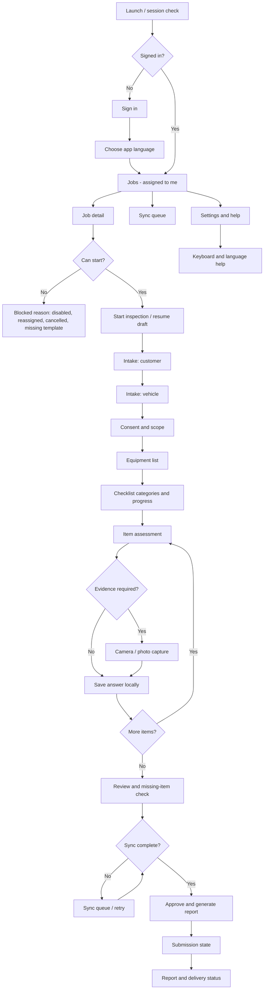
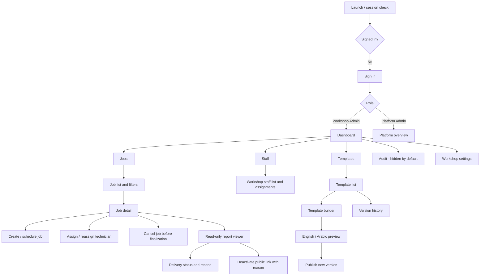
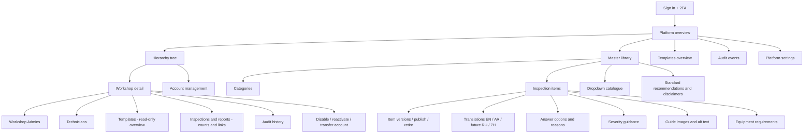
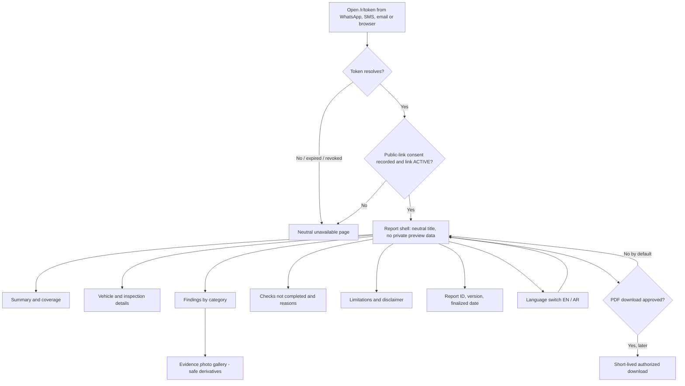
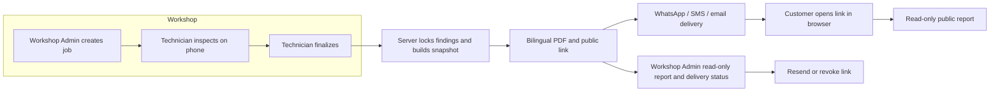

# Navigation Maps

**Project:** TrueReport  
**Document:** 01-navigation-maps.md  
**Status:** Phase 1 proposal. Routes are implementation targets, not production code.

---

## 1. Navigation principles

1. **Role is resolved by the server.** A route guard is a convenience; the Java API enforces every permission and workshop boundary.
2. **Technician app is one-handed and offline-first.** Primary actions sit in the bottom third of the screen. Destructive/final actions require an explicit confirmation.
3. **Admin web is desktop-first; admin mobile is a reduced version of the same role.** Both use the same feature folders and API.
4. **Platform Admin is web-first.** The hierarchy tree and content editors are designed for keyboard and large screens; the app shows only the screens that make sense on a phone.
5. **Public report has no app shell.** It is a read-only server-rendered document at `/r/{token}` with no login, navigation to other reports, admin code or customer portal.
6. **No screen offers a correction, review, approval or resubmission action.** There is no manager role.
7. **Every screen has loading, empty, error, success and offline states.** Offline is explicit, never a silent failure.

---

## 2. Technician mobile app

### 2.1 Map

### 2.2 Bottom navigation (mobile)

| Tab | Purpose | Hidden when |
|---|---|---|
| **Jobs** | Assigned jobs and drafts | Never |
| **Sync** | Local-only, queued, uploading, failed and conflict items | Never; badge shows pending count |
| **Settings** | App language, entry-direction default, keyboard help, sign out, device diagnostics | Never |

The job detail, intake, checklist and review screens are pushed routes without bottom navigation, so the technician focuses on one job. A persistent top bar shows the job reference, vehicle summary and a **Saved on this phone / Received by server** indicator.

### 2.3 Route table

| Route | Screen | Access | Guard / note |
|---|---|---|---|
| `/sign-in` | Sign in | Unauthenticated | Rate-limited; generic error; no account enumeration. |
| `/language` | Launch language choice | Unauthenticated | Stores app language only; does not change report language. |
| `/jobs` | Assigned jobs | Technician | Server returns only jobs assigned to this technician and workshop. |
| `/jobs/:jobId` | Job detail | Technician (assigned) | 404 for another workshop; 409/403 if reassigned. |
| `/jobs/:jobId/intake/customer` | Customer intake | Technician (current assignee) | Before finalization only. |
| `/jobs/:jobId/intake/vehicle` | Vehicle intake | Technician (current assignee) | VIN/plate LTR; no public exposure. |
| `/jobs/:jobId/consent` | Consent and scope | Technician (current assignee) | Records separate consent types and wording version. |
| `/jobs/:jobId/equipment` | Equipment list | Technician (current assignee) | Read-only from pinned template version. |
| `/jobs/:jobId/checklist` | Categories and progress | Technician (current assignee) | Pinned template version; offline capable. |
| `/jobs/:jobId/checklist/:itemId` | Item assessment | Technician (current assignee) | Local save on every change. |
| `/jobs/:jobId/checklist/:itemId/photo` | Capture / attach evidence | Technician (current assignee) | Camera permission, storage and compression states. |
| `/jobs/:jobId/review` | Review and blocking items | Technician (current assignee) | Shows missing answers, reasons and evidence. |
| `/jobs/:jobId/finalize` | Final confirmation | Technician (current assignee) | Requires server receipt and idempotency key. |
| `/jobs/:jobId/status` | Report and delivery status | Technician (assigned) | Read-only; resend/revoke not available to Technician. |
| `/sync` | Sync queue | Technician | Per-item states and conflicts. |
| `/settings` | Settings | Technician | Language, direction default, help, sign out. |
| `/help/keyboard` | Keyboard help | Any signed-in user | Explains OS keyboard limitations; no custom keyboard. |
| `/offline` | Offline fallback | Any | Explains what still works and what is queued. |

### 2.4 Deep links

- The technician app does **not** accept public report tokens as app deep links. A report link opens the browser.
- Notification deep links open `/jobs/:jobId` only after the server confirms the signed-in technician is the current assignee.
- If the app is opened from a stale notification, show a neutral “job unavailable or reassigned” state; do not reveal vehicle/customer data.

---

## 3. Admin app and admin website

The same Flutter codebase serves Workshop Admin and Platform Admin. The active role and permitted feature folders are resolved from the server.

### 3.1 Map — Workshop Admin

**Default restrictions:** Workshop Admin can assign work and manage intake before finalization, but cannot edit checklist findings, cannot create master content, cannot see another workshop and cannot change the Platform Admin library. Staff account creation defaults to Platform Admin (RQ3 pending). Audit visibility defaults off (RQ4 pending).

### 3.2 Map — Platform Admin

Platform Admin sees the tree and operational metadata. Customer PII defaults to hidden (RQ8 pending). Platform Admin cannot edit finalized findings, cannot create a correction, and cannot silently change a workshop’s published template.

### 3.3 Route table

| Route | Screen | Workshop Admin | Platform Admin |
|---|---|---|---|
| `/sign-in` | Sign in | Yes | Yes; 2FA challenge |
| `/dashboard` | Role-aware dashboard | Own workshop | Platform-wide |
| `/jobs` | Job list | Own workshop | All workshops (oversight, read-only by default) |
| `/jobs/new` | Create / schedule job | Yes | No by default |
| `/jobs/:jobId` | Job detail | Own workshop | Read-only oversight |
| `/jobs/:jobId/assign` | Assign / reassign | Yes, before finalization | No by default |
| `/jobs/:jobId/report` | Completed report viewer | Own workshop, read-only | Read-only |
| `/jobs/:jobId/delivery` | Delivery status / resend | Own workshop | No by default |
| `/jobs/:jobId/link` | Link state / revoke | Own workshop, with reason | No by default |
| `/staff` | Workshop staff list | Own workshop | Via hierarchy |
| `/templates` | Template list | Own workshop | All, read-only overview |
| `/templates/new` | Template builder | Own workshop | No |
| `/templates/:id/versions` | Version history | Own workshop | Read-only |
| `/hierarchy` | Workshop/staff tree | No | Yes |
| `/hierarchy/workshops/:id` | Workshop detail | No | Yes |
| `/hierarchy/accounts/:id` | Account detail | No | Yes |
| `/master/categories` | Master categories | No | Yes |
| `/master/items` | Master items | No | Yes |
| `/master/items/:id/versions` | Item version history | No | Yes |
| `/master/dropdowns` | Dropdown catalogue | No | Yes |
| `/master/equipment` | Equipment catalogue | No | Yes |
| `/master/media` | Guide images | No | Yes |
| `/audit` | Audit events | Hidden by default | Yes |
| `/settings/workshop` | Workshop settings | Own workshop | Yes |
| `/settings/platform` | Platform settings | No | Yes |

### 3.4 Responsive behaviour

- **Web ≥ 1200 px:** side navigation, two-column detail, data table with filters, persistent context header.
- **Web 768–1199 px:** collapsible side navigation; tables become card lists below 900 px.
- **Admin mobile < 768 px:** bottom navigation for Dashboard, Jobs, Templates, More; hierarchy tree is read-only summary with drill-down, not a full drag/drop editor.
- **RTL:** navigation, breadcrumbs, table columns and icon direction mirror with `Directionality`; backend field values (VIN, phone, IDs) stay LTR.

---

## 4. Public report

### 4.1 Map

### 4.2 Route table

| Route | Purpose | Access | Notes |
|---|---|---|---|
| `/r/{token}` | Public report | Anyone with active token | Token is 256-bit random; lookup by hash; `noindex`; neutral metadata. |
| `/r/{token}?lang=ar` | Arabic report view | Same | Locale switch only; does not leak extra data. |
| `/r/{token}?lang=en` | English report view | Same | Default from `Accept-Language` if supported. |
| `/r/{token}/pdf` | PDF download | **Disabled by default** | Only if PDF1/RQ7 is approved; signed, short-lived, rate-limited, audited. |
| `/r/unavailable` | Neutral unavailable | Public | Used for invalid, revoked, rate-limited or consent-missing links. No report data. |
| `/r/{token}/photo/{derivativeId}` | Public photo derivative | Anyone with active token | Safe resized/re-encoded derivative; no original high-resolution file; no EXIF. |

### 4.3 Public navigation rules

- There is no search, directory, “other reports”, account menu, booking, payment or contact form.
- The only interactive controls are **language switch**, optional **photo zoom**, **print** (browser) and, only if approved later, **PDF download**.
- The page must render its core content without JavaScript. If JavaScript is unavailable, all text, tables and photos remain readable.
- A revoked/invalid token shows a neutral message that does not confirm whether a report exists.
- The page must not set a referrer that exposes the token to third parties; use `Referrer-Policy: no-referrer` (or strict-origin) and avoid external embeds.
- No analytics that sends the token or report contents to a third party.

---

## 5. Cross-surface journey

The customer never enters an app or portal. The workshop owns the customer relationship and payment. The platform owns the report record and delivery.

---

## 6. Navigation states that must be designed once and reused

| State | Behaviour |
|---|---|
| **Session expired** | Return to sign-in with a neutral message; preserve unsent local inspection data; never silently sign out and discard it. |
| **Role changed / account disabled** | Block access, revoke tokens, wipe local PII on next successful sign-in; show a neutral account-unavailable message. |
| **Workshop disabled** | Block new jobs and finalization; allow read-only access only if policy permits; do not expose another workshop. |
| **Offline** | Show offline banner; allow local work on downloaded jobs; disable actions that need the server; queue safely. |
| **Conflict** | Show the conflicting record/version; never overwrite silently; provide “reload server version” and “keep my local copy for support” paths. |
| **Not found / no permission** | Prefer 404-like neutral UI for cross-workshop access to avoid existence leaks. |
| **Rate limited** | Neutral retry message with backoff; no data leakage. |
| **Server error** | Retry with request ID; preserve local work. |
| **Reduced motion** | Respect system setting; no decorative animation on checklist screens. |

---

## 7. Items intentionally absent from navigation

- Customer login, customer profile, booking, payment, invoices, repair orders.
- Manager/reviewer/approval queue/resubmission.
- Report editing or “fix findings”.
- Correction request/creation.
- Public report directory, search, comments, reactions or contact forms.
- Multi-workshop switcher for technicians.
- Custom keyboard.
- VIN OCR/scanning (deferred).
- Video evidence (deferred).
