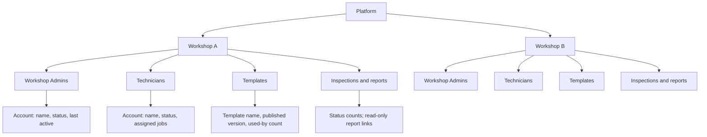
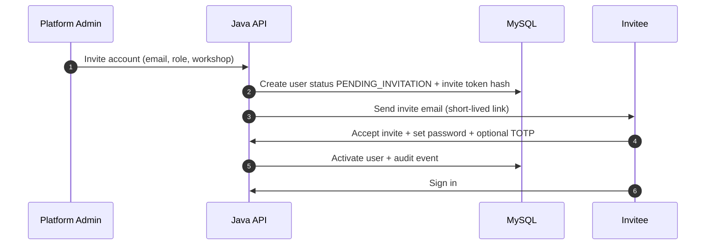

# Platform Admin Hierarchy Design

**Project:** TrueReport  
**Document:** 04-platform-admin-hierarchy.md  
**Status:** Phase 1 proposal. Permissions marked Pending follow `00-decisions.md`.

---

## 1. Purpose

Platform Admin needs one reliable place to see and manage the platform’s tenancy structure without gaining the power to alter finalized inspection findings.

The hierarchy must answer four questions quickly:

1. Which workshops exist, and are they active?
2. Who are the Workshop Admins and Technicians, and which workshop do they belong to?
3. What templates, inspections and reports belong to each workshop?
4. What sensitive account/content changes happened, by whom and when?

---

## 2. Tree model



### 2.1 Node types

| Node | Shows | Does not show |
|---|---|---|
| Platform | Workshop count, active/disabled, pending invitations, platform alerts | Customer data |
| Workshop | Name, branch, status, plan placeholder, created date, counts | Customer contact details |
| Workshop Admins | Display name, email (masked until opened), status, last active, 2FA state | Password, tokens |
| Technicians | Display name, email (masked), status, primary workshop, active job count | Customer PII |
| Templates | Name, status, current published version, item count, used-by inspections | Full item wording in the tree |
| Inspections and reports | Counts by status, recent finalizations, failed report generation | Customer name, phone, full VIN |
| Account detail | Identity, role, membership, sessions, audit | Finalized findings editing |

### 2.2 Tree behaviour

- **Expand/collapse** each node; remember expansion state per user.
- **Search** across workshop name, branch, account display name and email; search is server-side and tenant-safe.
- **Filters:** active, disabled, pending invitation; role; workshop; has failed delivery; report generation failed.
- **Lazy load** children; a workshop with thousands of inspections does not load all rows.
- **Keyboard:** arrow keys move, Enter opens, Space expands, `/` focuses search, Escape closes.
- **RTL:** tree indentation and expand chevrons mirror; text aligns to the right.
- **Counts** are badges, not content; opening a count goes to a filtered list, not directly to a report.
- **No drag-and-drop** for moving accounts between workshops; transfers use an explicit audited action because they affect access and history.
- **Virtualized** rendering for large trees; do not render every account at once.

---

## 3. Screen structure

### 3.1 Desktop web

```
┌──────────────────────────────────────────────────────────────────────┐
│ Top bar: search · filters · create workshop · account menu · audit  │
├───────────────────┬──────────────────────────────────────────────────┤
│ Tree (320–380 px) │ Detail panel                                     │
│                   │                                                  │
│ Platform          │ Workshop detail                                  │
│  ▾ Workshop A     │  Header: name, status, branch, actions            │
│    Admins (2)     │  Tabs: Overview · Staff · Templates · Inspections │
│    Technicians(8) │        · Audit                                   │
│    Templates (4)  │  Content: table/cards with pagination             │
│    Inspections    │                                                  │
│  ▸ Workshop B     │                                                  │
└───────────────────┴──────────────────────────────────────────────────┘
```

- The tree and detail panel are independently scrollable.
- Selected node is visually clear and announced to screen readers.
- The detail panel width adapts; below 1200 px the tree collapses into a drawer.
- The top bar never shows customer PII.

### 3.2 Mobile app

- A drill-down list: Platform → workshops → workshop detail → staff/templates.
- No full tree editor on a phone.
- Account actions remain available but require confirmation and re-authentication for high-risk actions.
- Search and filters remain available.

---

## 4. Account lifecycle

### 4.1 Proposed authority split (Pending)

| Action | Platform Admin | Workshop Admin | Default status |
|---|---|---|---|
| Create workshop | Yes | No | Proposed |
| Disable/reactivate workshop | Yes | No | Proposed |
| Create/invite Workshop Admin | Yes | No | Proposed |
| Create/invite Technician | Yes | **No by default** (RQ3 pending) | Pending |
| Disable Technician | Yes | No by default | Pending |
| Disable Workshop Admin | Yes | No | Proposed |
| Transfer user to another workshop | Yes | No | Proposed |
| Change role | Yes | No | Proposed |
| Reset password | Yes, audited | No by default | Pending |
| View own workshop staff | Yes | Yes | Proposed |
| Delete user permanently | No — soft-disable | No | Proposed |
| Delete workshop permanently | No — soft-disable | No | Proposed |

**Rule:** soft-disable, never hard-delete records that reports depend on. A disabled user cannot sign in or refresh a token. A transferred user’s historical reports keep the original workshop and technician identity.

### 4.2 Invitation flow



- Invitations expire (default 72 hours; confirm policy).
- The invite token is stored hashed and is single-use.
- Resending an invite invalidates the previous token.
- A pending invitation appears in the tree filter.
- An invited account has no access until accepted.

### 4.3 Disable / reactivate / transfer

- **Disable:** revoke sessions and refresh tokens immediately; block sign-in; keep historical records; reassign in-flight jobs before disabling where possible.
- **Reactivate:** restore sign-in; do not restore old sessions; require a fresh sign-in.
- **Transfer:** require confirmation; record old and new workshop; revoke sessions; the user gets access only to the new workshop on next sign-in. In-flight jobs in the old workshop must be reassigned first.
- **Last-admin protection:** cannot disable the last active Workshop Admin of an active workshop without assigning a replacement.
- **Self-protection:** a Platform Admin cannot disable their own last privileged account through the UI; require another Platform Admin or a documented break-glass process.

---

## 5. Data visibility and privacy

### 5.1 What the tree may show

- Workshop name and branch.
- Account display name and masked email (`a•••@example.com`).
- Role, status, last active date, 2FA enabled yes/no.
- Counts of templates, inspections and reports.
- Operational alerts (failed delivery, report generation failure).

### 5.2 What the tree must not show

- Customer name, phone, email or address.
- Full VIN, plate, registration or engine number.
- Report findings.
- Tokens, password hashes, session identifiers, provider credentials.
- Delivery message bodies.

### 5.3 Opening a report

Platform Admin may open a **read-only** report view for oversight. The view uses the same immutable snapshot renderer. It does not expose customer PII by default (RQ8 pending). Opening a report is audited. There is no edit, correction, hide or delete control.

### 5.4 Search privacy

- Search by customer PII is not available in the hierarchy.
- Search results are scoped to the Platform Admin’s permitted data.
- Search queries and results are not logged with PII; log only the query type and result count.

---

## 6. Sensitive actions and audit

### 6.1 Audited actions

- Workshop created, disabled, reactivated, renamed, branch changed.
- Account invited, accepted, disabled, reactivated, transferred, role changed.
- Password reset requested/completed.
- 2FA enabled/disabled/reset.
- Platform Admin viewed a report (optional but recommended).
- Master content created, published, retired, translated.
- Template published/retired (by Workshop Admin; visible to Platform Admin).
- Report link revoked/resend (by Workshop Admin; visible to Platform Admin).
- Export of audit data.
- Settings/provider changes.

### 6.2 Audit event shape

| Field | Rule |
|---|---|
| Event ID | UUIDv7 |
| Occurred at | UTC |
| Actor | User ID + role; service identity for workers |
| Workshop | Owning workshop, if any |
| Action | Stable code, e.g. `ACCOUNT_DISABLED` |
| Entity | Type + ID |
| Before/after | Only non-secret, non-PII fields; redact tokens/passwords |
| Reason | Required for disable, transfer, revoke, correction (if ever approved) |
| Request ID | Correlates with logs |
| IP / user agent | Stored if policy allows; redacted/masked where required |

### 6.3 Audit rules

- Append-only. No update/delete API.
- The application user has no `UPDATE`/`DELETE` on the audit table.
- Audit must not contain secrets or full PII. Use IDs and redacted values.
- Platform Admin can filter and export; export is itself audited.
- Workshop Admin audit visibility is hidden by default (RQ4).

---

## 7. Permissions (authoritative matrix lives in the API document)

The hierarchy design assumes:

- Platform Admin: full hierarchy read; create/disable/reactivate/transfer accounts; manage master content.
- Workshop Admin: own workshop staff read (and limited management only if approved); no other workshop.
- Technician: no hierarchy access.
- Public viewer: none.

The Java API resolves the caller’s membership from the token and database. A client-supplied `workshopId` is never trusted for authorization. Cross-workshop access returns a neutral 404/403.

---

## 8. API surface for the hierarchy

| Method | Endpoint | Purpose |
|---|---|---|
| GET | `/api/v1/platform/workshops` | List/search workshops (cursor) |
| POST | `/api/v1/platform/workshops` | Create workshop |
| GET | `/api/v1/platform/workshops/{id}` | Workshop detail |
| PATCH | `/api/v1/platform/workshops/{id}` | Update profile/status |
| GET | `/api/v1/platform/workshops/{id}/members` | Staff list |
| POST | `/api/v1/platform/invitations` | Invite account |
| POST | `/api/v1/platform/invitations/{id}/resend` | Resend invite |
| GET | `/api/v1/platform/users/{id}` | Account detail |
| POST | `/api/v1/platform/users/{id}/disable` | Disable |
| POST | `/api/v1/platform/users/{id}/reactivate` | Reactivate |
| POST | `/api/v1/platform/users/{id}/transfer` | Transfer workshop |
| POST | `/api/v1/platform/users/{id}/reset-password` | Audited reset |
| GET | `/api/v1/platform/audit-events` | Audit search |

All mutations require `Idempotency-Key` where retry could duplicate an effect. High-risk actions require a reason and re-authentication.

---

## 9. Edge cases

| Case | Behaviour |
|---|---|
| Workshop has no admin | Show warning; block disabling the last admin; offer invite. |
| Admin disabled while technicians are active | Allow operations to continue; warn that account recovery is unavailable. |
| User transferred while offline | Old device cannot sync; server rejects with conflict; local data wiped on next sign-in. |
| Duplicate email | Reject with a neutral message; do not reveal another workshop’s account. |
| Workshop disabled with active public links | Links continue or are revoked according to policy; decide before launch. Default: revoke on disable? **Pending.** |
| Deleted/retired master item used by old templates | Old versions remain readable; new templates cannot use the retired version. |
| Large workshop (10k+ inspections) | Paginate counts and lists; do not load all reports. |
| Platform Admin opens a finalized report | Read-only; audit event; no edit controls. |
| Platform Admin account compromised | Revoke sessions, rotate secrets, audit review, incident process. |
| RTL | Tree chevrons and indentation mirror; names may be Arabic; emails/IDs LTR. |

---

## 10. Acceptance criteria for Phase 3

1. Platform Admin can expand/collapse, search and filter the tree.
2. Platform Admin can create a workshop, invite a Workshop Admin and a Technician, and see them in the tree.
3. A Workshop Admin sees only their own workshop.
4. Disabling an account revokes access immediately.
5. Transferring an account preserves historical ownership and blocks old-workshop access.
6. Every sensitive action writes an audit event with actor, workshop, reason and timestamp.
7. The tree never shows customer contact details, full VIN or findings.
8. The tree is keyboard accessible and renders correctly in English and Arabic.
9. No control in the hierarchy can edit finalized findings.
10. Cross-workshop access tests fail closed.
