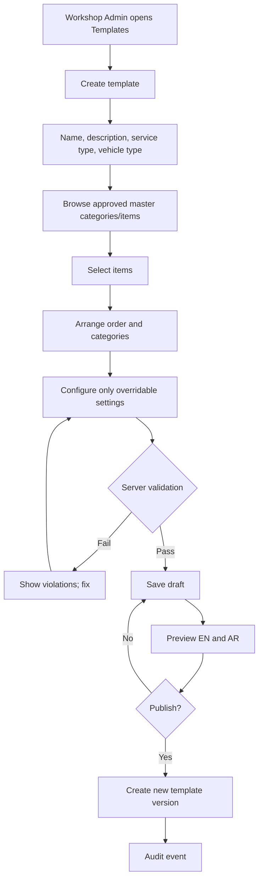

# Master Library and Workshop Templates

**Project:** TrueReport  
**Document:** 05-master-library-and-templates.md  
**Status:** Phase 1 design. The actual 100+ inspection items are Phase 3 content work and require an automotive specialist.

---

## 1. Two different things

| | Master library | Workshop template |
|---|---|---|
| Owner | Platform Admin | Workshop Admin |
| Contains | Categories, items, instructions, translations, guide images, answer/severity rules, reasons, equipment, dropdowns, standard text | A selected, ordered subset of approved master item **versions**, plus permitted settings |
| Can change wording? | Yes, by publishing a new master version | **No** |
| Can change safety rules? | Yes, by publishing a new master version | **Only where the master explicitly marks a setting overridable, and never in a weakening direction** |
| Used by | Templates and the catalogue | Inspections |
| Versioned? | Yes, append-only versions | Yes, append-only versions |

**The master library is not hardcoded in Flutter.** The app downloads published content from the server and stores the exact template version for offline use.

---

## 2. Content model

### 2.1 Master categories

- Stable ID, slug, EN/AR name, order, status.
- One category per item for V1 (no multi-category item without a decision).
- Categories can be retired but not hard-deleted if referenced.

### 2.2 Master inspection items

Each item has a stable ID and an append-only version. The editable draft is separate from the published version.

| Field | Rule |
|---|---|
| Stable item ID | UUIDv7, never reused |
| Category | Required |
| EN label / AR label | Required to publish |
| Instruction EN/AR | Required; supports rich text limited to safe formatting |
| Future RU/ZH translations | Optional until those interfaces launch |
| Result options | Subset of the platform result set; master controls which are allowed |
| Severity guidance | Required when a defect result is allowed |
| Note requirement | Never / optional / required |
| Evidence requirement | Not required / optional / required / required with minimum count |
| Evidence lock | `LOCKED` means a workshop cannot make it optional |
| Reason requirement | Which results require a reason |
| Guidance image | Guide image ID, not evidence |
| Accessibility description | Required for every guide image |
| Required equipment | Equipment IDs |
| Applicability | Conditions (vehicle type, fuel, service scope, etc.) |
| Overridable fields | Explicit list; default **none** |
| Version / status | Draft, published, retired |
| Audit | Created by, published by, retired by, timestamps |

### 2.3 Result options

The platform-level result set is fixed; a master item selects the allowed subset:

- `NO_ISSUE_OBSERVED`
- `ATTENTION_RECOMMENDED`
- `DEFECT_FOUND`
- `NOT_CHECKED`
- `NOT_APPLICABLE`
- `COULD_NOT_VERIFY`

Rules:

- `NOT_CHECKED` and `COULD_NOT_VERIFY` require a reason.
- `NOT_APPLICABLE` requires a reason only if the master item says so.
- `DEFECT_FOUND` and `ATTENTION_RECOMMENDED` require severity; `DEFECT_FOUND` may require a recommendation.
- A finding is created only for results that record a defect/attention condition. `NO_ISSUE_OBSERVED` is an assessment, not a defect.
- Do not describe `NO_ISSUE_OBSERVED` as “pass” or “vehicle is perfect”.

### 2.4 Severity

| Code | Display | Guidance |
|---|---|---|
| `MINOR` | Minor | Cosmetic or slight wear; monitor; does not currently affect safe operation. |
| `MODERATE` | Moderate | Clear defect; repair/monitor; may worsen. |
| `MAJOR` | Major | Significant defect; prompt repair; may affect usability or safety. |
| `SAFETY_CRITICAL` | Safety-critical | Do not drive / immediate attention; explicit warning. |

Final wording and examples require an automotive specialist and Arabic reviewer. Severity is not a condition score.

### 2.5 Reasons

Reasons are master values with EN/AR labels, e.g.:

- Not accessible / covered
- Equipment unavailable
- Unsafe to inspect
- Vehicle system not present
- Customer declined
- Other (free text, capped length)

A free-text note is always allowed; the reason code is for reporting and consistency.

### 2.6 Guide images vs evidence images

- **Guide image:** owned/licensed instructional image; teaches where/how to inspect. Private catalogue asset; not evidence.
- **Evidence image:** photo of this vehicle at this inspection. Private original; public derivative only.
- The UI must label them differently and never display a guide image in the evidence gallery.
- Guide images need alt text and a licence note.

### 2.7 Standard content

- Recommendations library (EN/AR) with approved wording.
- Disclaimers and limitations, versioned.
- Equipment catalogue.
- Dropdown values (vehicle makes/models, colours, fuel types, etc.).
- All are versioned or audited; old reports keep the snapshot.

---

## 3. Versioning

### 3.1 Master item versions

```
DRAFT ──publish──> PUBLISHED ──retire──> RETIRED
  │                    │
  └─ edit creates      └─ never edited in place
     a new draft
```

- Editing a published item creates a **new draft version**. The published version remains immutable.
- Publishing a draft creates a new published version with a monotonically increasing version number.
- Retiring prevents new templates from using it; it does not delete it or change existing templates/reports.
- Old versions remain readable for audit.
- A template references a **master_item_version_id**, never “the latest item”.

### 3.2 Template versions

- A template has a name, description, service type and versions.
- A draft version can be edited.
- Publishing creates an immutable template version containing:
  - ordered `template_items`,
  - each item’s `master_item_version_id`,
  - permitted settings chosen by the Workshop Admin,
  - EN/AR preview snapshot metadata.
- Existing inspections keep the template version they started with.
- Publishing a new template version does not migrate in-progress inspections.
- A template can be retired; old versions remain readable.

### 3.3 What an inspection pins

When a technician starts an inspection, the server pins:

- `template_version_id`,
- each `master_item_version_id`,
- the exact EN/AR item labels/instructions,
- the allowed results and severity rules,
- the reason requirements,
- the evidence requirements,
- the equipment list,
- the guide image references.

At finalization, the exact wording and answers are copied into `inspection_item_snapshots` and the report snapshot. The report never joins live catalogue tables.

---

## 4. The “cannot weaken safety” rule

### 4.1 Principle

A Workshop Admin may **select and arrange** approved items. A Workshop Admin may **not** change what an item means or reduce a platform safety requirement.

### 4.2 Enforceable rule model

Each master item version declares:

| Setting | Values | Workshop override |
|---|---|---|
| `evidence_requirement` | `NONE`, `OPTIONAL`, `REQUIRED`, `REQUIRED_MIN_N` | Only if `overridable.evidence = true`; can only increase, never decrease below master |
| `min_photos` | integer | Can increase, never decrease |
| `note_requirement` | `NONE`, `OPTIONAL`, `REQUIRED` | Can increase, never decrease |
| `allowed_results` | subset | Cannot add a result the master forbids |
| `severity_required_for` | subset | Cannot remove |
| `reason_required_for` | subset | Cannot remove |
| `applicability` | rule set | Cannot broaden in a way that skips a required check |
| `order` | integer | Yes |
| `included` | boolean | Yes, unless the master marks the item as mandatory for the service |

### 4.3 Server validation

On template save and publish, the server compares each item’s chosen settings with the pinned master version:

```
effective_min_photos = max(master.min_photos, template.min_photos)
effective_note_required = master.note_requirement OR template.note_requirement
effective_reason_required = master.reason_required OR template.reason_required
allowed_results = intersection(master.allowed_results, template.allowed_results)
```

If the template would weaken a locked requirement, the request fails with `422 TEMPLATE_WEAKENS_SAFETY_RULE`.

### 4.4 UI

- Locked fields are disabled and labelled “Locked by platform”.
- Overridable fields show the master value and the allowed range.
- The builder shows a validation panel: “3 items have a weaker evidence setting than the platform requires.”
- The publish button is disabled until the template passes validation.
- No “advanced” or “override all” switch.

### 4.5 Tests (Phase 4)

- Workshop Admin cannot make required evidence optional when the master locks it.
- Workshop Admin cannot remove `NOT_CHECKED` reason requirement.
- Workshop Admin cannot add a result the master does not allow.
- Workshop Admin cannot lower `min_photos`.
- A crafted API request that bypasses the UI still fails.
- Publishing a template does not change any existing inspection.

---

## 5. Template builder flow



### 5.1 Search and selection

- Search by EN/AR label, item ID and category.
- Filter by category, evidence requirement, equipment, status.
- Show only **published** master versions; retired versions are visible for history but cannot be added to a new template.
- Selected items are grouped by category; order can be changed.
- A missing item can be requested from Platform Admin; the Workshop Admin cannot create a master item.

### 5.2 Preview

- EN and AR tabs.
- Shows item labels, instructions, allowed results, severity, reason/evidence rules, guide image placeholder.
- Shows the exact version numbers.
- Shows a warning if Arabic is missing.
- Does not allow editing master wording.

### 5.3 Publish

- Requires a valid draft, at least one item, and all required translations.
- Creates a new immutable version.
- Audit records the actor, workshop, version, item count and timestamp.
- The template becomes selectable for new jobs; existing jobs are unaffected.

### 5.4 Retire

- A retired template/version cannot be selected for new jobs.
- In-progress inspections using it continue with the pinned version.
- Finalized reports are unaffected.

---

## 6. Content lifecycle and audit

| Action | Who | Audit |
|---|---|---|
| Create category/item draft | Platform Admin | Yes |
| Translate | Platform Admin | Yes |
| Publish item version | Platform Admin | Yes |
| Retire item | Platform Admin | Yes |
| Upload/replace guide image | Platform Admin | Yes |
| Create/edit template draft | Workshop Admin | Yes |
| Publish template version | Workshop Admin | Yes |
| Retire template | Workshop Admin | Yes |
| Select template for a job | Workshop Admin/Technician | Yes (job event) |
| Start inspection with version | Technician | Yes |

No hard delete of content referenced by a template, inspection or report.

---

## 7. Fallbacks and missing content

- If a make/model is missing: “Other” with free text; server stores as entered; do not invent a catalogue match.
- If an item is missing: Platform Admin adds it; the technician can record a general note/limitation, but cannot invent a master item.
- If equipment is unavailable: record the limitation; do not force unsafe work.
- If a translation is missing at runtime: fall back to EN and mark the missing translation in internal/admin views. Required AR/EN missing blocks publish.
- If an image is missing: show a neutral placeholder; never show a guide image as evidence.

---

## 8. Initial library scope

Phase 1 defines the structure, not the 100+ final items. Phase 3 must deliver and validate:

- At least 100 inspection points.
- Categories covering identity/intake, exterior, glass/lights/wipers, tyres/wheels/brakes, interior/safety, engine/mechanical, transmission/drivetrain, steering/suspension, electrical/AC, underbody/exhaust/road test, and conditional EV/hybrid checks.
- EN/AR wording reviewed by a native Arabic reviewer and an automotive specialist.
- Guide images with licences and alt text.
- Evidence requirements that are realistic for inspection time (D11).
- Reasons and severity guidance that a technician can apply consistently.

**No item is represented as an official RTA/Tasjeel check unless the workshop is authorised and the claim is legally supportable.**

---

## 9. API surface (summary)

| Method | Endpoint | Purpose |
|---|---|---|
| GET | `/api/v1/master/categories` | List categories |
| POST | `/api/v1/master/categories` | Create draft |
| GET | `/api/v1/master/items` | Search items |
| POST | `/api/v1/master/items` | Create item |
| POST | `/api/v1/master/items/{id}/versions` | Create draft version |
| POST | `/api/v1/master/items/{id}/versions/{v}/publish` | Publish |
| POST | `/api/v1/master/items/{id}/versions/{v}/retire` | Retire |
| GET | `/api/v1/master/items/{id}/versions` | History |
| PUT | `/api/v1/master/items/{id}/translations` | Add/update translations |
| GET | `/api/v1/master/dropdowns` | Dropdown values |
| POST | `/api/v1/master/guide-images` | Upload guide image |
| GET | `/api/v1/workshop/templates` | Workshop template list |
| POST | `/api/v1/workshop/templates` | Create draft |
| PUT | `/api/v1/workshop/templates/{id}/draft` | Update draft |
| POST | `/api/v1/workshop/templates/{id}/publish` | Publish new version |
| GET | `/api/v1/workshop/templates/{id}/versions` | Version history |

The API enforces the safety-rule validation server-side. The UI is not a control.

---

## 10. Acceptance criteria for Phase 4

1. Workshop Admin can create a template from approved items and publish version 1.
2. Publishing a change creates version 2; existing inspections keep version 1.
3. Workshop Admin cannot change master wording, answers, severity definitions or safety rules.
4. Workshop Admin cannot weaken a locked evidence obligation.
5. A crafted API request cannot bypass the rule.
6. Preview shows EN and AR without overflow.
7. A retired item cannot be added to a new template but remains readable in old versions.
8. No master content is hardcoded in Flutter.
9. Old reports keep their exact wording and rules after a master update.
10. All content actions are audited.
