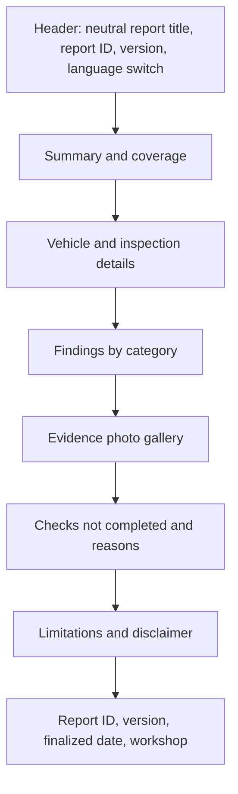
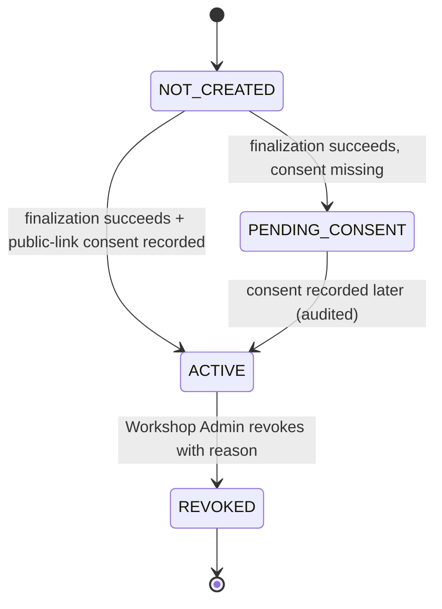

# Public Report Design

**Project:** TrueReport  
**Document:** 06-public-report-design.md  
**Status:** Phase 1 design. D4 is pending product-owner approval; the measured recommendation is server-rendered HTML. PDF download is disabled by default.

---

## 1. What the public report is

A read-only, unauthenticated web page at `/r/{token}` that renders an immutable report snapshot. It is:

- the customer-facing record of one inspection,
- available in English and Arabic,
- designed to open from WhatsApp, SMS or email on a poor connection,
- not a customer portal, booking page, payment page or marketplace,
- not an official RTA/Tasjeel certificate, warranty or condition guarantee.

**Hard rules**

1. The page renders only from the frozen report snapshot; it never joins live catalogue or customer tables.
2. It uses an explicit public-field allowlist, never a direct entity serializer.
3. No active link without recorded public-link consent.
4. No customer name, phone, email, precise location, full VIN, plate, registration or engine number by default.
5. No original high-resolution evidence file is public.
6. Invalid and revoked tokens produce a neutral page that does not confirm whether a report exists.
7. No search indexing. No private data in link previews, logs or referrers.
8. No admin code, no customer login, no other-report browsing.

---

## 2. Page structure



### 2.1 Wireframe (mobile-first)

```
┌──────────────────────────────────────┐
│ Vehicle inspection report            │
│ تقرير فحص مركبة                       │
│ TR-2026-0001 · v1      [EN | AR]     │
├──────────────────────────────────────┤
│ Inspection summary / ملخص الفحص       │
│ Coverage: 113 of 120 applicable      │
│ checks completed.                    │
│ (This is coverage, not a score.)      │
├──────────────────────────────────────┤
│ Vehicle / المركبة                     │
│ Toyota Land Cruiser 2022              │
│ Odometer 82,902 km                   │
│ Inspection date 2026-11-03 14:30 GST │
│ Workshop: Dubai Technical Inspection │
├──────────────────────────────────────┤
│ Findings by category                 │
│ ▸ Tyres, wheels and brakes (12)      │
│    • Item label                      │
│      Result · Severity               │
│      Note / recommendation            │
│      [photo] [photo]                 │
│ ▸ Interior and occupant safety (15)  │
├──────────────────────────────────────┤
│ Checks not completed                 │
│ 2 not checked · 2 could not verify   │
│ reasons shown                        │
├──────────────────────────────────────┤
│ Limitations and disclaimer           │
├──────────────────────────────────────┤
│ Report ID · version · finalized date │
│ Workshop · “Not an official cert.”   │
└──────────────────────────────────────┘
```

### 2.2 Section rules

| Section | Content | Rules |
|---|---|---|
| Header | Neutral title, report ID, version, language switch | No customer name or vehicle model in the metadata/title. |
| Summary | Coverage counts, key findings count, limitations summary | No single unexplained score. Explain coverage. |
| Vehicle | Make, model, year, variant; odometer if approved; inspection date/time; workshop | No full VIN, plate, registration, engine number. Odometer is Pending (see allowlist). |
| Findings | Category, item, result, severity, note, recommendation, evidence thumbnails | Only snapshot content. No internal notes. |
| Evidence | Safe derivatives with captions and item links | No original files, no EXIF/GPS, no guide images. |
| Not checked | Result, reason, limitation | Reason required for not checked/could not verify. |
| Limitations | Approved disclaimer, scope, road-test/diagnostic limits | Must be visible, not hidden in a modal. |
| Footer | Report ID, version, finalized date, workshop, language | Consistent with PDF. |
| PDF | Download link | **Not rendered by default** (PDF1 pending). |

---

## 3. Explicit public-field allowlist

### 3.1 Allowed by default

| Field | Rule |
|---|---|
| Vehicle make | From the snapshot; localized display name if available. |
| Vehicle model | From the snapshot. |
| Model year | From the snapshot. |
| Variant/trim | Only if approved for publication. |
| Odometer value + unit | **Pending**: include only if the product owner approves; otherwise omit. |
| Inspection date/time | Include time zone (GST/UTC+4). |
| Workshop name | Approved branch/display name. |
| Workshop branch area | City/area only if approved; no precise address by default. |
| Technician display name | **Pending**: a display name or approved identifier; default display name. |
| Inspection scope | Template name/version and service type. |
| Report ID | Stable, non-secret. |
| Report version | `v1`, etc. |
| Finalized date | UTC converted to GST for display. |
| Summary of key findings | Rule-based: all Safety-critical/Major, plus counts of Moderate/Minor. |
| Coverage counts | Applicable, completed, not applicable, not checked, could not verify. |
| Category results | Category name + counts + item rows. |
| Item label/instruction | Exact snapshot wording in selected language. |
| Result | One of the six result codes, localized. |
| Severity | Minor/Moderate/Major/Safety-critical, localized. |
| Note | The technician’s note, as entered; optional translation separate and labelled. |
| Recommendation | From the approved snapshot. |
| Evidence photo derivative | Resized, re-encoded, EXIF-stripped, no original. |
| Photo caption | Item link and safe caption; no customer data. |
| Not-checked reason | Localized reason; free text as entered. |
| Limitations/disclaimer | Approved text, versioned. |
| Report hash/verification detail | Optional; must not enable token guessing or expose private data. |

### 3.2 Never public

- Customer name, email, phone, address, precise location.
- Full VIN, plate, registration, engine number.
- Customer ID, vehicle ID, job ID, internal database IDs.
- Consent records, consent wording, capture channel/actor.
- Customer notes not approved for publication.
- Internal notes, audit events, delivery logs, provider message IDs.
- Original high-resolution evidence; EXIF/GPS; file paths; object keys.
- Public token hash; revocation reason free text (show only “unavailable”).
- Staff personal contact details.
- Payment or billing data (the platform must not hold it).
- Admin comments or manager/reviewer data (no such role exists).

### 3.3 Allowlist implementation

- A dedicated `PublicReportDto` / serializer with explicit fields.
- Unit tests assert the serialized JSON/HTML contains no denied field names or values.
- The renderer receives the DTO, not a JPA entity.
- The snapshot JSON may contain internal fields; the public mapper selects only allowed keys.
- No reflection-based whole-object serialization.
- No “temporarily include” debug fields.

---

## 4. Consent gate and link states

### 4.1 Link state machine



- `NOT_CREATED`: no link.
- `PENDING_CONSENT`: report exists internally; no active URL. A consent capture screen can activate it later, audited.
- `ACTIVE`: link serves the snapshot.
- `REVOKED`: link never serves report content again; neutral page.
- **No reactivation in V1** (RQ13 pending).

### 4.2 Consent rules

- Public-link consent is **separate** from consent to send a message.
- Record consent version, wording hash, timestamp, actor, channel/evidence.
- The link is active only after the specific public-link consent is recorded.
- Finalization may succeed without public-link consent; the link stays inactive.
- Consent withdrawal → revoke link; explain copies cannot be recalled.
- No consent → no token generation? The design may generate a token only at activation, or generate and keep inactive. Prefer **generate at activation** to reduce dormant secrets.

### 4.3 Revocation

- Only an authorised Workshop Admin (own workshop) can revoke in V1.
- Required reason: privacy, security, legal or customer request.
- Revocation is immediate at the origin; cached copies may persist until TTL; use `no-store` for HTML to reduce this.
- Public response is neutral: “This link is unavailable.” No vehicle/customer data.
- Revocation is audited (actor, time, reason code, report ID; not token plaintext).

---

## 5. Invalid, revoked and error states

| State | HTTP | Page | Data |
|---|---|---|---|
| Invalid/unknown token | 404 | Neutral unavailable | None |
| Revoked token | 404 or 410 | Neutral unavailable | None |
| Consent missing | 404 | Neutral unavailable | None |
| Rate limited | 429 | Neutral “try again later” | None |
| Report generation failed | 503 (retry) | Neutral “temporarily unavailable” | None |
| PDF failed | 200 page, no PDF | Report page without download | Report only |
| Link active but report deleted (should not happen) | 404 | Neutral | None |
| Server error | 500 | Neutral with request ID | None |

**No state may reveal whether a token ever existed.** Use the same neutral page and similar timing where practical.

---

## 6. Link preview and search

- `<title>` and description are neutral: “Vehicle inspection report” / “A vehicle inspection report is available at this link.”
- No customer name, vehicle model, VIN, findings or workshop contact in `og:`/`twitter:` metadata.
- `noindex, nofollow`; do not rely on `robots.txt` alone.
- `Referrer-Policy: no-referrer` (or strict-origin) so the token is not sent to third parties.
- No external embeds, fonts, scripts or analytics that receive the token or contents.
- If a preview image is used, it must be a generic brand image, never vehicle evidence.
- Test previews in WhatsApp, iMessage, email clients and Slack/Teams; behavior is controlled by the messaging app and may change.

---

## 7. Caching and performance

- HTML is token-specific: `Cache-Control: no-store` (or a very short private cache) to make revocation effective.
- Public photo derivatives use content-hashed, immutable URLs and may be cached for a longer period; they contain no private metadata.
- No CDN cache key that ignores the token.
- If a CDN is used, configure purge-on-revoke and verify with a test.
- The page must render without JavaScript; photos lazy-load with `loading="lazy"` and width/height to avoid layout shift.
- Target: useful content visible on a throttled 3G connection; no blocking font fetch; no admin JS.
- Images: responsive `srcset`, modern formats where supported, fallback JPEG; derivatives only.

---

## 8. English/Arabic behavior

- `lang` and `dir` on `<html>`; `lang` on mixed-language spans.
- Language switch changes the rendering language from the snapshot; it does not change content or version.
- Default language: `Accept-Language` if supported, otherwise workshop default, otherwise English.
- Arabic layout is RTL; tables, lists and headings flow right-to-left.
- VIN/phone/date/numbers inside Arabic text use LTR isolates (see `03-localization-and-rtl-rules.md`).
- The PDF is bilingual; the public page is one language at a time.
- Russian/Chinese names/notes appear as entered, with an optional translation labelled separately.
- Do not machine-translate a safety finding and present it as confirmed.

---

## 9. Evidence photos

- Public derivatives: resized (target max 1600 px long edge, pending), re-encoded, EXIF/GPS stripped, no original.
- Caption: item label + safe description; no customer name, plate or location.
- Alt text: “Evidence photo for [item]” plus any safe description.
- Guide images are never shown in the evidence gallery.
- Missing derivative: neutral placeholder; do not fall back to the original.
- Photos are grouped by category/item; a lightbox is optional and must be keyboard/ screen-reader accessible.
- Do not publish a photo that clearly contains a plate, VIN plate, customer face or address unless the workshop has a specific approval; default is to crop/blur or omit. This is a product/legal policy to confirm.

---

## 10. PDF download

- **Disabled by default.** The public page has no download button in V1 unless PDF1/RQ7 is approved.
- If enabled later:
  - requires the same active link and consent policy,
  - uses a short-lived signed URL or server-authorized stream,
  - is rate-limited and audited,
  - sends `Content-Disposition: attachment`,
  - does not expose the original evidence files,
  - remains unavailable after revocation.
- The PDF is otherwise delivered to the recorded customer by an approved channel (email/WhatsApp/SMS link), with channel consent.

---

## 11. Accessibility and document behaviour

- Semantic HTML: `header`, `main`, `section`, `h1`–`h3`, `table` with `th`/`scope`, lists, `figure`/`figcaption`.
- Skip link to main content.
- Visible focus; keyboard-operable language switch and photo lightbox.
- Contrast meets WCAG 2.2 AA.
- Text is selectable, copyable and findable; `Ctrl/Cmd+F` works.
- Print stylesheet: legible, no clipped tables, page breaks avoid splitting a row badly.
- Screen reader reading order follows the visual order; language changes are announced.
- Zoom to 200% without horizontal scrolling for text.
- No autoplay media, no flashing, no motion that cannot be reduced.

---

## 12. Content rules

- Coverage, not a single condition score.
- “No issue observed in this check” does not mean the vehicle is perfect.
- The disclaimer states:
  - the inspection is visual and non-invasive,
  - components are not dismantled,
  - hidden/intermittent faults may remain,
  - the report is not a warranty or official certificate,
  - the report reflects the vehicle at a point in time and within a scope.
- Do not use “certified”, “independently reviewed”, “manager approved” or “RTA approved” unless factually and legally true.
- Do not show a headline “8.8/10” or similar score.
- Key findings summary rule (Pending specialist): all Safety-critical and Major, plus counts of Moderate/Minor, with links to category detail.

---

## 13. Acceptance criteria for Phase 6

1. Public page and PDF render from the same immutable snapshot and match.
2. No customer name, phone, email, precise location, full VIN, plate or registration appears.
3. No original high-resolution evidence is public.
4. The link is inactive without recorded public-link consent.
5. Revocation stops future server access and shows a neutral page.
6. Arabic and English render correctly, including mixed text.
7. The page is usable without JavaScript and on a throttled connection.
8. Text is selectable/findable and the page is keyboard/screen-reader usable.
9. Link previews contain no private data.
10. The page is `noindex` and not browsable/searchable.
11. Invalid/revoked tokens do not reveal whether a report exists.
12. No PDF download control exists unless explicitly approved.
