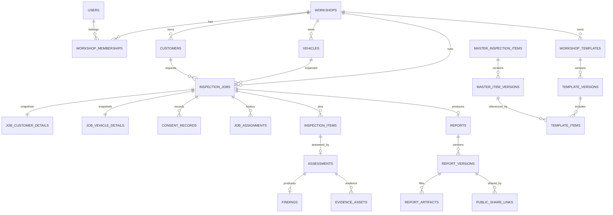

# Database Design (MySQL 8.4 LTS)

**Project:** TrueReport  
**Document:** 07-database-design.md  
**Status:** Phase 1 proposal. D1 (MySQL 8.4 LTS) is Pending; the schema assumes it. No migration has been written.

---

## 1. Design goals

1. **Tenant isolation by construction.** Every workshop-owned table has `workshop_id`; every query is scoped by it; cross-workshop tests are mandatory.
2. **Immutable finalized findings.** Application rules, database triggers, grants and a report hash provide defence in depth.
3. **Exact snapshots.** Reports render from frozen JSON and item snapshots, never live catalogue rows.
4. **Offline-safe IDs.** UUIDv7 generated by the client/server, stored as `BINARY(16)`, so offline records can be created without a central sequence.
5. **Exact Unicode.** `utf8mb4` everywhere; Arabic, Cyrillic and Chinese text stored and returned exactly as entered.
6. **No payment data.** No card columns, no payment tables, no payment endpoints.
7. **No hard delete of report dependencies.** Soft-disable users/workshops/content; retain history.

---

## 2. Conventions

| Topic | Rule |
|---|---|
| Engine | InnoDB |
| Character set | `utf8mb4` |
| Collation | `utf8mb4_0900_ai_ci` for general text; binary columns for hashes/tokens; document any exception |
| Primary keys | `BINARY(16)` UUIDv7, generated in the application (Java/Dart), not by MySQL |
| Tenant key | `workshop_id BINARY(16) NOT NULL` on every workshop-owned table, including child tables |
| Timestamps | `DATETIME(6)` in UTC, set by the application; session `time_zone='+00:00'` |
| Optimistic locking | `version INT NOT NULL DEFAULT 0` on editable rows; `UPDATE ... WHERE version = ?` |
| Soft disable | `status` enum; no hard delete for users, workshops, content or reports |
| JSON | Only for immutable snapshots and flexible settings; searchable fields stay in normal columns |
| Foreign keys | `RESTRICT` on report dependencies; no cascade delete of finalized data |
| SQL mode | `STRICT_ALL_TABLES`, `NO_ZERO_DATE`, `NO_ZERO_IN_DATE`, `ERROR_FOR_DIVISION_BY_ZERO` |
| IDs in APIs | UUID string; never expose internal numeric sequences (there are none) |
| PII | Contact fields encrypted at application level; blind-index hashes for lookup; no PII in public tables |

### 2.1 UUIDv7 storage

- 16 bytes, RFC 9562 UUIDv7 layout, generated in app code.
- `BINARY(16)` primary key; no `CHAR(36)`.
- Time-ordered for index locality.
- The client may generate UUIDv7 for offline-created rows (answers, evidence, idempotency keys); the server accepts client IDs only within the authenticated user/workshop and validates uniqueness.
- Never use a UUID as a public report token. Public tokens are separate 256-bit random values stored hashed.

### 2.2 Why not MySQL row-level security

MySQL does not provide PostgreSQL-style row-level security. Tenant isolation is enforced by:

- a tenant-aware repository layer that always injects `workshop_id`,
- server-side membership resolution (never a client-supplied workshop ID),
- composite indexes starting with `workshop_id`,
- automated tests that attempt cross-workshop reads/writes for every endpoint,
- code review and ArchUnit-style rules forbidding raw queries outside the repository layer.

---

## 3. Entity map



---

## 4. Tables

### 4.1 Identity and tenancy

#### `workshops`

| Column | Type | Notes |
|---|---|---|
| `id` | `BINARY(16)` PK | UUIDv7 |
| `name` | `VARCHAR(200)` | Display name |
| `legal_name` | `VARCHAR(255)` NULL | Contract name |
| `branch_name` | `VARCHAR(200)` NULL | Branch |
| `status` | `ENUM('ACTIVE','DISABLED')` | Soft disable |
| `timezone` | `VARCHAR(64)` | Default `Asia/Dubai` |
| `default_report_language` | `ENUM('en','ar')` | Default `en` |
| `created_at`, `updated_at` | `DATETIME(6)` | UTC |
| `version` | `INT` | Optimistic lock |

Indexes: `(status, created_at)`.

#### `users`

| Column | Type | Notes |
|---|---|---|
| `id` | `BINARY(16)` PK | UUIDv7 |
| `email` | `VARCHAR(320)` | Display/original |
| `email_normalized` | `VARCHAR(320)` | Lowercase/trimmed; unique |
| `password_hash` | `VARCHAR(255)` | Argon2id |
| `display_name` | `VARCHAR(200)` | Not necessarily legal name |
| `status` | `ENUM('PENDING_INVITATION','ACTIVE','DISABLED')` | Soft disable |
| `two_factor_enabled` | `BOOLEAN` | Default false |
| `two_factor_secret_enc` | `VARBINARY(512)` NULL | Encrypted TOTP secret |
| `last_login_at` | `DATETIME(6)` NULL | UTC |
| `created_at`, `updated_at` | `DATETIME(6)` | UTC |
| `version` | `INT` | Optimistic lock |

Unique: `email_normalized`. Index: `(status, created_at)`.

#### `workshop_memberships`

| Column | Type | Notes |
|---|---|---|
| `id` | `BINARY(16)` PK | UUIDv7 |
| `workshop_id` | `BINARY(16)` FK | Tenant |
| `user_id` | `BINARY(16)` FK | User |
| `role` | `ENUM('WORKSHOP_ADMIN','TECHNICIAN')` | No manager role |
| `status` | `ENUM('ACTIVE','DISABLED')` | |
| `is_primary` | `BOOLEAN` | One primary workshop in V1 |
| `created_at`, `updated_at` | `DATETIME(6)` | UTC |
| `version` | `INT` | |

Unique: `(workshop_id, user_id)`. Indexes: `(workshop_id, role, status)`, `(user_id, status)`.

#### `invitations`

| Column | Type | Notes |
|---|---|---|
| `id` | `BINARY(16)` PK | |
| `workshop_id` | `BINARY(16)` FK | |
| `email_normalized` | `VARCHAR(320)` | |
| `role` | `ENUM('WORKSHOP_ADMIN','TECHNICIAN')` | |
| `token_hash` | `BINARY(32)` | SHA-256; unique |
| `status` | `ENUM('PENDING','ACCEPTED','EXPIRED','REVOKED')` | |
| `expires_at` | `DATETIME(6)` | Default 72 hours (confirm) |
| `accepted_at` | `DATETIME(6)` NULL | |
| `invited_by` | `BINARY(16)` FK users | |
| `created_at` | `DATETIME(6)` | |

Indexes: `(workshop_id, status)`, `(email_normalized, status)`, unique `(token_hash)`.

#### `refresh_tokens`

| Column | Type | Notes |
|---|---|---|
| `id` | `BINARY(16)` PK | |
| `user_id` | `BINARY(16)` FK | |
| `family_id` | `BINARY(16)` | Rotation family |
| `token_hash` | `BINARY(32)` | SHA-256; unique |
| `issued_at`, `expires_at` | `DATETIME(6)` | |
| `revoked_at` | `DATETIME(6)` NULL | |
| `replaced_by` | `BINARY(16)` NULL | |
| `ip_hash`, `user_agent_hash` | `BINARY(32)` NULL | Redacted |

Indexes: `(user_id, revoked_at)`, `(family_id)`.

#### `audit_events`

| Column | Type | Notes |
|---|---|---|
| `id` | `BINARY(16)` PK | UUIDv7 |
| `workshop_id` | `BINARY(16)` NULL | NULL for platform-only events |
| `actor_user_id` | `BINARY(16)` NULL | NULL for system |
| `actor_role` | `VARCHAR(32)` | |
| `action` | `VARCHAR(80)` | Stable code |
| `entity_type` | `VARCHAR(80)` | |
| `entity_id` | `BINARY(16)` NULL | |
| `occurred_at` | `DATETIME(6)` | UTC |
| `request_id` | `VARCHAR(64)` | |
| `ip_hash`, `user_agent_hash` | `BINARY(32)` NULL | |
| `reason_code` | `VARCHAR(64)` NULL | |
| `before_json`, `after_json` | `JSON` NULL | Redacted, non-secret |
| `metadata_json` | `JSON` NULL | |

Append-only. Indexes: `(workshop_id, occurred_at)`, `(actor_user_id, occurred_at)`, `(entity_type, entity_id, occurred_at)`, `(action, occurred_at)`.

#### `outbox_events`

| Column | Type | Notes |
|---|---|---|
| `id` | `BINARY(16)` PK | |
| `aggregate_type` | `VARCHAR(80)` | |
| `aggregate_id` | `BINARY(16)` | |
| `event_type` | `VARCHAR(80)` | |
| `payload_json` | `JSON` | No secrets/PII |
| `status` | `ENUM('PENDING','PROCESSING','DONE','FAILED')` | |
| `available_at` | `DATETIME(6)` | Retry backoff |
| `attempts` | `INT` | |
| `created_at`, `processed_at` | `DATETIME(6)` | |

Index: `(status, available_at)`, `(aggregate_type, aggregate_id)`.

#### `idempotency_keys`

| Column | Type | Notes |
|---|---|---|
| `id` | `BINARY(16)` PK | |
| `actor_id` | `BINARY(16)` | User or service |
| `endpoint` | `VARCHAR(120)` | |
| `key_hash` | `BINARY(32)` | SHA-256 of the header |
| `request_hash` | `BINARY(32)` | Detects key reuse with a different body |
| `response_status` | `INT` | |
| `response_body` | `JSON` | Sanitized; **must not contain plaintext tokens, passwords or PII** |
| `created_at`, `expires_at` | `DATETIME(6)` | Default 24 hours |

Unique: `(actor_id, endpoint, key_hash)`. Index: `(expires_at)`.

### 4.2 Customer and vehicle

#### `customers`

| Column | Type | Notes |
|---|---|---|
| `id` | `BINARY(16)` PK | |
| `workshop_id` | `BINARY(16)` FK | |
| `name_as_entered` | `VARCHAR(200)` | Exact Unicode |
| `name_normalized` | `VARCHAR(200)` | Search only |
| `phone_enc` | `VARBINARY(512)` NULL | AES-GCM |
| `phone_hash` | `BINARY(32)` NULL | Blind index |
| `phone_last4` | `CHAR(4)` NULL | Display only |
| `email_enc` | `VARBINARY(512)` NULL | AES-GCM |
| `email_hash` | `BINARY(32)` NULL | Blind index |
| `preferred_language` | `VARCHAR(16)` NULL | BCP-47 |
| `created_at`, `updated_at` | `DATETIME(6)` | |
| `version` | `INT` | |

Indexes: `(workshop_id, phone_hash)`, `(workshop_id, email_hash)`, `(workshop_id, name_normalized)`.

#### `vehicles`

| Column | Type | Notes |
|---|---|---|
| `id` | `BINARY(16)` PK | |
| `workshop_id` | `BINARY(16)` FK | |
| `make_value_id` | `BINARY(16)` NULL | Master dropdown value |
| `make_text` | `VARCHAR(120)` NULL | “Other” fallback |
| `model_text` | `VARCHAR(120)` | |
| `model_year` | `SMALLINT` NULL | |
| `variant` | `VARCHAR(120)` NULL | |
| `vin_enc` | `VARBINARY(512)` NULL | AES-GCM |
| `vin_hash` | `BINARY(32)` NULL | Blind index |
| `plate_enc` | `VARBINARY(512)` NULL | |
| `plate_hash` | `BINARY(32)` NULL | |
| `registration_enc` | `VARBINARY(512)` NULL | |
| `odometer_value` | `INT` NULL | |
| `odometer_unit` | `ENUM('KM','MI')` NULL | |
| `created_at`, `updated_at` | `DATETIME(6)` | |
| `version` | `INT` | |

Indexes: `(workshop_id, vin_hash)`, `(workshop_id, plate_hash)`, `(workshop_id, model_year)`.

#### `job_customer_details` (one row per job)

Copied at job creation, editable before finalization, never public.

| Column | Type | Notes |
|---|---|---|
| `job_id` | `BINARY(16)` PK/FK | |
| `workshop_id` | `BINARY(16)` | Tenant |
| `name_as_entered` | `VARCHAR(200)` | |
| `name_normalized` | `VARCHAR(200)` | Search |
| `phone_enc`, `phone_hash`, `phone_last4` | | As above |
| `email_enc`, `email_hash` | | |
| `preferred_language` | `VARCHAR(16)` | |
| `delivery_preferences_json` | `JSON` | Channels |
| `updated_at`, `version` | | |

Index: `(workshop_id, phone_hash)`.

#### `job_vehicle_details` (one row per job)

| Column | Type | Notes |
|---|---|---|
| `job_id` | `BINARY(16)` PK/FK | |
| `workshop_id` | `BINARY(16)` | |
| `make_value_id`, `make_text`, `model_text`, `model_year`, `variant` | | |
| `vin_enc`, `vin_hash` | | |
| `plate_enc`, `plate_hash` | | |
| `registration_enc` | | |
| `odometer_value`, `odometer_unit` | | |
| `updated_at`, `version` | | |

### 4.3 Jobs, assignments and consent

#### `inspection_jobs`

| Column | Type | Notes |
|---|---|---|
| `id` | `BINARY(16)` PK | |
| `workshop_id` | `BINARY(16)` FK | |
| `reference` | `VARCHAR(40)` | Human reference, unique per workshop |
| `status` | `ENUM('DRAFT','SCHEDULED','ASSIGNED','IN_PROGRESS','READY_TO_FINALIZE','FINALIZED','CANCELLED')` | |
| `customer_id` | `BINARY(16)` NULL | Reusable record |
| `vehicle_id` | `BINARY(16)` NULL | Reusable record |
| `template_version_id` | `BINARY(16)` FK | Pinned |
| `assigned_technician_id` | `BINARY(16)` NULL | Current assignee |
| `created_by` | `BINARY(16)` | |
| `scheduled_at` | `DATETIME(6)` NULL | |
| `started_at`, `ready_at`, `finalized_at`, `cancelled_at` | `DATETIME(6)` NULL | |
| `cancel_reason` | `VARCHAR(255)` NULL | |
| `finalized_by` | `BINARY(16)` NULL | Technician |
| `finalization_key_hash` | `BINARY(32)` NULL | Idempotency |
| `created_at`, `updated_at` | `DATETIME(6)` | |
| `version` | `INT` | |

Unique: `(workshop_id, reference)`. Indexes: `(workshop_id, status, created_at)`, `(workshop_id, assigned_technician_id, status, updated_at)`, `(workshop_id, scheduled_at)`, `(template_version_id)`.

#### `job_assignments`

| Column | Type | Notes |
|---|---|---|
| `id` | `BINARY(16)` PK | |
| `workshop_id` | `BINARY(16)` | |
| `job_id` | `BINARY(16)` FK | |
| `technician_id` | `BINARY(16)` | |
| `assigned_by` | `BINARY(16)` | |
| `assigned_at` | `DATETIME(6)` | |
| `unassigned_at` | `DATETIME(6)` NULL | |
| `reason` | `VARCHAR(255)` NULL | |

Indexes: `(job_id, assigned_at)`, `(technician_id, unassigned_at)`.

#### `consent_records`

Append-only. Withdrawal is a new row, not an update.

| Column | Type | Notes |
|---|---|---|
| `id` | `BINARY(16)` PK | |
| `workshop_id` | `BINARY(16)` | |
| `job_id` | `BINARY(16)` FK | |
| `consent_type` | `ENUM('PROCESSING','PUBLIC_LINK','WHATSAPP','SMS','EMAIL','PDF_DOWNLOAD')` | |
| `status` | `ENUM('GRANTED','REFUSED','WITHDRAWN')` | |
| `wording_version` | `VARCHAR(40)` | |
| `wording_hash` | `BINARY(32)` | |
| `captured_by` | `BINARY(16)` | |
| `captured_at` | `DATETIME(6)` | UTC |
| `channel` | `VARCHAR(40)` | In person, phone, etc. |
| `evidence_ref` | `VARCHAR(255)` NULL | No raw PII |

Index: `(job_id, consent_type, captured_at)`.

#### `inspection_status_history`

| Column | Type | Notes |
|---|---|---|
| `id` | `BINARY(16)` PK | |
| `workshop_id` | `BINARY(16)` | |
| `job_id` | `BINARY(16)` | |
| `from_status` | `VARCHAR(32)` | |
| `to_status` | `VARCHAR(32)` | |
| `actor_id` | `BINARY(16)` NULL | |
| `occurred_at` | `DATETIME(6)` | |
| `reason` | `VARCHAR(255)` NULL | |

Index: `(job_id, occurred_at)`.

### 4.4 Master catalogue

#### `master_categories`

`id`, `parent_id` NULL, `slug` unique, `status ENUM('ACTIVE','RETIRED')`, `sort_order`, `created_at`, `updated_at`, `version`.

#### `master_inspection_items`

| Column | Type | Notes |
|---|---|---|
| `id` | `BINARY(16)` PK | Stable identity; never reused |
| `stable_code` | `VARCHAR(60)` | Unique, human-readable |
| `category_id` | `BINARY(16)` FK | |
| `status` | `ENUM('DRAFT','PUBLISHED','RETIRED')` | |
| `current_published_version_id` | `BINARY(16)` NULL | |
| `created_at`, `updated_at`, `version` | | |

Unique: `(stable_code)`. Index: `(category_id, status)`.

#### `master_item_versions`

| Column | Type | Notes |
|---|---|---|
| `id` | `BINARY(16)` PK | |
| `item_id` | `BINARY(16)` FK | |
| `version_no` | `INT` | 1..n |
| `status` | `ENUM('DRAFT','PUBLISHED','RETIRED')` | |
| `result_options_json` | `JSON` | Allowed result codes |
| `severity_policy_json` | `JSON` | Required severity per result |
| `note_requirement` | `ENUM('NONE','OPTIONAL','REQUIRED')` | |
| `evidence_requirement` | `ENUM('NONE','OPTIONAL','REQUIRED','REQUIRED_MIN_N')` | |
| `min_photos` | `SMALLINT` | 0 default |
| `reason_required_for_json` | `JSON` | Result codes needing a reason |
| `applicability_json` | `JSON` | Safe rule set |
| `overridable_json` | `JSON` | Explicit allowlist; default none |
| `guide_image_id` | `BINARY(16)` NULL | Guide, not evidence |
| `published_at` | `DATETIME(6)` NULL | |
| `published_by` | `BINARY(16)` NULL | |
| `created_at`, `updated_at`, `version` | | Draft only changes; publish freezes |

Unique: `(item_id, version_no)`. Index: `(item_id, status)`, `(status, published_at)`.

#### `localized_content`

| Column | Type | Notes |
|---|---|---|
| `id` | `BINARY(16)` PK | |
| `entity_type` | `ENUM('CATEGORY','ITEM_VERSION','RESULT','SEVERITY','REASON','DROPDOWN_VALUE','EQUIPMENT','RECOMMENDATION','DISCLAIMER','GUIDE_IMAGE')` | |
| `entity_id` | `BINARY(16)` | |
| `locale` | `VARCHAR(16)` | `en`, `ar`, `ru`, `zh-Hans` |
| `field_key` | `VARCHAR(60)` | `label`, `instruction`, `name`, `description`, `alt_text`, `text` |
| `text_value` | `TEXT` | Exact Unicode |
| `text_hash` | `BINARY(32)` | Integrity/search |
| `updated_at`, `version` | | |

Unique: `(entity_type, entity_id, locale, field_key)`. Index: `(locale, field_key, text_value(191))` for prefix search.

#### `master_dropdowns` / `master_dropdown_values`

`master_dropdowns`: `id`, `code` unique, `status`, `created_at`, `updated_at`, `version`.
`master_dropdown_values`: `id`, `dropdown_id`, `code` (unique within dropdown), `status`, `sort_order`; labels in `localized_content`.

#### `guide_images`

`id`, `storage_key`, `content_hash BINARY(32)`, `mime`, `bytes`, `width`, `height`, `licence_note`, `status`, `uploaded_by`, `created_at`. Alt text in `localized_content` (`entity_type='CATEGORY'?` use `ITEM_VERSION` or a dedicated `GUIDE_IMAGE` value — add `GUIDE_IMAGE` to the enum).

#### `equipment`

`id`, `code` unique, `status`, `created_at`, `updated_at`, `version`; names in `localized_content`.

#### `master_item_version_equipment`

`item_version_id`, `equipment_id`, `required BOOLEAN`; PK `(item_version_id, equipment_id)`.

#### `standard_recommendations` / `recommendation_versions`

`standard_recommendations`: `id`, `code`, `status`, `current_published_version_id`, timestamps, version.
`recommendation_versions`: `id`, `recommendation_id`, `version_no`, `status`, `published_at`, `published_by`; text in `localized_content`. Append-only after publish.

#### `disclaimers`

`id`, `code`, `version_no`, `status`, `published_at`, `published_by`; text in `localized_content`. Append-only after publish.

### 4.5 Templates

#### `workshop_templates`

| Column | Type | Notes |
|---|---|---|
| `id` | `BINARY(16)` PK | |
| `workshop_id` | `BINARY(16)` FK | |
| `name` | `VARCHAR(200)` | |
| `description` | `VARCHAR(1000)` NULL | |
| `service_type` | `VARCHAR(60)` | |
| `status` | `ENUM('DRAFT','PUBLISHED','RETIRED')` | |
| `current_published_version_id` | `BINARY(16)` NULL | |
| `created_by`, `created_at`, `updated_at`, `version` | | |

Unique: `(workshop_id, name)`. Index: `(workshop_id, status)`.

#### `template_versions`

| Column | Type | Notes |
|---|---|---|
| `id` | `BINARY(16)` PK | |
| `template_id` | `BINARY(16)` FK | |
| `workshop_id` | `BINARY(16)` | |
| `version_no` | `INT` | |
| `status` | `ENUM('DRAFT','PUBLISHED','RETIRED')` | |
| `published_at`, `published_by` | | |
| `created_at`, `updated_at`, `version` | | |

Unique: `(template_id, version_no)`. Index: `(workshop_id, status)`.

#### `template_items`

| Column | Type | Notes |
|---|---|---|
| `id` | `BINARY(16)` PK | |
| `template_version_id` | `BINARY(16)` FK | |
| `workshop_id` | `BINARY(16)` | |
| `master_item_version_id` | `BINARY(16)` FK | Pinned version |
| `sort_order` | `INT` | |
| `included` | `BOOLEAN` | |
| `overrides_json` | `JSON` | Only permitted settings |
| `effective_rules_json` | `JSON` | Computed at publish |

Unique: `(template_version_id, master_item_version_id)`. Index: `(template_version_id, sort_order)`.

#### `template_version_categories`

`template_version_id`, `category_id`, `sort_order`; PK `(template_version_id, category_id)`.

### 4.6 Inspection content

#### `inspection_items` (pinned at inspection start)

| Column | Type | Notes |
|---|---|---|
| `id` | `BINARY(16)` PK | |
| `workshop_id` | `BINARY(16)` | |
| `job_id` | `BINARY(16)` FK | |
| `template_version_id` | `BINARY(16)` | |
| `template_item_id` | `BINARY(16)` | |
| `master_item_version_id` | `BINARY(16)` | |
| `sort_order` | `INT` | |
| `effective_rules_json` | `JSON` | Frozen at start |
| `created_at` | `DATETIME(6)` | |

Unique: `(job_id, template_item_id)`. Index: `(job_id, sort_order)`.

#### `assessments`

| Column | Type | Notes |
|---|---|---|
| `id` | `BINARY(16)` PK | |
| `workshop_id` | `BINARY(16)` | |
| `job_id` | `BINARY(16)` FK | |
| `inspection_item_id` | `BINARY(16)` FK | |
| `result_code` | `ENUM('NO_ISSUE_OBSERVED','ATTENTION_RECOMMENDED','DEFECT_FOUND','NOT_CHECKED','NOT_APPLICABLE','COULD_NOT_VERIFY')` | |
| `severity_code` | `ENUM('MINOR','MODERATE','MAJOR','SAFETY_CRITICAL')` NULL | |
| `note_text` | `TEXT` NULL | Exact Unicode |
| `note_language` | `VARCHAR(16)` NULL | BCP-47 or `und` |
| `recommendation_text` | `TEXT` NULL | |
| `reason_code` | `VARCHAR(60)` NULL | |
| `reason_text` | `TEXT` NULL | |
| `technician_id` | `BINARY(16)` | |
| `client_revision` | `BIGINT` | Client monotonic revision |
| `server_revision` | `BIGINT` | Server-assigned |
| `base_version` | `INT` | Conflict detection |
| `created_at`, `updated_at`, `version` | | |

Unique: `(job_id, inspection_item_id)`. Index: `(workshop_id, job_id)`.

#### `findings`

| Column | Type | Notes |
|---|---|---|
| `id` | `BINARY(16)` PK | |
| `workshop_id` | `BINARY(16)` | |
| `job_id` | `BINARY(16)` FK | |
| `assessment_id` | `BINARY(16)` FK | |
| `severity_code` | `ENUM(...)` | |
| `description` | `TEXT` | |
| `recommendation` | `TEXT` NULL | |
| `created_at` | `DATETIME(6)` | |

Unique: `(assessment_id)`. Index: `(workshop_id, job_id)`.

`assessments` = the answer/result per item. `findings` = defect details derived from an assessment. A finding exists only for `ATTENTION_RECOMMENDED` or `DEFECT_FOUND` (and only if the master requires/permits defect details). This resolves the Phase 0 ambiguity.

#### Coverage formula (proposed, pending specialist confirmation)

- **Applicable** = items whose result is not `NOT_APPLICABLE`.
- **Completed** = applicable items whose result is `NO_ISSUE_OBSERVED`, `ATTENTION_RECOMMENDED` or `DEFECT_FOUND`.
- **Not checked** = result `NOT_CHECKED`.
- **Could not verify** = result `COULD_NOT_VERIFY`.
- **Not applicable** = result `NOT_APPLICABLE`.
- `coverage = completed / applicable`, shown as a count (e.g. “113 of 120 applicable checks completed”), never as a condition score.
- A check that was not performed is never counted as completed.
- The public report shows all five counts and the limitations, not only the percentage.

#### `inspection_item_snapshots` (created at finalization)

| Column | Type | Notes |
|---|---|---|
| `id` | `BINARY(16)` PK | |
| `workshop_id` | `BINARY(16)` | |
| `job_id` | `BINARY(16)` FK | |
| `inspection_item_id` | `BINARY(16)` | |
| `master_item_version_id` | `BINARY(16)` | |
| `sort_order` | `INT` | |
| `item_json` | `JSON` | Labels, instructions, rules, translations, answer, finding, evidence IDs |
| `snapshot_hash` | `BINARY(32)` | Per-item hash |
| `created_at` | `DATETIME(6)` | |

Unique: `(job_id, inspection_item_id)`. Index: `(workshop_id, job_id)`.

#### `evidence_assets`

| Column | Type | Notes |
|---|---|---|
| `id` | `BINARY(16)` PK | |
| `workshop_id` | `BINARY(16)` | |
| `job_id` | `BINARY(16)` FK | |
| `inspection_item_id` | `BINARY(16)` NULL | |
| `assessment_id` | `BINARY(16)` NULL | |
| `storage_key` | `VARCHAR(512)` | Private object |
| `content_hash` | `BINARY(32)` | SHA-256 |
| `mime` | `VARCHAR(100)` | Validated |
| `bytes` | `BIGINT` | |
| `width`, `height` | `INT` NULL | |
| `captured_at` | `DATETIME(6)` NULL | EXIF time read, GPS not stored |
| `uploaded_by` | `BINARY(16)` | |
| `upload_status` | `ENUM('PENDING','RECEIVED','VERIFIED','REJECTED')` | |
| `created_at`, `updated_at`, `version` | | |

Indexes: `(workshop_id, job_id)`, `(content_hash)`, `(upload_status)`.

#### `evidence_derivatives`

| Column | Type | Notes |
|---|---|---|
| `id` | `BINARY(16)` PK | |
| `workshop_id` | `BINARY(16)` | |
| `evidence_asset_id` | `BINARY(16)` FK | |
| `purpose` | `ENUM('PUBLIC_THUMB','PUBLIC_FULL')` | |
| `storage_key` | `VARCHAR(512)` | Public-safe object |
| `content_hash` | `BINARY(32)` | |
| `mime`, `bytes`, `width`, `height` | | |
| `exif_stripped` | `BOOLEAN` | Must be true |
| `created_at` | `DATETIME(6)` | |

Unique: `(evidence_asset_id, purpose)`. Index: `(workshop_id)`.

### 4.7 Reports and public links

#### `reports`

| Column | Type | Notes |
|---|---|---|
| `id` | `BINARY(16)` PK | |
| `workshop_id` | `BINARY(16)` | |
| `job_id` | `BINARY(16)` FK | Unique |
| `created_at` | `DATETIME(6)` | |
| `version` | `INT` | |

Unique: `(job_id)`.

#### `report_versions`

| Column | Type | Notes |
|---|---|---|
| `id` | `BINARY(16)` PK | |
| `report_id` | `BINARY(16)` FK | |
| `workshop_id` | `BINARY(16)` | |
| `version_no` | `INT` | `1` in V1; future correction versions |
| `snapshot_json` | `JSON` | Immutable |
| `snapshot_hash` | `BINARY(32)` | SHA-256 of canonical JSON |
| `created_at` | `DATETIME(6)` | |

Unique: `(report_id, version_no)`. Index: `(workshop_id, created_at)`.

#### `report_artifacts`

| Column | Type | Notes |
|---|---|---|
| `id` | `BINARY(16)` PK | |
| `report_version_id` | `BINARY(16)` FK | |
| `kind` | `ENUM('PDF','CHECKSUM')` | PDF only for V1; images are `evidence_derivatives` |
| `storage_key` | `VARCHAR(512)` | Private PDF |
| `content_hash` | `BINARY(32)` | |
| `bytes` | `BIGINT` | |
| `created_at` | `DATETIME(6)` | |

Unique: `(report_version_id, kind)`. Public photo derivatives belong in `evidence_derivatives`; do not overload this table with multiple images.

#### `report_generation_jobs`

| Column | Type | Notes |
|---|---|---|
| `id` | `BINARY(16)` PK | |
| `report_version_id` | `BINARY(16)` FK | |
| `status` | `ENUM('QUEUED','GENERATING','READY','FAILED')` | |
| `attempts` | `INT` | |
| `last_error` | `VARCHAR(1000)` NULL | Redacted |
| `available_at` | `DATETIME(6)` | |
| `locked_at`, `locked_by` | | |
| `created_at`, `updated_at`, `version` | | |

Index: `(status, available_at)`.

#### `public_share_links`

| Column | Type | Notes |
|---|---|---|
| `id` | `BINARY(16)` PK | |
| `workshop_id` | `BINARY(16)` | |
| `report_version_id` | `BINARY(16)` FK | |
| `token_hash` | `BINARY(32)` NULL | SHA-256; unique; NULL until activation |
| `status` | `ENUM('PENDING_CONSENT','ACTIVE','REVOKED')` | |
| `activated_at` | `DATETIME(6)` NULL | |
| `revoked_at` | `DATETIME(6)` NULL | |
| `revoked_by` | `BINARY(16)` NULL | |
| `revocation_reason_code` | `VARCHAR(60)` NULL | |
| `revocation_note` | `VARCHAR(500)` NULL | Internal only |
| `created_at`, `updated_at`, `version` | | |

Unique: `(token_hash)`. Indexes: `(report_version_id, status)`, `(workshop_id, status)`.

**Token rules:** at least 32 random bytes (256 bits), base64url-encoded; only the SHA-256 hash is stored; lookup by hash; never log the plaintext token.

#### `delivery_attempts`

| Column | Type | Notes |
|---|---|---|
| `id` | `BINARY(16)` PK | |
| `workshop_id` | `BINARY(16)` | |
| `report_id` | `BINARY(16)` FK | |
| `channel` | `ENUM('WHATSAPP','SMS','EMAIL')` | |
| `recipient_enc` | `VARBINARY(512)` | Encrypted |
| `recipient_hash` | `BINARY(32)` | |
| `recipient_masked` | `VARCHAR(80)` | Display |
| `template_name` | `VARCHAR(120)` NULL | Provider template |
| `status` | `ENUM('QUEUED','SENT','DELIVERED','FAILED','RETRY_PENDING')` | |
| `provider_message_id` | `VARCHAR(255)` NULL | Provider ID |
| `error_code` | `VARCHAR(80)` NULL | |
| `attempted_at` | `DATETIME(6)` | |
| `updated_at`, `version` | | |

Index: `(workshop_id, report_id, attempted_at)`, `(status, updated_at)`.

#### `report_integrity_checks`

`id`, `report_version_id`, `checked_at`, `stored_hash`, `computed_hash`, `status ENUM('OK','MISMATCH','ERROR')`; index `(report_version_id, checked_at)`, `(status, checked_at)`.

---

## 5. Immutability

### 5.1 Layers

1. **Domain:** no update/delete method for finalized data; `finalize()` is the only transition and locks the job.
2. **API:** no endpoint exposes editing of finalized assessments, findings, snapshots or report content. There is no correction endpoint.
3. **Database triggers:** reject `UPDATE`/`DELETE` on finalized child rows and on snapshot/report rows.
4. **Grants:** the application user has no `UPDATE`/`DELETE` on immutable tables; the worker has only the narrow grants it needs.
5. **Integrity:** snapshot hash stored; a scheduled read-only job recomputes and alerts on mismatch.
6. **Tests:** direct SQL as the app user must fail; API attempts must fail; double finalization is idempotent.
7. **Honesty:** a MySQL superuser/DBA can disable triggers or change grants. No schema can make data absolutely immutable against a privileged operator. Separation of duties, audit, backups, and hash monitoring are part of the control. Do not claim “impossible for anyone” in a legal sense.

### 5.2 Trigger examples

```sql
DELIMITER $$

CREATE TRIGGER trg_assessments_no_update_after_finalize
BEFORE UPDATE ON assessments
FOR EACH ROW
BEGIN
  IF EXISTS (
    SELECT 1 FROM inspection_jobs j
    WHERE j.id = NEW.job_id AND j.status = 'FINALIZED'
  ) THEN
    SIGNAL SQLSTATE '45000'
      SET MESSAGE_TEXT = 'Finalized assessment is immutable';
  END IF;
END$$

CREATE TRIGGER trg_assessments_no_delete_after_finalize
BEFORE DELETE ON assessments
FOR EACH ROW
BEGIN
  IF EXISTS (
    SELECT 1 FROM inspection_jobs j
    WHERE j.id = OLD.job_id AND j.status = 'FINALIZED'
  ) THEN
    SIGNAL SQLSTATE '45000'
      SET MESSAGE_TEXT = 'Finalized assessment is immutable';
  END IF;
END$$

CREATE TRIGGER trg_findings_no_update
BEFORE UPDATE ON findings
FOR EACH ROW
BEGIN
  IF EXISTS (
    SELECT 1 FROM inspection_jobs j
    WHERE j.id = NEW.job_id AND j.status = 'FINALIZED'
  ) THEN
    SIGNAL SQLSTATE '45000'
      SET MESSAGE_TEXT = 'Finalized finding is immutable';
  END IF;
END$$

CREATE TRIGGER trg_findings_no_delete
BEFORE DELETE ON findings
FOR EACH ROW
BEGIN
  IF EXISTS (
    SELECT 1 FROM inspection_jobs j
    WHERE j.id = OLD.job_id AND j.status = 'FINALIZED'
  ) THEN
    SIGNAL SQLSTATE '45000'
      SET MESSAGE_TEXT = 'Finalized finding is immutable';
  END IF;
END$$

CREATE TRIGGER trg_item_snapshots_no_update
BEFORE UPDATE ON inspection_item_snapshots
FOR EACH ROW
BEGIN
  SIGNAL SQLSTATE '45000'
    SET MESSAGE_TEXT = 'Item snapshots are immutable';
END$$

CREATE TRIGGER trg_item_snapshots_no_delete
BEFORE DELETE ON inspection_item_snapshots
FOR EACH ROW
BEGIN
  SIGNAL SQLSTATE '45000'
    SET MESSAGE_TEXT = 'Item snapshots are immutable';
END$$

CREATE TRIGGER trg_report_versions_no_update
BEFORE UPDATE ON report_versions
FOR EACH ROW
BEGIN
  SIGNAL SQLSTATE '45000'
    SET MESSAGE_TEXT = 'Report versions are immutable';
END$$

CREATE TRIGGER trg_report_versions_no_delete
BEFORE DELETE ON report_versions
FOR EACH ROW
BEGIN
  SIGNAL SQLSTATE '45000'
    SET MESSAGE_TEXT = 'Report versions are immutable';
END$$

DELIMITER ;
```

Additional triggers:

- `evidence_assets`: block `UPDATE`/`DELETE` after job `FINALIZED`; allow upload-status changes before.
- `consent_records`: block `UPDATE`/`DELETE` entirely (append-only).
- `audit_events`: block `UPDATE`/`DELETE` entirely.
- `public_share_links` `BEFORE UPDATE`: allow `token_hash` to be set **once** from `NULL` on activation, then reject any change to `token_hash`, `report_version_id` or `workshop_id`; allow only `PENDING_CONSENT→ACTIVE`, `ACTIVE→REVOKED`, `PENDING_CONSENT→REVOKED`; require `revoked_at` and reason when `REVOKED`.
- `reports`: block `UPDATE`/`DELETE` entirely; `report_generation_jobs` carries mutable status.
- `delivery_attempts`: allow status/error updates; block delete.
- `master_item_versions`: after `PUBLISHED`, block updates to content columns; only a new draft version can change wording.
- `template_versions`: after `PUBLISHED`, block changes to `template_items`; enforce via trigger on `template_items` checking parent status.

### 5.3 Finalization transaction order

1. `SELECT ... FOR UPDATE` the job row; verify assignee and version.
2. Validate all mandatory answers, reasons and evidence receipt.
3. Insert `inspection_item_snapshots` from pinned items + assessments + findings + evidence references.
4. Build canonical report JSON; compute SHA-256; insert `reports` and `report_versions`.
5. Insert consent-derived link state (`PENDING_CONSENT` or `ACTIVE` token) — or activate later.
6. Update `inspection_jobs` status to `FINALIZED`, set `finalized_at`, `finalized_by`, version.
7. Insert `outbox_events` for PDF/public derivative generation.
8. Insert audit event.
9. Commit. If any step fails, roll back; no half-finalized state.

`report_versions` and `inspection_item_snapshots` are insert-only, so the order does not violate triggers.

---

## 6. Grants and database users

| User | Purpose | Grants |
|---|---|---|
| `tr_migrator` | Flyway migrations | DDL on schema; no runtime access |
| `tr_app` | Spring API | `SELECT, INSERT, UPDATE` on mutable tables; `SELECT, INSERT` on immutable tables; column-level `UPDATE` on `public_share_links` status fields; **no** `UPDATE/DELETE` on `report_versions`, `inspection_item_snapshots`, `reports`, `findings`, `audit_events`, `consent_records` (except append-only insert) |
| `tr_worker` | PDF/image/delivery worker | `SELECT` on report snapshots/evidence; `INSERT` on artifacts/derivatives; `UPDATE` on `report_generation_jobs`, `delivery_attempts`, `outbox_events`; **no** access to customer PII tables unless required (prefer not) |
| `tr_integrity` | Nightly hash check | `SELECT` on report versions/snapshots; write only to `report_integrity_checks` |
| `tr_readonly` | Reporting/analytics | `SELECT` on allowlisted views; no PII views |

Example column-level grant:

```sql
GRANT SELECT, INSERT ON truereport.public_share_links TO 'tr_app'@'%';
GRANT UPDATE (status, activated_at, revoked_at, revoked_by,
              revocation_reason_code, revocation_note, updated_at, version)
  ON truereport.public_share_links TO 'tr_app'@'%';
```

No application user is a MySQL superuser. No `GRANT ALL`. No `DROP`/`ALTER` at runtime.

---

## 7. Indexing plan

| Table | Index | Reason |
|---|---|---|
| `inspection_jobs` | `(workshop_id, status, created_at)` | Job list filters |
| `inspection_jobs` | `(workshop_id, assigned_technician_id, status, updated_at)` | Technician queue |
| `inspection_jobs` | `(workshop_id, reference)` unique | Human lookup |
| `assessments` | `(job_id, inspection_item_id)` unique | One answer per item |
| `assessments` | `(workshop_id, job_id)` | Job fetch |
| `evidence_assets` | `(workshop_id, job_id)`, `(content_hash)` | Gallery and dedupe |
| `inspection_item_snapshots` | `(job_id)`, `(workshop_id, job_id)` | Report build |
| `report_versions` | `(report_id, version_no)` unique, `(workshop_id, created_at)` | Report lookup |
| `public_share_links` | `(token_hash)` unique, `(report_version_id, status)` | Token lookup/revoke |
| `localized_content` | `(entity_type, entity_id, locale, field_key)` unique, `(locale, field_key, text_value(191))` | Translation/search |
| `template_items` | `(template_version_id, sort_order)` | Checklist order |
| `audit_events` | `(workshop_id, occurred_at)`, `(actor_user_id, occurred_at)`, `(entity_type, entity_id, occurred_at)` | Audit search |
| `outbox_events` | `(status, available_at)` | Worker polling |
| `idempotency_keys` | `(actor_id, endpoint, key_hash)` unique, `(expires_at)` | Retry safety |

Avoid over-indexing write-heavy tables. Use `EXPLAIN ANALYZE` on real pilot queries before adding more.

---

## 8. Data retention and deletion

- No hard delete of reports, snapshots, evidence or audit while retained.
- Soft-disable users/workshops/content.
- Retention periods are a legal decision (Pending). Do not hard-delete report dependencies until counsel approves.
- Customer deletion request: the platform must be able to explain what can be deleted, what must be retained for legal/audit, and what has already been shared. This is a documented process, not an ad-hoc SQL delete.
- Backups must respect the same retention; a deleted record may persist in encrypted backups until expiry.

---

## 9. What this design does not do

- It does not create the 100+ inspection items.
- It does not implement the schema; no migration exists.
- It does not resolve D1 (MySQL 8.4), D9 (corrections), D11 (photo limits) or legal retention.
- It does not make a privileged DBA unable to bypass controls; it makes bypass detectable and requires separation of duties.
- It does not store full card data anywhere; there are no payment tables.

---

## 10. Phase 2 database acceptance criteria

1. Flyway migrations run from empty and from the previous migration on MySQL 8.4.
2. `utf8mb4` round-trips Arabic, Cyrillic and Chinese exactly.
3. UUIDv7 `BINARY(16)` keys work in JPA/Hibernate mappings and raw SQL.
4. Every workshop-owned table has `workshop_id` and a leading index.
5. Cross-workshop repository tests fail closed.
6. Direct `UPDATE`/`DELETE` as `tr_app` fails on immutable tables.
7. Trigger tests prove finalized rows cannot be changed through SQL as `tr_app`.
8. Double finalization is idempotent.
9. Snapshot hash recomputation detects a deliberate mismatch.
10. No payment columns exist.
