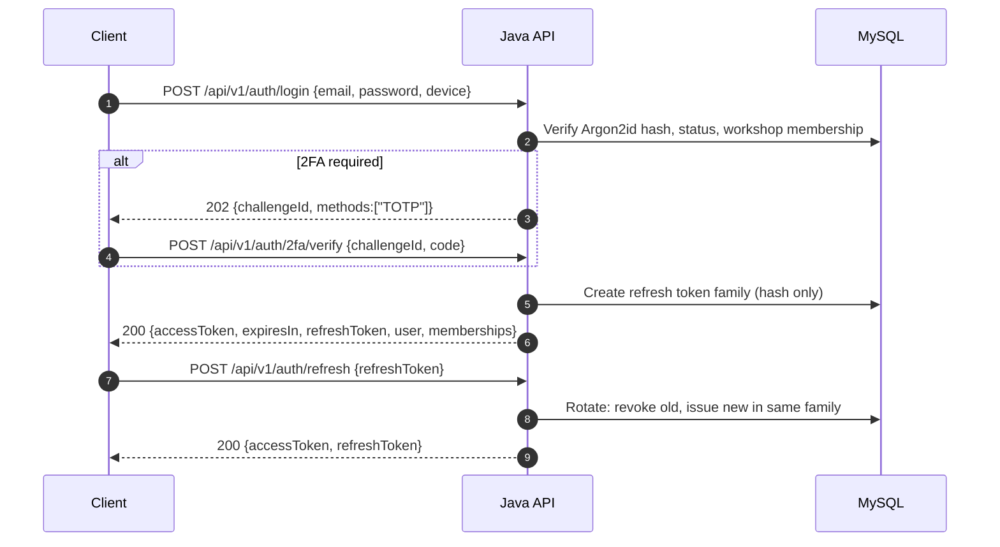

# API Design (`/api/v1`)

**Project:** TrueReport  
**Document:** 08-api-design.md  
**Status:** Phase 1 proposal. No endpoint is implemented. Roles and defaults follow `00-decisions.md`.

---

## 1. Conventions

| Topic | Rule |
|---|---|
| Base path | `/api/v1` |
| Format | JSON, UTF-8; `application/json` except file upload/download |
| Auth | `Authorization: Bearer <access token>` |
| Refresh | Rotating refresh token; server stores only a hash |
| IDs | UUID strings in JSON; server stores `BINARY(16)` |
| Timestamps | ISO 8601 with offset, e.g. `2026-11-03T14:30:00+04:00`; storage is UTC |
| Locale | `Accept-Language` for server messages; stored content keeps its language |
| Request correlation | `X-Request-Id` accepted or generated; returned in every response |
| Optimistic locking | `ETag` / `If-Match` on mutable resources; version in body where useful |
| Idempotency | `Idempotency-Key` required on finalize, resend and other unsafe retries |
| Pagination | Cursor-based: `cursor`, `limit` (default 20, max 100); response `nextCursor` |
| Filtering | Allowlisted query parameters only; unknown filters are rejected |
| Errors | RFC 9457 `application/problem+json` with a stable `code` |
| Public routes | `/r/{token}` and `/r/{token}/...` are outside `/api/v1` and use an allowlist renderer |
| OpenAPI | Generated from annotations; the Dart client is generated or hand-written against the same spec |
| Versioning | `/api/v1`; breaking changes require a new major path or a documented migration |

---

## 2. Authentication

### 2.1 Flow



### 2.2 Token rules

- Access token: short-lived JWT (target 10–15 minutes; Pending security review). Contains `sub`, `role`, `workshopId`, `sessionId`, `iat`, `exp`, `jti`.
- Refresh token: opaque random value, hashed at rest, rotated on every use.
- Reuse of a rotated refresh token revokes the whole family and triggers an audit/alert.
- Disabling a user or changing their workshop revokes all sessions.
- 2FA is required for Workshop Admin and Platform Admin (D12 Pending; TOTP default).
- Password hashing: Argon2id with reviewed parameters.
- Login errors are generic: “Email or password is incorrect.” Do not reveal whether an account exists, is disabled, or belongs to another workshop.
- Rate limit login by IP and by account identifier; exponential backoff; alert on spikes.

### 2.3 Endpoints

| Method | Endpoint | Purpose | Auth |
|---|---|---|---|
| POST | `/auth/login` | Password sign-in; may return a 2FA challenge | Public |
| POST | `/auth/2fa/verify` | Verify TOTP challenge | Challenge |
| POST | `/auth/refresh` | Rotate refresh token | Refresh token |
| POST | `/auth/logout` | Revoke current session | Bearer |
| POST | `/auth/logout-all` | Revoke all sessions | Bearer |
| GET | `/auth/me` | Current user, role, memberships | Bearer |
| POST | `/auth/password/change` | Change own password | Bearer |
| POST | `/auth/password/forgot` | Request reset (generic response) | Public |
| POST | `/auth/password/reset` | Reset with single-use token | Public |
| GET | `/auth/sessions` | List own sessions | Bearer |
| DELETE | `/auth/sessions/{id}` | Revoke one session | Bearer |

---

## 3. Errors

### 3.1 Problem Details shape

```json
{
  "type": "https://truereport.example/problems/validation",
  "title": "Validation failed",
  "status": 422,
  "detail": "Two required answers are missing.",
  "instance": "/api/v1/inspections/0190f.../finalize",
  "code": "VALIDATION_FAILED",
  "messageKey": "error.validation.failed",
  "traceId": "req_01J...",
  "fieldErrors": [
    { "field": "answers.42", "code": "REQUIRED", "messageKey": "error.answer.required" }
  ]
}
```

- `code` is stable and machine-readable.
- `messageKey` is translatable; the server does not send a single hardcoded human sentence only.
- `fieldErrors` is present for validation.
- `traceId` never contains PII.

### 3.2 Status codes

| Status | Use |
|---|---|
| 200 | Success |
| 201 | Created; `Location` header |
| 202 | Accepted for async work (2FA challenge, report generation) |
| 204 | No content (delete/revoke where appropriate) |
| 400 | Malformed request |
| 401 | Missing/invalid/expired token |
| 403 | Authenticated but not permitted (use 404 for cross-tenant where existence must not leak) |
| 404 | Not found / neutral cross-tenant |
| 409 | Domain conflict: stale version, reassigned, already finalized, duplicate, idempotency key reuse |
| 412 | `If-Match` precondition failed (where used; otherwise 409) |
| 413 | Payload too large |
| 415 | Unsupported media type |
| 422 | Validation or safety-rule failure |
| 429 | Rate limited; `Retry-After` |
| 500 | Unexpected server error |
| 503 | Temporary dependency failure (PDF, storage, provider) |

### 3.3 Stable error codes (initial set)

| Code | Meaning |
|---|---|
| `AUTH_INVALID_CREDENTIALS` | Wrong email/password |
| `AUTH_2FA_REQUIRED` | TOTP challenge required |
| `AUTH_2FA_INVALID` | Invalid TOTP |
| `AUTH_TOKEN_EXPIRED` | Access token expired |
| `AUTH_REFRESH_REUSED` | Refresh token reuse detected |
| `ACCOUNT_DISABLED` | Account disabled |
| `FORBIDDEN` | Role/permission denied |
| `NOT_FOUND` | Neutral not found |
| `VERSION_CONFLICT` | Stale `If-Match`/version |
| `JOB_REASSIGNED` | Job assigned to another technician |
| `JOB_CANCELLED` | Job cancelled |
| `ALREADY_FINALIZED` | Finalized; immutable |
| `TEMPLATE_RETIRED` | Template version retired |
| `TEMPLATE_WEAKENS_SAFETY_RULE` | Workshop override would weaken a master rule |
| `VALIDATION_FAILED` | Field validation |
| `MANDATORY_EVIDENCE_MISSING` | Required photo not received |
| `REASON_REQUIRED` | Result requires a reason |
| `CONSENT_REQUIRED` | Public link/message needs consent |
| `IDEMPOTENCY_KEY_REUSED` | Same key, different request body |
| `IDEMPOTENCY_IN_PROGRESS` | Same key, original still processing |
| `RATE_LIMITED` | Too many requests |
| `UPLOAD_INVALID_TYPE` | Disallowed MIME/content |
| `UPLOAD_TOO_LARGE` | Size limit |
| `UPLOAD_HASH_MISMATCH` | Content hash mismatch |
| `LINK_REVOKED` | Link unavailable |
| `REPORT_NOT_READY` | PDF/link still generating |
| `PROVIDER_UNAVAILABLE` | Messaging/storage provider failure |

---

## 4. Idempotency and conflict handling

### 4.1 Idempotency

- Required on: finalize, resend, revoke, create job, create invite, publish template, publish master item, disable/transfer account, and any `POST` that can be retried.
- Client generates a UUIDv7 per logical action; reuses it only for retries of the same action.
- Server stores `(actor_id, endpoint, key_hash, request_hash, response_status, response_body)` for 24 hours (configurable).
- **Secret-bearing fields are not stored in plaintext in the idempotency record.** For finalize, store a safe result reference (report ID/version/state), not the plaintext public token; on replay, return the current authorized link representation only after re-checking the caller’s permission. Never persist a token, password or full customer PII in `response_body`.
- Same key + same request hash → return the stored response (including errors) with `Idempotent-Replay: true`.
- Same key + different request hash → `409 IDEMPOTENCY_KEY_REUSED`.
- Same key while the original is still processing → `409 IDEMPOTENCY_IN_PROGRESS` with `Retry-After`.
- Finalization also has a unique constraint on the job; a second finalization cannot create a second report.

### 4.2 Conflicts

- Every mutable resource returns an `ETag` (e.g., `"7"` for version 7).
- Mutating requests send `If-Match: "7"`.
- Stale version → `409 VERSION_CONFLICT` with `currentVersion` and a safe diff link/summary.
- No silent last-write-wins for:
  - answers,
  - intake fields,
  - template drafts,
  - master item drafts,
  - job assignment.
- Reassignment while a technician is offline → `409 JOB_REASSIGNED`; the old technician stops; local data is preserved for support, not applied.
- Cancellation while offline → `409 JOB_CANCELLED`.
- Finalized job edits → `409 ALREADY_FINALIZED`.
- Hash mismatch on upload → `422 UPLOAD_HASH_MISMATCH`; require re-upload.

### 4.3 Retry guidance

- `429`/`503`: exponential backoff with jitter; honor `Retry-After`.
- `401`: refresh once, then sign in.
- `409`: do not auto-retry; show the conflict to the user.
- `422`: do not retry; fix the request.
- Finalize: retry only with the same idempotency key.

---

## 5. Pagination, filtering and sorting

- Cursor is opaque: base64url of `(created_at, id)` (or another stable tuple). Do not expose SQL offsets.
- `limit` default 20, max 100.
- Sort allowlist per endpoint (e.g., `created_at`, `scheduled_at`, `status`).
- Filter allowlist per endpoint; unknown filter → `400`.
- Response:

```json
{
  "items": [],
  "nextCursor": "eyJjcmVhdGVkQXQiOi...",
  "hasMore": false
}
```

- Large exports are asynchronous and audited; no unbounded download in V1.

---

## 6. Tenant and role enforcement

- The server resolves `userId`, role and `workshopId` from the token and membership table.
- A client-supplied `workshopId` is only accepted for Platform Admin endpoints, and is validated against the target.
- A Technician/Workshop Admin request never chooses its workshop from the body.
- Cross-workshop access returns `404 NOT_FOUND` (preferred) or `403 FORBIDDEN` without revealing existence.
- Object-level checks happen on every resource fetch, not only on list queries.
- Media access uses short-lived signed URLs issued only after the same authorization check.
- Public routes use the token only; no internal IDs.

---

## 7. Permission matrix by endpoint

Legend: **T** Technician, **WA** Workshop Admin, **PA** Platform Admin, **Pub** Public, **W** Worker/service. “Own” = own workshop or assigned record. “RO” = read-only.

### 7.1 Platform Admin

| Method | Endpoint | T | WA | PA | Pub | Notes |
|---|---|---|---|---|---|---|
| GET | `/platform/workshops` | No | No | Yes | No | Search/filter/paginate |
| POST | `/platform/workshops` | No | No | Yes | No | Idempotent; audited |
| GET | `/platform/workshops/{id}` | No | No | Yes | No | No customer PII by default |
| PATCH | `/platform/workshops/{id}` | No | No | Yes | No | `If-Match`; audited |
| POST | `/platform/workshops/{id}/disable` | No | No | Yes | No | Reason required |
| POST | `/platform/workshops/{id}/reactivate` | No | No | Yes | No | Audited |
| GET | `/platform/workshops/{id}/members` | No | No | Yes | No | Masked email |
| POST | `/platform/invitations` | No | No | Yes | No | Idempotent; role/workshop |
| POST | `/platform/invitations/{id}/resend` | No | No | Yes | No | Invalidates old token |
| POST | `/platform/invitations/{id}/revoke` | No | No | Yes | No | Audited |
| GET | `/platform/users/{id}` | No | No | Yes | No | No secrets |
| POST | `/platform/users/{id}/disable` | No | No | Yes | No | Revokes sessions; reason |
| POST | `/platform/users/{id}/reactivate` | No | No | Yes | No | Audited |
| POST | `/platform/users/{id}/transfer` | No | No | Yes | No | Reason; old/new workshop |
| POST | `/platform/users/{id}/reset-password` | No | No | Yes | No | Audited; generic response |
| POST | `/platform/users/{id}/role` | No | No | Yes | No | Change WA/T; audited |
| GET | `/platform/audit-events` | No | No | Yes | No | Filter; no secrets/PII |

### 7.2 Master content

| Method | Endpoint | T | WA | PA | Pub | Notes |
|---|---|---|---|---|---|---|
| GET | `/master/categories` | RO | RO | Yes | No | Published only for T/WA |
| POST | `/master/categories` | No | No | Yes | No | Draft |
| PATCH | `/master/categories/{id}` | No | No | Yes | No | Audited |
| GET | `/master/items` | RO | RO | Yes | No | Search published |
| POST | `/master/items` | No | No | Yes | No | Draft |
| GET | `/master/items/{id}` | RO | RO | Yes | No | Published version for T/WA |
| POST | `/master/items/{id}/versions` | No | No | Yes | No | New draft |
| PUT | `/master/items/{id}/versions/{v}` | No | No | Yes | No | Draft only |
| POST | `/master/items/{id}/versions/{v}/publish` | No | No | Yes | No | Validation; audit |
| POST | `/master/items/{id}/versions/{v}/retire` | No | No | Yes | No | Audit |
| GET | `/master/items/{id}/versions` | No | No | Yes | No | History |
| PUT | `/master/items/{id}/versions/{v}/translations` | No | No | Yes | No | EN/AR required to publish |
| GET | `/master/dropdowns` | RO | RO | Yes | No | Published values |
| POST | `/master/dropdowns` | No | No | Yes | No | |
| PUT | `/master/dropdowns/{id}/values` | No | No | Yes | No | |
| POST | `/master/guide-images` | No | No | Yes | No | Multipart; validated |
| POST | `/master/equipment` | No | No | Yes | No | |
| POST | `/master/recommendations` | No | No | Yes | No | Versioned |
| POST | `/master/disclaimers` | No | No | Yes | No | Versioned; legal approval |

### 7.3 Workshop jobs and staff

| Method | Endpoint | T | WA | PA | Pub | Notes |
|---|---|---|---|---|---|---|
| GET | `/workshop/jobs` | Own assigned | Own | RO oversight | No | Cursor; filters |
| POST | `/workshop/jobs` | Walk-in only, if authorised | Yes | No | No | Idempotent |
| GET | `/workshop/jobs/{id}` | Own assigned | Own | RO | No | Tenant check |
| PATCH | `/workshop/jobs/{id}` | Intake own assigned | Intake own | No | No | Before finalization |
| POST | `/workshop/jobs/{id}/assign` | No | Yes | No | No | Before finalization |
| POST | `/workshop/jobs/{id}/cancel` | No | Yes | No | No | Reason; not finalized |
| GET | `/workshop/jobs/{id}/assignments` | No | Own | RO | No | History |
| GET | `/workshop/staff` | No | Own | Yes | No | Masked PII |
| POST | `/workshop/staff/invitations` | No | No by default | Yes | No | RQ3 pending |
| GET | `/workshop/audit-events` | No | No by default | Yes | No | RQ4 pending |
| GET | `/workshop/settings` | No | Own | Yes | No | |
| PUT | `/workshop/settings` | No | Own | Yes | No | Audited |

### 7.4 Templates

| Method | Endpoint | T | WA | PA | Pub | Notes |
|---|---|---|---|---|---|---|
| GET | `/workshop/templates` | RO own | Own | RO all | No | |
| POST | `/workshop/templates` | No | Yes | No | No | Draft |
| GET | `/workshop/templates/{id}` | RO own | Own | RO | No | |
| PUT | `/workshop/templates/{id}/draft` | No | Own | No | No | `If-Match` |
| POST | `/workshop/templates/{id}/publish` | No | Own | No | No | Safety validation |
| POST | `/workshop/templates/{id}/retire` | No | Own | No | No | Audit |
| GET | `/workshop/templates/{id}/versions` | RO own | Own | RO | No | |
| GET | `/workshop/templates/{id}/preview` | RO own | Own | RO | No | EN/AR |

### 7.5 Technician inspection

| Method | Endpoint | T | WA | PA | Pub | Notes |
|---|---|---|---|---|---|---|
| GET | `/inspections` | Own assigned | Own | RO | No | Same as jobs; narrow view |
| GET | `/inspections/{id}` | Own assigned | Own | RO | No | |
| POST | `/inspections/{id}/start` | Own assigned | No | No | No | Pins template version |
| PUT | `/inspections/{id}/customer` | Own assigned | Intake own | No | No | Before finalization |
| PUT | `/inspections/{id}/vehicle` | Own assigned | Intake own | No | No | Before finalization |
| POST | `/inspections/{id}/consent` | Own assigned | Intake own | No | No | Append-only record |
| GET | `/inspections/{id}/equipment` | Own assigned | Own | RO | No | Pinned |
| GET | `/inspections/{id}/items` | Own assigned | Own RO | RO | No | Pinned checklist |
| GET | `/inspections/{id}/items/{itemId}` | Own assigned | Own RO | RO | No | |
| PUT | `/inspections/{id}/items/{itemId}/assessment` | Own assigned | No | No | No | `If-Match`; local revision |
| POST | `/inspections/{id}/items/{itemId}/evidence/init` | Own assigned | No | No | No | Pre-signed upload |
| POST | `/inspections/{id}/items/{itemId}/evidence/complete` | Own assigned | No | No | No | Hash verification |
| DELETE | `/inspections/{id}/evidence/{evidenceId}` | Own assigned | No | No | No | Draft only |
| PUT | `/inspections/{id}/sync/answers` | Own assigned | No | No | No | Batch idempotent upsert |
| POST | `/inspections/{id}/review` | Own assigned | No | No | No | Server validation preview |
| POST | `/inspections/{id}/finalize` | Own assigned | No | No | No | **Idempotency-Key + If-Match** |
| GET | `/inspections/{id}/status` | Own assigned | Own | RO | No | Report/link/delivery state |
| GET | `/inspections/{id}/conflicts` | Own assigned | No | No | No | Sync conflicts |

### 7.6 Reports, links and delivery

| Method | Endpoint | T | WA | PA | Pub | Notes |
|---|---|---|---|---|---|---|
| GET | `/reports/{id}` | Own assigned RO | Own RO | RO | No | Internal viewer |
| GET | `/reports/{id}/snapshot` | Own assigned RO | Own RO | RO | No | Allowlisted internal DTO |
| GET | `/reports/{id}/pdf` | Own assigned? | Own | RO | No | Internal download policy |
| GET | `/reports/{id}/delivery` | Own assigned RO | Own | RO | No | Status only |
| POST | `/reports/{id}/delivery/resend` | No | Own | No by default | No | Idempotent; consent |
| GET | `/reports/{id}/link` | Own assigned RO | Own | RO | No | Token never returned |
| POST | `/reports/{id}/link/revoke` | No | Own | No by default | No | Reason; idempotent |
| GET | `/reports` | No | Own | Yes | No | Cursor/filter |
| GET | `/reports/{id}/audit` | No | Own subset? | Yes | No | RQ4 pending |

### 7.7 Public routes (outside `/api/v1`)

| Method | Endpoint | T | WA | PA | Pub | Notes |
|---|---|---|---|---|---|---|
| GET | `/r/{token}` | — | — | — | Yes | Server-rendered HTML; token lookup by hash |
| GET | `/r/{token}?lang=ar` | — | — | — | Yes | Locale switch from snapshot |
| GET | `/r/{token}/photo/{derivativeId}` | — | — | — | Yes | Safe derivative only |
| GET | `/r/{token}/pdf` | — | — | — | **No by default** | Only if PDF1 approved |
| GET | `/r/unavailable` | — | — | — | Yes | Neutral |

### 7.8 Health and operations (not public)

| Method | Endpoint | Access |
|---|---|---|
| GET | `/actuator/health` | Internal only; no details publicly |
| GET | `/actuator/prometheus` | Internal network only |
| POST | `/internal/jobs/run` | Worker/admin network only; not a user endpoint |

---

## 8. Important request/response contracts

### 8.1 Finalize

```
POST /api/v1/inspections/{id}/finalize
Authorization: Bearer ...
Idempotency-Key: 0190f5a0-...
If-Match: "12"
Content-Type: application/json

{ "reportLanguage": "en+ar", "technicianNote": null }
```

Success:

```json
{
  "inspectionId": "0190f...",
  "status": "FINALIZED",
  "finalizedAt": "2026-11-03T14:30:00+04:00",
  "reportId": "0190f...",
  "reportVersion": 1,
  "link": { "state": "ACTIVE", "url": "https://..." },
  "warnings": []
}
```

- `FINALIZED` is returned only after the transaction commits.
- If PDF generation is asynchronous, return `reportState: "QUEUED"`; do not claim the PDF is ready.
- If consent is missing, finalization succeeds and `link.state` is `PENDING_CONSENT`.
- A retry with the same key returns the same body with `Idempotent-Replay: true`.

Errors: `422 MANDATORY_EVIDENCE_MISSING`, `422 REASON_REQUIRED`, `409 VERSION_CONFLICT`, `409 JOB_REASSIGNED`, `409 ALREADY_FINALIZED`, `403 FORBIDDEN`.

### 8.2 Assessment upsert (offline)

```
PUT /api/v1/inspections/{id}/items/{itemId}/assessment
If-Match: "3"

{
  "clientRevision": 17,
  "baseVersion": 3,
  "resultCode": "DEFECT_FOUND",
  "severityCode": "MODERATE",
  "note": "تم رصد عيب واضح ويتطلب متابعة.",
  "noteLanguage": "ar",
  "recommendation": "يوصى بمراجعة الفني المختص.",
  "reasonCode": null,
  "reasonText": null
}
```

- The server compares `baseVersion`; stale → `409 VERSION_CONFLICT`.
- Same `clientRevision` replayed → idempotent success.
- Different device with a newer server revision → conflict, not silent overwrite.
- Result/severity combinations validated against the pinned item rules.

### 8.3 Evidence upload

1. `POST /inspections/{id}/items/{itemId}/evidence/init` with `{mime, bytes, sha256}`.
2. Server checks size/type/quota and returns a short-lived pre-signed `PUT` URL and `evidenceId`.
3. Client uploads directly to object storage.
4. `POST /inspections/{id}/items/{itemId}/evidence/complete` with `{evidenceId, sha256}`.
5. Server verifies object metadata/hash, marks `VERIFIED`, and creates derivatives asynchronously.
6. Finalization requires `VERIFIED` evidence that the server has received.

Reject: wrong MIME, decompression bomb, executable/SVG, hash mismatch, over quota.

### 8.4 Sync answers (batch)

```
PUT /api/v1/inspections/{id}/sync/answers
Idempotency-Key: ...
{
  "operations": [
    {
      "clientId": "0190f...",
      "itemId": "0190f...",
      "clientRevision": 17,
      "baseVersion": 3,
      "payload": { ... }
    }
  ]
}
```

Response returns per-operation `ACCEPTED`, `REJECTED`, `CONFLICT` with a safe reason. The client must not mark the whole batch as received if any operation is rejected.

### 8.5 Public token route

- `GET /r/{token}` returns HTML.
- Lookup is by SHA-256 hash; constant-work path for unknown tokens; rate-limited by IP and token hash.
- Never return JSON with internal IDs.
- `Cache-Control: no-store`; `X-Robots-Tag: noindex, nofollow`; `Referrer-Policy: no-referrer`.
- Invalid/revoked → neutral page with 404/410 and no data.

---

## 9. Rate limits (initial targets, to tune)

| Endpoint group | Limit |
|---|---|
| Login | 5 attempts / 15 min / account + 20 / 15 min / IP |
| Password reset | 3 / hour / account |
| Public report | 120 requests / min / IP; lower per token if abuse detected |
| Public photo | 240 requests / min / IP |
| Finalize | 10 / hour / technician; idempotent |
| Resend | 10 / hour / workshop |
| Master/content writes | 60 / hour / Platform Admin |
| General API | 600 / min / user |

`429` includes `Retry-After`; no token/report existence leak.

---

## 10. Security headers (web and public)

- `Strict-Transport-Security: max-age=31536000; includeSubDomains` (production only)
- `Content-Security-Policy` with no inline script for the public report; if inline styles are required, use hashes/nonces
- `X-Content-Type-Options: nosniff`
- `Referrer-Policy: no-referrer` (public) / `strict-origin-when-cross-origin` (admin)
- `Permissions-Policy` minimal
- `X-Frame-Options: DENY` or CSP `frame-ancestors 'none'`
- No `Server` version banner
- CORS deny-by-default; only the admin web origin if needed

---

## 11. What the API deliberately does not have

- No correction endpoint.
- No manager/review/approval/resubmission endpoint.
- No customer login, customer portal, booking or payment endpoint.
- No endpoint that edits finalized findings, severities, notes or evidence.
- No endpoint that returns a full report token after creation (only the share URL at activation, and only to the owning workshop).
- No endpoint that exposes original high-resolution evidence publicly.
- No endpoint that exports customer PII without an approved, audited process.
- No endpoint that processes card data.

---

## 12. Phase 2 API acceptance criteria

1. OpenAPI spec is generated and committed.
2. Every endpoint has a role/tenant test, including negative cases.
3. Cross-workshop access returns neutral 404/403 and never leaks data.
4. Finalize is idempotent under double submit and timeout retry.
5. Stale writes return 409 and never silently overwrite.
6. Public routes have an allowlist serializer and a no-private-field test.
7. Revoked/invalid tokens return the neutral page and no data.
8. Rate limits are enforced and tested.
9. No endpoint can change finalized data.
10. Error responses use RFC 9457 with stable codes and no PII.
