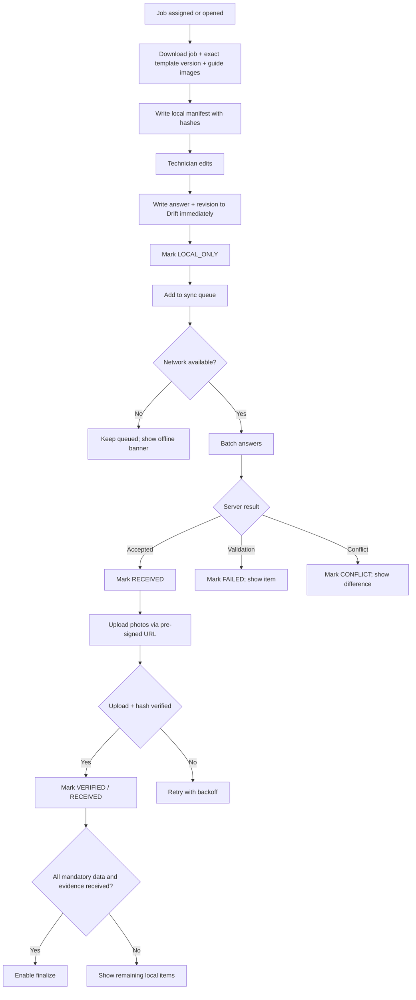

# Offline and Upload Design

**Project:** TrueReport  
**Document:** 09-offline-and-upload-design.md  
**Status:** Phase 1 proposal. Targets and limits marked Pending require pilot validation (D11).

---

## 1. Goals

A technician must be able to:

- work in a workshop with weak or no internet,
- lose the app or battery without losing saved answers,
- see exactly what is saved on the phone and what the server has received,
- recover safely from reassignment, cancellation, template changes and photo failures,
- never show “submitted” before the server confirms.

The public report must not become available until the server has received the required data and evidence and the inspection is finalized.

---

## 2. Local-first model



**Principle:** the local database is the source of truth for draft work. The server is the source of truth for finalized work.

---

## 3. What is stored locally

| Store | Contents | Notes |
|---|---|---|
| Drift/SQLite | Assigned jobs, pinned template version, item metadata, answers, revisions, sync states | Encrypted at rest if available (SQLCipher or platform encryption); key in secure storage |
| Drift | Photo queue metadata: local path, hash, size, MIME, item link, state | Original photo file is stored in app-private storage |
| Drift | Conflict records and last server error (safe message) | No full server payloads containing PII |
| Secure storage | Refresh token, local DB key, device identifier | Never in `shared_preferences` |
| Shared preferences | App language, last tab, non-sensitive UI prefs | No PII |
| App-private files | Compressed photos, thumbnails | Deleted after server receipt and retention window |
| Cached guide images | Guide images for the pinned template | Read-only; never evidence |

**Not stored locally:**

- Full customer list beyond the assigned jobs.
- Another technician’s jobs.
- Report tokens for other users.
- Admin/master content not needed for assigned jobs.
- Payment data (none exists).

---

## 4. Downloading a job

1. Server returns the job plus `templateVersionId`.
2. App requests the exact pinned template version and item rules.
3. App downloads guide images and equipment metadata.
4. App writes a manifest with:
   - `jobId`, `templateVersionId`, `manifestVersion`,
   - item IDs and order,
   - SHA-256 of each downloaded asset,
   - downloaded timestamp,
   - server `ETag`/version.
5. App verifies hashes and marks the job `READY_OFFLINE`.
6. If any required asset is missing, the job is not fully offline-ready; show what is missing and allow retry.

**Do not silently substitute a newer template version.** If the pinned version is unavailable, show a conflict and require the Workshop Admin to resolve it.

---

## 5. Local write rules

- Every answer write is a transaction: update the assessment row and append an outbox/sync row.
- Assign a monotonic `clientRevision` per item (or per job) and store `baseVersion` from the last server response.
- Save on every result change, note blur, severity change and photo attach; do not wait for a “Save” button.
- Debounce text notes (e.g., 300–500 ms) but flush on navigation, backgrounding and app pause.
- Keep the original note text exactly; do not trim internal whitespace or line breaks.
- If the app is killed mid-write, SQLite transaction rollback leaves the previous consistent state.
- On reopen, show “Recovered draft” and the last saved time; never discard silently.

---

## 6. Sync protocol

### 6.1 Answer batch

```
PUT /api/v1/inspections/{id}/sync/answers
Idempotency-Key: <uuidv7>
{
  "operations": [
    {
      "clientId": "<uuidv7>",
      "itemId": "<uuid>",
      "clientRevision": 17,
      "baseVersion": 3,
      "payload": { "resultCode": "...", "note": "...", "severityCode": "..." }
    }
  ]
}
```

Response:

```json
{
  "results": [
    { "clientId": "...", "status": "ACCEPTED", "serverRevision": 18, "version": 4 },
    { "clientId": "...", "status": "CONFLICT", "serverVersion": 5, "code": "VERSION_CONFLICT" },
    { "clientId": "...", "status": "REJECTED", "code": "REASON_REQUIRED" }
  ]
}
```

Rules:

- Batch size: target 50 operations or 1 MB; tune in pilot.
- The server applies each operation independently; one conflict does not discard the whole batch.
- The client marks only accepted operations `RECEIVED`.
- Replaying the same `clientId` is idempotent.
- The server returns a safe current version for conflicts; the client shows the difference, not a raw dump.

### 6.2 Photo upload

```mermaid
sequenceDiagram
    autonumber
    participant App
    participant API
    participant S3
    App->>API: POST evidence/init {mime, bytes, sha256, itemId}
    API->>API: Validate size/type/quota; authorize item/job
    API-->>App: {evidenceId, uploadUrl, expiresAt, headers}
    App->>S3: PUT uploadUrl (binary)
    App->>API: POST evidence/complete {evidenceId, sha256}
    API->>S3: HEAD object, verify size/content-type
    API->>API: Verify hash / scan / create derivative job
    API-->>App: {status:"VERIFIED"} or error
```

Rules:

- Pre-signed URL is short-lived (target 10–15 minutes) and scoped to one object key.
- The client computes SHA-256 before upload.
- The server verifies the object size and hash; mismatch → reject and require re-upload.
- MIME is validated by content sniffing, not only the client header.
- Re-encode images server-side; strip EXIF/GPS from public derivatives.
- Reject SVG, executables and oversized images; enforce decompression limits.
- Upload is resumable only if pilot testing shows it is needed; start with simple retry.
- A failed upload never loses the local file; it stays queued.

### 6.3 Batch order

- Answers may sync before or after photos; finalization waits for both.
- The server can accept an answer that references an evidence ID that is not yet `VERIFIED`; finalization validation rejects it until verified.
- The app shows “answer received, photo pending” separately.

---

## 7. State model (local and server)

| Local state | Meaning | UI |
|---|---|---|
| `LOCAL_ONLY` | Saved on this phone; not queued yet | “Saved on this phone” |
| `QUEUED` | In the sync queue | “Waiting to send” |
| `UPLOADING` | Transfer in progress | Progress; cancel only if safe |
| `RECEIVED` | Server confirmed | “Received by server” |
| `VERIFIED` | Photo hash/content verified | “Photo received” |
| `FAILED` | Retryable or fixable failure | Error with retry |
| `CONFLICT` | Server rejected due to version/assignment/state | Conflict panel |

Server-side answer state is not a separate enum; the server stores the current assessment version and returns per-operation results. The client derives its display from the last result plus its local revision.

**Never label a local-only answer “submitted”.** “Submitted” is reserved for server receipt, and “Finalized” only after finalization.

---

## 8. Conflict handling

| Conflict | Detection | Behaviour |
|---|---|---|
| Job reassigned | Server `assigned_technician_id` changed, or assignment version mismatch | Stop editing; show “This job was reassigned”; preserve local data for support; do not apply it. |
| Job cancelled | Job status `CANCELLED` | Stop; show cancelled; preserve local copy; no finalize. |
| Newer server answer | `baseVersion` < server version | Show both versions side by side (or a safe summary); technician chooses or reloads; never silent overwrite. |
| Same client revision replay | `clientId`/`clientRevision` match | Idempotent success; no duplicate. |
| Template version mismatch | Pinned version not current | Keep pinned version; do not migrate answers; show a conflict if the server refuses. |
| Photo hash mismatch | Uploaded hash ≠ local/expected | Reject; require re-upload; keep local file. |
| Photo already attached elsewhere | Server duplicate/hash policy | Warn; allow if it is the same evidence, otherwise reject. |
| Finalized while offline | Server status `FINALIZED` | Show finalized read-only; local unsent data is not applied. |
| Account disabled | 401/403 on sync | Stop sync; wipe local PII on next successful sign-in per policy. |
| Device storage full | OS/local check | Block new photos; allow sync/cleanup; show exact free space. |

### 8.1 Conflict UI rules

- Show what changed and when, in plain language.
- Do not auto-resolve by “latest timestamp”.
- Provide “Use server version”, “Keep my version as a note for support” (does not overwrite finalized data) and “Retry”.
- A conflict does not delete local evidence automatically.
- Log a safe conflict event for support; no PII.

---

## 9. Finalization gate

The finalize button is enabled only when **all** are true:

1. The job is downloaded and pinned.
2. Every mandatory item has an accepted result received by the server.
3. Every “not checked”/“could not verify” item has a reason received by the server.
4. Every required evidence photo is `VERIFIED` by the server.
5. Required customer/vehicle fields are received.
6. Required consent records are received.
7. The current user is the assignee (or authorised).
8. The app holds a fresh `If-Match` version and an idempotency key.

If any is false, show a blocking list with per-item actions. Finalize is a single server call; the UI shows “Submitting”, then “Finalized” only after a 200 with `FINALIZED`. A timeout is not success; retry with the same key.

---

## 10. Background work and app lifecycle

- Save synchronously on every edit; background work is for upload/sync, not for saving drafts.
- Android: `workmanager` may retry uploads; iOS background limits mean uploads must also resume when the app opens.
- Do not promise background delivery on iOS.
- On app pause/background, flush pending writes and record a checkpoint.
- On app kill, reopen the local draft and show recovery state.
- On sign-out, warn about unsent work; after confirmation, wipe local PII and queued evidence per policy.
- On role/workshop change or account disable, wipe on next successful sign-in; server tokens are revoked immediately.

---

## 11. Photo and storage budgets

| Item | Phase 1 target | Status |
|---|---|---|
| Compressed photo size | 1–2 MB | Pending pilot (D11) |
| Max photo dimensions | Long edge 2048 px before server derivative | Pending |
| Public derivative | Long edge 1600 px, re-encoded | Pending |
| Photos per item | Per master rule; not every item | Pending specialist |
| Photos per inspection | 100+ possible; design must handle album/gallery paging | Pending pilot |
| Local free-space threshold | Warn below 500 MB; block below 200 MB | Pending device testing |
| Upload concurrency | 2–3 concurrent uploads; backoff on failure | Pending |
| Batch size | 50 answers / 1 MB | Pending |
| Retry | Exponential backoff with jitter; cap; resume on app open | — |

The design must not assume a fixed number of photos. The checklist UI and upload queue must handle a large gallery without loading all full images into memory.

---

## 12. Security and privacy

- Local database encrypted at rest where the platform supports it; key in secure storage.
- Local data scoped to the signed-in user and workshop; a different user on the same device must not see it.
- No customer PII or tokens in logs, crash reports or analytics.
- Photo files are app-private; no gallery-wide access unless the user explicitly exports.
- Pre-signed URLs are short-lived and scoped; never logged.
- Server verifies content type, size, hash and (optionally) malware before accepting.
- Public derivatives strip EXIF/GPS and never expose originals.
- Wipe local data on sign-out, role change, account disable or workshop transfer, per policy.

---

## 13. Failure scenarios and expected behaviour

| Scenario | Expected |
|---|---|
| App killed during inspection | Reopen draft; all committed answers and photos remain; unsaved in-flight text may be lost and is clearly indicated. |
| Battery dies during photo capture | The unsaved capture is lost; previously saved photos remain; retake. |
| Network drops mid-batch | Accepted operations are marked; the rest retry; no duplicates. |
| Server returns 500 | Keep queue; retry with backoff; do not mark received. |
| Server returns 409 reassigned | Stop; preserve local data; show conflict; do not overwrite. |
| Storage full | Block new captures; allow sync/cleanup; show exact state. |
| Camera permission denied | Explain settings path; allow limitation record only if template permits. |
| Photo compression fails | Keep original local file; retry compression; do not upload a corrupt file. |
| Timezone/clock wrong on device | Server timestamps are authoritative for finalization; display uses workshop time zone. |
| Template retired while offline | Keep pinned version; server may reject new start; show conflict. |
| App updated mid-draft | Run local DB migration; never drop unsynced answers; test migration. |

---

## 14. Tests

### 14.1 Automated

- Local write survives app kill/restart.
- Queue persists across restart.
- Replaying a batch is idempotent.
- Stale `baseVersion` returns 409 and does not overwrite.
- Photo hash mismatch is rejected.
- Finalize is blocked until mandatory evidence is `VERIFIED`.
- Double finalize returns the same result.
- Sign-out wipes local PII.
- Migration from the previous local schema preserves data.

### 14.2 Manual / device

- Low-end Android, mid-range Android, iPhone.
- Poor network: 3G, high latency, packet loss, captive portal.
- Airplane mode for a full inspection, then sync.
- App kill, battery pull, storage full, camera denial.
- Arabic keyboard and mixed-text notes.
- 100+ items and a large photo gallery.
- Reassignment and cancellation while offline.

---

## 15. What this design does not decide

- Exact photo size/count (D11).
- Whether resumable/chunked upload is required (pilot).
- Whether video is allowed (out of scope).
- The final device minimum OS versions.
- The exact local encryption library (Phase 2 security review).
