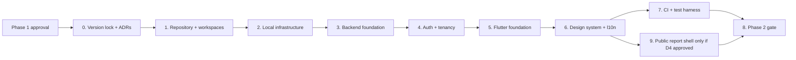

# Phase 2 Plan — Project Foundation

**Project:** TrueReport  
**Document:** 15-phase-2-plan.md  
**Status:** Plan only. Phase 2 starts only after Phase 1 approval. No production code exists.

---

## 1. Objective

Create a working, testable foundation for the Flutter workspace and Java backend, with local infrastructure, authentication, tenancy, localization, design system and CI.

Phase 2 does **not** build the inspection workflow, template builder, master content library, PDF, public report content or delivery. Those are later phases.

---

## 2. Prerequisites

| Prerequisite | Owner | Status |
|---|---|---|
| Phase 1 approved in writing | Product owner | Pending |
| D1 MySQL 8.4 LTS confirmed | Product owner | Pending |
| D2 one admin app confirmed | Product owner | Pending |
| D3 Riverpod confirmed | Product owner | Pending |
| D4 public report approach approved (SSR recommended) | Product owner | Pending |
| D5 PDF engine approved (Chromium recommended) | Product owner | Pending |
| D6 object storage shortlist approved | Product owner + counsel | Pending |
| D7 forms package confirmed | Tech lead | Pending |
| D8 delivery providers not needed until Phase 7 | Product owner | Not blocking Phase 2 |
| D9 no correction UI/API | Product owner + counsel | **Accepted constraint** |
| D10 `zh-Hans` confirmed | Product owner | Pending |
| D12 2FA method confirmed (TOTP recommended) | Product owner | Pending |
| D13 version lock | Tech lead | Phase 2 task 1 |
| UAE counsel engaged for consent/privacy | Product owner | Pending; not blocking fake-data foundation |
| Native Arabic reviewer identified | Product owner | Pending; needed before Phase 5/6 |

**Rule:** do not implement a feature whose decision is Pending; use a stub or a documented assumption, and do not present it as approved.

---

## 3. Indicative sequencing

Workstreams can overlap, but the gate requires all acceptance criteria.

---

## 4. Workstreams and deliverables

### 4.1 Workstream 0 — Version lock and decisions (task 1)

- Re-check every version on pub.dev, Maven Central and official release pages.
- Pin Flutter/Dart, Java, Spring Boot, Spring Modulith, MySQL, Flyway, JobRunr, Playwright, Node/tooling.
- Produce `pubspec.lock`, Maven dependency tree/effective POM, Docker image digests.
- Run licence scan and record obligations:
  - MySQL Connector/J (GPLv2 + FOSS exception),
  - JobRunr (LGPL-3.0/commercial),
  - fonts (OFL/embedding),
  - browser runtime,
  - any AGPL/LGPL dependency.
- Run vulnerability scan; record exceptions with expiry.
- Write ADRs for D1, D2, D3, D4, D5, D6, D7, D12, D13.
- **Exit:** `docs/phase-2/version-lock.md` approved; no floating versions.

### 4.2 Workstream 1 — Repository and workspaces

- Monorepo:
  - `client/` Flutter workspace (Melos 8 + Dart pub workspaces),
  - `server/` Java Maven project,
  - `infra/` compose/scripts,
  - `docs/` phase docs and ADRs,
  - `.github/workflows/`.
- Flutter apps:
  - `technician_app`,
  - `admin_app` (Workshop Admin + Platform Admin role folders),
  - `public_report_web` only if D4 selects Flutter; otherwise no Flutter public app.
- Flutter packages:
  - `core`, `design_system`, `l10n`, `api_client`, `domain`, `auth`, `offline_sync`, `media`, `report_ui` (shared read-only report widgets for admin viewer).
- Java modules:
  - `identity`, `tenancy`, `masterdata`, `templates`, `inspections`, `media`, `reports`, `delivery`, `audit`, `shared`.
- **Exit:** clean checkout builds; module boundaries documented; no business logic yet.

### 4.3 Workstream 2 — Local infrastructure

- `docker compose`: MySQL 8.4 LTS, MinIO (dev-only, pinned), Mailpit, server.
- MySQL settings: `utf8mb4`, UTC, strict SQL mode, separate users.
- `.env.example`; secrets not committed.
- Health checks; documented ports; one-command startup.
- **Exit:** `docker compose up` gives a working DB, storage and mail sink; README commands work on Windows and Linux.

### 4.4 Workstream 3 — Backend foundation

- Spring Boot modular monolith; Spring Modulith boundary tests.
- Flyway baseline migration and seed data (fake).
- RFC 9457 error handling; request ID; structured logs with redaction.
- OpenAPI/springdoc; generated spec committed.
- JPA/Hibernate configuration; UUIDv7 `BINARY(16)` mapping; MySQL dialect.
- Testcontainers for MySQL and MinIO.
- **Exit:** server starts; `/actuator/health` is safe; Flyway runs from empty; OpenAPI generated; arch tests pass.

### 4.5 Workstream 4 — Authentication and tenancy

- Sign-in, refresh rotation, logout, password reset (email via Mailpit in dev).
- Argon2id; JWT access; hashed refresh tokens; session revocation.
- TOTP 2FA skeleton for admins (D12).
- Workshop membership model: Workshop Admin, Technician.
- Server-side tenant resolution; neutral 404/403.
- Seed: two workshops, one admin each, two technicians.
- **Exit:** a user signs in; a Workshop Admin cannot access another workshop; a Technician cannot access admin endpoints; tests prove it.

### 4.6 Workstream 5 — Flutter foundation

- Melos workspace; FVM; `very_good_analysis`.
- App shells: sign-in, empty home, settings, language switch, sign-out.
- `go_router` with guards; path URL strategy on web.
- Riverpod; `freezed`/`json_serializable`; `dio` client with auth/locale/request ID interceptors.
- Secure storage for refresh token; no PII in prefs.
- `flutter_localizations` + ARB; EN/AR; `ru`/`zh-Hans` structure prepared but not translated.
- **Exit:** both apps run on Android/iOS/web (admin); sign-in shell works; EN/AR shells render without overflow; RTL base screens correct.

### 4.7 Workstream 6 — Design system and localization base

- Token set (colour, type, spacing, radius, elevation, motion, breakpoints) as `ThemeExtension`.
- Buttons, fields, cards, chips, status/severity badges, empty/error/loading/offline states.
- RTL helpers and lint rules against hardcoded left/right.
- Golden tests for EN/AR base components.
- Accessibility baseline: contrast, focus, tap targets, semantics.
- **Exit:** component gallery renders in EN/AR; golden tests pass; accessibility checklist signed off for base components.

### 4.8 Workstream 7 — CI and test harness

- CI: Flutter analyze/test/golden; Java build/unit/Testcontainers/ArchUnit; OpenAPI drift check; dependency/secret scan.
- Build on Windows and Linux.
- Migration check from empty and previous.
- **Exit:** CI green; a deliberate lint/test/architecture violation fails the build.

### 4.9 Workstream 8 — Public report shell (conditional)

- If D4 = SSR: a minimal `/r/unavailable` neutral route and a neutral HTML shell; no report content, no token logic beyond a stub; security headers; no admin code.
- If D4 = Flutter Web: do **not** build it in Phase 2; the spike does not support it. Escalate.
- **Exit:** neutral unavailable page renders; no private data; headers correct; route has tests.

### 4.10 Workstream 9 — Documentation and ADRs

- Phase 2 README: setup, run, test, reset.
- ADRs for resolved decisions.
- Threat model delta and risk update.
- **Exit:** a new developer can run the project from the README on a clean machine.

---

## 5. Acceptance criteria (Phase 2 gate)

1. App and server run locally from a clean checkout using documented commands.
2. A user can sign in and receive a valid access/refresh token.
3. Refresh rotation works; reuse revokes the family.
4. A Technician cannot access a Workshop Admin endpoint.
5. A Workshop Admin cannot access another workshop’s data.
6. Cross-workshop isolation tests pass for every implemented endpoint.
7. English and Arabic shells render without overflow; RTL is correct on base screens.
8. MySQL 8.4 migrations run from empty and from the previous migration.
9. UUIDv7 `BINARY(16)` round-trips correctly.
10. CI is green and fails on a deliberate lint/test/architecture violation.
11. Secrets are not in source; local secrets are documented.
12. No payment tables or endpoints exist.
13. The neutral public unavailable page exists if D4 = SSR; it exposes no data.
14. The version lock is complete; no floating versions.
15. ADRs are written for resolved decisions.
16. The risk register is updated.

---

## 6. Tests

### 6.1 Backend

- Unit: auth, token rotation, membership, permission matrix.
- Repository/tenant tests with two workshops.
- ArchUnit module boundaries.
- Testcontainers MySQL migration and query tests.
- Direct SQL immutability tests once the first finalized schema exists (may be Phase 3/5; start with a test harness).
- Error contract tests (RFC 9457, stable codes).
- Rate-limit and idempotency harness.

### 6.2 Flutter

- Unit: models, providers, formatters, direction detection.
- Widget: sign-in, shell, language switch, empty/error/loading.
- Golden: EN/AR base components and shells.
- Integration: sign in → load stub home → sign out.
- RTL overflow tests with long Arabic.
- Accessibility: semantics labels, focus, tap targets.

### 6.3 CI

- Flutter analyze/test/golden.
- Java build/unit/Testcontainers/ArchUnit.
- OpenAPI generation and drift check.
- Dependency and secret scan.
- Docker image build.
- Windows and Linux.

### 6.4 Manual

- Clean-machine setup on Windows and Linux.
- Android emulator/device and iOS simulator/device.
- Arabic and English base screens.
- Admin web in Chrome/Edge/Safari.
- Keyboard-only admin web baseline.

---

## 7. Out of scope for Phase 2

- The 100+ inspection item library (Phase 3).
- Template builder (Phase 4).
- Technician checklist, intake, evidence capture, offline sync (Phase 5).
- PDF generation (Phase 6).
- Public report content, token/revocation, photo derivatives (Phase 6).
- WhatsApp/SMS/email delivery (Phase 7).
- Customer app/portal/booking/payments (never in V1).
- Correction UI/API (until D9 approved).
- Manager/review/approval (never).
- Real customer data.
- Production hosting commitment.

---

## 8. Indicative effort

For a small team (1 Flutter, 1 Java, 1 designer/QA part-time), Phase 2 is indicatively **8–12 working weeks**, including version lock, infrastructure, auth/tenancy, shells, design system and CI. Re-estimate after staffing and after D1–D6 are confirmed. This is a planning assumption, not a commitment.

---

## 9. Risks for Phase 2

| Risk | Mitigation |
|---|---|
| Version incompatibility (Spring Boot/Modulith/Hibernate/Flyway) | Version lock first; minimal build; BOM; Testcontainers. |
| MySQL Connector/J licence | Legal review; consider MariaDB Connector/J or commercial licence. |
| MinIO dev-only confusion | Pin, label, separate compose profile, no production config. |
| Flutter Melos 8 layout | Use root `pubspec.yaml` workspace; verify on the pinned Flutter/Dart. |
| RTL regressions | Golden tests; lint rules; Arabic review. |
| Font licences/size | Verify before bundling; measure app size. |
| Cross-workshop leak in early code | Tenant-aware repositories from day one; tests. |
| CI drift between OpenAPI and Dart client | Generate in CI; fail on drift. |
| Scope creep into Phase 3 | Gate discipline; this plan’s out-of-scope list. |
| Decisions still Pending | Use stubs; do not implement dependent behavior. |

---

## 10. Phase 2 gate

**App and server run locally; roles and workshop separation are proven by tests.**

The gate is not “the code compiles”. Evidence required:

- clean-checkout demo on Windows and Linux,
- sign-in and token rotation demo,
- cross-workshop denial demo,
- EN/AR shell screenshots,
- CI green run,
- migration from empty,
- version-lock document,
- updated risk register and ADRs.

---

## 11. What Phase 2 must not do

- Build a checklist, template builder, PDF or public report content.
- Add a manager/review/approval/correction feature.
- Add customer login, booking or payment.
- Add a customer app or portal.
- Use real customer data.
- Claim PDPL/ISO/PCI compliance.
- Commit secrets.
- Treat a Pending decision as approved.
