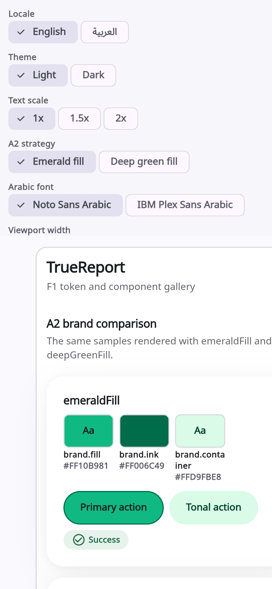
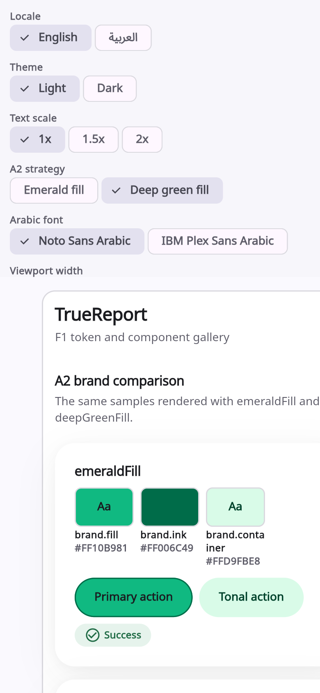
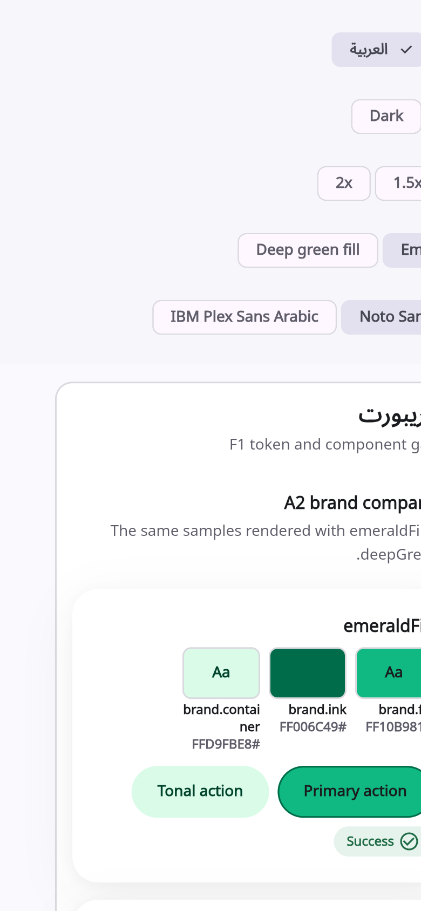
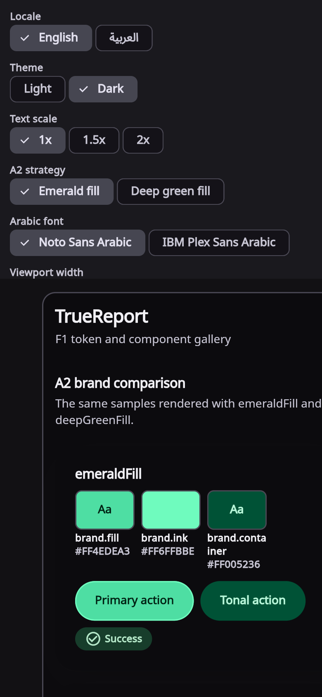
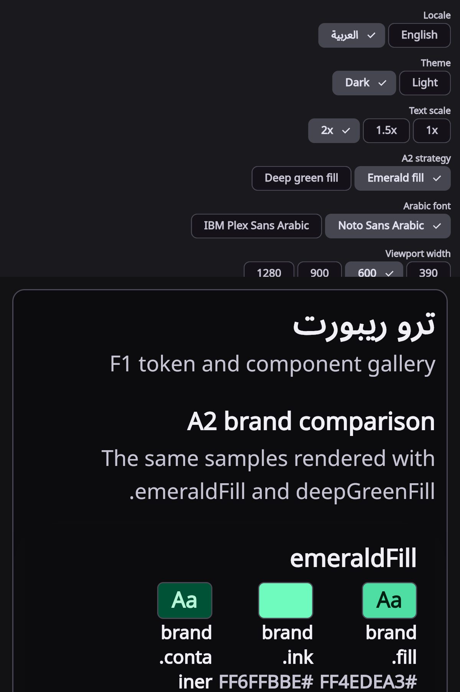

# Phase F1 report — design system, components, gallery, fidelity harness

> **F1.1 supersedes the fidelity section of this report (5 November 2026).**
> The F1 component samples were below the 0.98 SSIM gate. F1.1 reverted the
> token/component drift and the three Figma-exact samples now pass:
> primary button **0.99520**, delivery card **0.99198**, result selector
> **0.98340**. See `f1-fidelity-audit.md`, `deviations.md`,
> `app-structure-report.md`, `contrast-after.md` and
> `docs/ui/figma/fidelity/README.md`. The rest of this report remains the F1
> record of the token/font/gallery/harness work.

**Project:** TrueReport
**Phase:** F1
**Date:** 5 November 2026
**Status:** implementation complete; **F1 gate pending owner acceptance** of the documented residuals and contrast exceptions.
**Commit:** none. All changes are in the working tree for review.

---

## 1. What was completed

| F1 item | Status | Evidence |
|---|---|---|
| Owner decisions recorded | Done | `docs/ui/figma/decisions.md` |
| ADRs written | Done | `docs/ui/figma/adr/ADR-F1-001..005` |
| Consent privacy fix | Done | `job_detail_page.dart`, `consent_test.dart` |
| Token contract (Dart + CSS) | Done | `client/packages/design_system/tokens/tokens.json`, `tokens.g.dart`, `tokens.g.css` |
| Token generator and sync check | Done | `tools/design_tokens/generate.mjs`, `wire-print-tokens.mjs` |
| Fonts bundled and verified | Done | `design_system/assets/fonts/`, `fonts-and-licences-final.md` |
| Shared components rebuilt | Done | `design_system/lib/src/components/**` |
| SVG icon set and `flutter_svg` | Done (5 icons) | `design_system/assets/icons/`, `components/icons.dart` |
| Gallery | Done | `client/apps/ui_gallery` |
| Fidelity harness | Done | `tools/figma_fidelity/`, `design_system/test/fidelity_capture_test.dart` |
| Contrast after audit | Done | `docs/ui/figma/contrast-after.md` |
| Tests, analyze, builds | Done | §7 |
| Screenshots | Done | `docs/ui/figma/f1-screenshots/` |
| Risk register | Updated | `docs/phase-8/risk-register-consolidated.md` §5 |

**No application business logic, API contract, model, validation, permission, state-management or server logic was changed.** The only behavioural change is the approved consent default (ADR-F1-005). Server changes are static fonts and generated CSS/tokens only.

---

## 2. Token contract and CSS sync

**Source of truth:** `client/packages/design_system/tokens/tokens.json`
**Dart output:** `client/packages/design_system/lib/src/generated/tokens.g.dart`
**CSS output:** `server/src/main/resources/public-report/tokens.g.css`
**PDF token block:** marked `TOKENS:BEGIN/END` block in `server/src/main/resources/templates/report/print-report.html`

Commands:

```powershell
node tools/design_tokens/generate.mjs --write
node tools/design_tokens/generate.mjs --check
node tools/design_tokens/wire-print-tokens.mjs
node tools/design_tokens/wire-print-tokens.mjs --check
```

`report.css` now imports `tokens.g.css`; the public report uses the generated semantic and legacy variables. The PDF template carries the same variables inline because Chromium renders it from a temporary `file://` document and cannot load `/r/assets/...` at that point.

**Shell wiring:** `tokens.g.css` is served at `/r/assets/tokens.g.css` by the existing static resource mapping. The print template receives the generated block between the markers.

**A2:** the default is `emeraldFill` (`#10B981` fill, `#1A1B1F` label). The alternative `deepGreenFill` (`#006C49` fill, `#FFFFFF` label) is one theme switch and is shown side by side in the gallery. `#10B981` is never emitted as a text/icon token.

**Type scale:** 32/26/22/18/16/14/12 px, no 11 px style. Arabic build path sets tracking to 0 and increases body line height.

---

## 3. Fonts

Full evidence: `docs/ui/figma/fonts-and-licences-final.md`.

| Family | Files | Licence | Coverage |
|---|---|---|---|
| Plus Jakarta Sans | 400/500/600/700/800 | OFL 1.1, no RFN | Latin/Latin-ext only |
| Noto Sans Arabic | 400/500/600/700 (instanced from the official variable font) | OFL 1.1, no RFN | Arabic (256/256), shaping tables present |
| IBM Plex Sans Arabic | 400/500/600/700 | OFL 1.1, RFN `Plex` (files unmodified) | Arabic (252/256) |
| Noto Sans | 400 | OFL 1.1, no RFN | Latin/Latin-ext/Cyrillic |
| Noto Sans SC | 400 | OFL 1.1, RFN `Source` | Simplified Chinese (20,976/20,992) |

**Size impact:** 19,399,644 B (18.50 MiB) total; **2.83 MiB excluding Noto Sans SC**; Noto Sans SC alone is **15.68 MiB**. It is bundled for `zh-Hans` only. No runtime downloads. The app bundle is therefore significantly larger; subsetting or a dynamically loaded CJK asset is a candidate for a later phase.

**PDF:** the existing PDF path still embeds Noto Sans, Noto Naskh Arabic and Noto Sans SC through `ReportFonts`. The HTML report now uses Plus Jakarta Sans/Noto Sans Arabic. The PDF and HTML are token-colour-matched but not font-identical; aligning the PDF font stack needs a server font-embedding change and is listed as an F5 residual.

**SVG icons:** five exported Figma SVGs copied with stable names (`mail`, `lock`, `eye`, `arrow_forward`, `shield_check`) and exposed through `AppIcon`. `flutter_svg 2.3.2` is MIT-licensed (verified from the installed package `LICENSE`). More icons will be added in F2 with the same naming rule.

---

## 4. Components and gallery

**Components** (all token-only, no raw colours/font sizes/radii/shadows):
- `AppButton` primary/tonal/text/destructive, 56 dp, pill, press scale, focus ring, loading/disabled; primary emerald fill gets a 1.5 dp deep-green boundary.
- `AppIconButton`, `AppTextField` (filled, visible boundary, focus token, error/helper/char count), `AppCard`/`AppTonalCard`/`AppStatCard`.
- `StatusChip`, `SeverityBadge`, `AppFilterChip`, `AppSelectableText`, `AppSegmentedControl`, `AppLanguageSwitch`.
- `InspectionResultSelector` with the six approved results; no "Pass"/"Perfect"/"Certified".
- `AppProgressRing` and `AppCoverageBar` (coverage only; numeric fallback; LTR numerals).
- `AppBottomNavDock`, `AppListTile`, `SectionHeader`, `EmptyState`, `ErrorState`, `LoadingSkeleton`, `OfflineBanner`, `AppSnackBar`.
- `AppDataTable`, `AppTreeView`, `AdminSidebar`, `AdminTopBar`, `AdminShell`.
- `AppIcon` + 5 SVG assets.

**Gallery:** `client/apps/ui_gallery`. It supports EN/AR, light/dark, 1.0/1.5/2.0 text scale, both A2 strategies side by side, both Arabic font candidates, and 390/600/900/1280 viewport frames. URL parameters for screenshots/QA:

```
?lang=en|ar&theme=light|dark&scale=1|1.5|2&strategy=emerald|deepGreen&font=noto|ibm&width=390|600|900|1280&autofocus=0
```

Run:

```powershell
cd client
flutter pub get
cd apps/ui_gallery
flutter run -d chrome
# or
flutter build web --release
```

**Screenshots:** `docs/ui/figma/f1-screenshots/`
- `en-light.png`
- `en-deep-green.png`
- `ar-light.png`
- `en-dark.png`
- `ar-dark-2x.png` (Arabic, dark, 2.0x, 600 logical width)











The screenshots show the live gallery, not a mock. The 2.0x Arabic capture uses a 600 logical width because a 390-wide 2.0x Arabic title is a tight single-word fit; the component tests still cover 390 at 2.0x.

---

## 5. Consent privacy fix (approved behavioural change)

- `job_detail_page.dart`: consent type and status start **unselected** (`String? type`, `bool? granted`).
- Save is disabled until both a consent type and Granted/Refused are explicitly selected.
- No consent record is created before Save.
- `PROCESSING` and `PUBLIC_LINK` remain separate; no new consent type.
- `consent_test.dart` proves: both switches unselected, Save disabled, zero records before Save; after explicit selection, one record with the expected type/status. A second test covers `PUBLIC_LINK` + `REFUSED`.

---

## 6. Contrast after audit

`docs/ui/figma/contrast-after.md`: **154 audited token pairs, 140 pass, 14 fail.**

**Failing pairs — owner decision required:**

| Group | Pairs | Ratio | Why it is not automatically fixed | Recommendation |
|---|---:|---:|---|---|
| Emerald fill boundary (light) | 2 | 2.42–2.54:1 | A2 explicitly approves `#10B981` as a fill; the label is `#1A1B1F` (6.78:1) and the primary button now has a 1.5 dp deep-green boundary | Accept as a fill-only exception with the boundary; do not use emerald for text/icons |
| `outlineVariant` decorative dividers | 12 | 1.14–2.19:1 | They are dividers/decoration, not the sole boundary of an interactive control | Accept as decorative; interactive controls use `outline` (3.67–4.51:1) |

The four prohibited raw `#10B981` text/icon pairs are not emitted by the token generator and are listed separately in the report. No text pair fails 4.5:1; all status/severity pairs pass (5.41–9.68:1); focus rings pass 4.64–11.59:1.

If the owner does not accept the emerald fill exception, the alternative is `deepGreenFill` (`#006C49` + white) as the default, which passes 6.48:1.

---

## 7. Tests, analyze and builds

| Check | Result |
|---|---|
| `flutter analyze --fatal-infos` (client) | **No issues found** |
| `design_system` tests | **114 passed** (31 token, 80 component/golden, 3 fidelity capture) |
| `technician_app` tests | **22 passed** |
| `admin_app` tests | **83 passed** |
| `ui_gallery` test | **1 passed** |
| Server `mvn -B test` | **62 run, 0 failures, 0 errors, 3 skipped** |
| Goldens | 20 PNGs, second run 20/20 pass on Windows |
| `flutter build web --release` (gallery) | success |
| `flutter build web --release` (technician) | success |
| `flutter build apk --debug` (technician) | success |
| Token generator `--check` | pass |
| Print token block `--check` | pass |

The test suite covers EN/AR, light/dark, 390/600/900/1280, 1.0/1.5/2.0 text, target sizes (48/56), RTL, reduce motion, focus, semantics, goldens, and the source-scan rules. The source scan was extended to numeric radii, raw `BoxShadow`/`LinearGradient`, numeric `EdgeInsets`/`SizedBox` tokens and `fontFamily:`. It found two pre-existing numeric radii in `assessment_page.dart`; both were replaced with `context.radii.*`.

---

## 8. Fidelity harness

**Location:** `tools/figma_fidelity/` (README with commands), capture test in `design_system/test/fidelity_capture_test.dart`, artifacts in `docs/ui/figma/fidelity/`.

The harness computes SSIM, RMSE, CIEDE2000, diff boxes, key-box geometry, expected strings and a forbidden-term lint. It does not estimate metrics.

**Validated on synthetic and lint fixtures:**
- clean synthetic: SSIM 1.00000, pass.
- degraded synthetic: SSIM 0.89708, fail with 2 diff boxes (expected).
- forbidden bad string: fail (matched `certified`, `verified`, `score`).
- forbidden safe string: pass.
- Arabic certification bad: fail (matched `شهادة`, `تم التحقق`, `درجة`).
- plate/address bad: fail (matched `DXB A 12345`, `Dubai Marina`).
- Arabic safe result: pass.

**Component-level samples (F1 baseline, not accepted as passing):**

| Sample | SSIM | RMSE | ΔE2000 > 5 | Gate | Residual |
|---|---:|---:|---:|---|---|
| primary button | 0.93752 | 17.61 | 4.43% | fail | A2 dark label vs Figma white label; added accessibility boundary; different label/icon |
| delivery status card | 0.87955 | 36.006 | 9.13% | fail | Different status-component composition and copy |
| inspection result selector | 0.75583 | 44.881 | 32.78% | fail | Phase 1 six-result vocabulary/selector vs Figma Pass/Minor/Major filmstrip |

These are intentional component-design differences, not hidden regressions. They must be reviewed and accepted or reworked in F2; F1 does not claim the component samples meet the 0.98 gate. The harness itself is proven by the synthetic/lint fixtures, and real-screen fidelity starts in F2.

---

## 9. Accessibility and privacy review

Reports: `docs/ui/figma/f1-a11y-i18n-review.md`, `docs/ui/figma/f1-privacy-review.md`.

**Fixed during integration:**
- Semantics activation added to result options, nav dock, admin sidebar/rail, data-table headers and tree expand buttons.
- Text field now has a visible `outline` boundary (4.08–4.51:1) in addition to the fill.
- Result options, filter chips and segmented controls use `outline`/`brand.ink` boundaries; selected segment/filter chip also shows a check icon.
- Primary emerald button has a 1.5 dp deep-green boundary.
- Arabic tracking now comes from the locale-aware theme in both apps (`AppTheme.build(isArabic: ...)`).
- Progress ring/coverage numerals use LTR text direction.
- Admin top bar uses a minimum height instead of a fixed 64 dp.
- Loading skeleton now settles (single forward pulse) instead of repeating indefinitely.
- Consent type/status start unselected.

**Remaining or unverified:**
- Real TalkBack/VoiceOver/NVDA, browser zoom and native Arabic review.
- Full table caption/header-association semantics and sort-state announcements.
- Directional icons beyond `AppIcon.arrowForward` are not auto-mirrored; a screen-level RTL pass is due in F2.
- Gallery control labels are still English; the gallery is developer-only.
- Noto Sans SC is bundled in all app builds (15.68 MiB), not lazily loaded.
- PDF fonts remain Noto (not Plus Jakarta Sans/Noto Sans Arabic); HTML/PDF visual parity is an F5 item.

**Accessibility review final verdict:** pass with conditions (0 blockers, 6 deferred major conditions, 8 minor items). The screen-reader activation blocker is fixed; the remaining conditions are 2x ellipsis/FittedBox, full table semantics, gallery chrome localization, Noto Sans SC size, directional icon mirroring and the VIN/field-direction contract. Real-device screen-reader verification is still outstanding.

**Privacy review final verdict:** pass (0 blockers, 0 medium, 0 low, 3 info). The consent fix and tests are correct; fixtures are test-only; no new PII/fields/endpoints; public templates are unchanged except generated token CSS/fonts; no certification/score/portal/write actions. The token CSS is imported, print tokens are wired, and the deny-list now uses Unicode-aware matching with Arabic terms, UAE plate and area patterns, plus negative/positive fixtures. The reviewer’s conditions are closed.

---

## 10. What I should check on a real phone and in the browser

1. Run the gallery at 390 and 600 width; switch EN/AR, light/dark, 1.0/1.5/2.0; confirm no clipping in the components you care about.
2. Compare both A2 strategies: emerald fill with ink label vs deep-green fill with white label; decide which is the default.
3. Switch Arabic font between Noto Sans Arabic and IBM Plex Sans Arabic; have a native reviewer choose.
4. Check Arabic shaping, mixed Arabic/English/numbers, and RTL mirroring on a real Android and iOS device.
5. Check focus rings and keyboard traversal on web (Tab/Shift+Tab, Escape in dialogs/sheets).
6. Run TalkBack/VoiceOver on the consent sheet, result selector, nav dock and data table.
7. Check the 2.0x text scale on a small phone, especially the admin top bar/sidebar and dense tables.
8. Confirm the 15.68 MiB Noto Sans SC addition is acceptable; if not, choose subsetting or lazy loading.
9. Review the three fidelity samples in `docs/ui/figma/fidelity/component-samples/**/side-by-side.png` and accept or reject each residual.
10. Confirm the emerald-fill contrast exception and the decorative-divider exception, or switch the default to deep green.

---

## 11. What could not be verified

- Real-device Arabic shaping/RTL line-breaking; native Arabic approval is not claimed.
- Real screen-reader behaviour and browser zoom.
- Cross-platform golden stability (goldens were generated and passed on Windows only).
- Component-level fidelity to the Figma samples; the measured SSIM values above are below 0.98 and are reported as residuals.
- PDF font parity with the new HTML font stack.
- Any legal/accreditation truth; no certification claims were introduced.
- The real drift offline database in widget tests; an in-memory store is used for deterministic tests.
- Owner acceptance of the contrast exceptions and fidelity residuals.

---

## 12. Risks

Added to `docs/phase-8/risk-register-consolidated.md` §5. The highest F1 risks are the unverified Arabic native review, the unaccepted fidelity residuals, the Noto Sans SC app-size cost, and the HTML/PDF font mismatch.

---

## 13. Pending decisions

1. Accept the 14 contrast exceptions, or switch A2 default to deep green.
2. Accept the three component-sample fidelity residuals, or require rework before F2.
3. Choose the Arabic font default after native review.
4. Decide whether the Noto Sans SC 15.68 MiB cost is acceptable.
5. Decide whether PDF fonts must match the HTML font stack in F5.

Nothing in F2 should start until you approve the F1 gate.
