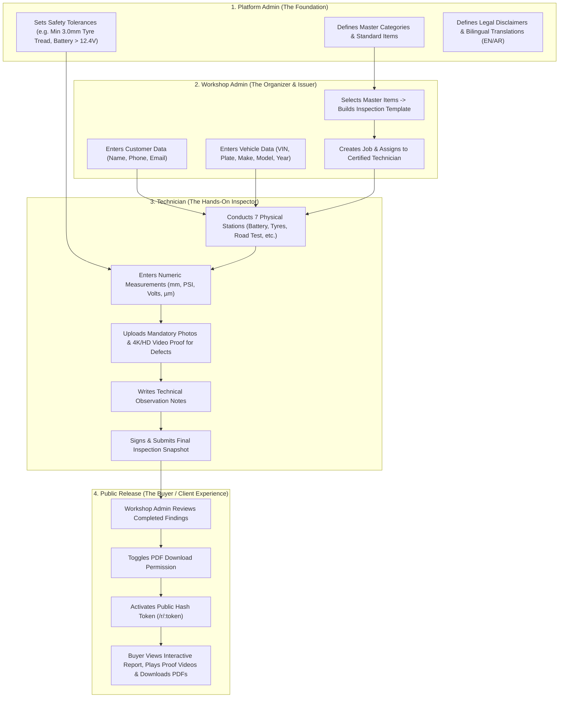
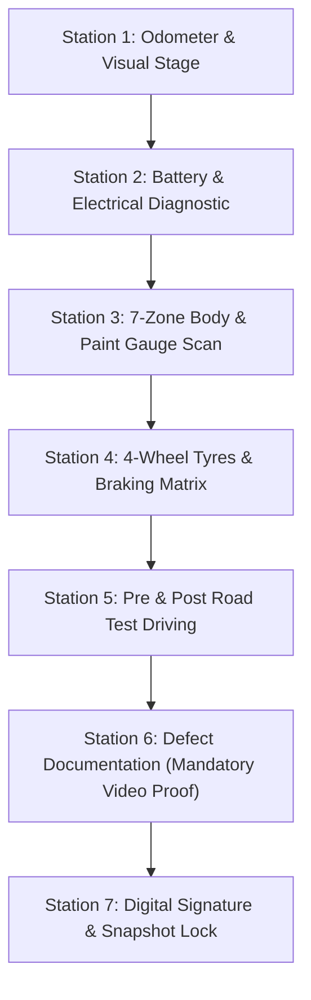

# TrueReport End-to-End Role Architecture, Workflows & Dependencies

This document provides a **complete, standalone product and technical blueprint** for building the TrueReport platform from scratch (UI and APIs). It explains:
1. **Who does what** (Role definition & scope).
2. **What data originates from each role** (Mandatory vs. optional fields).
3. **Who depends on whom** (The strict dependency chain).
4. **The Technician's Deep-Dive Inspection Stations** (Battery, Electrical, Road Test, Tyres, Damage Map, and Video/Photo Proof).

---

## 1. High-Level Dependency Chain (Who Depends on Whom)

A report cannot be created out of thin air. There is a strict sequence of dependencies that ensures 100% data integrity and tamper-proof verification:

---

## 2. Role 1: Platform Admin (System Authority & Master Data)

### 2.1 Role Purpose
The Platform Admin sets the **global standard of truth**. Workshops and technicians cannot invent checklist items, calculation rules, or measurement limits arbitrarily. The platform ensures consistency so that an "Inspection Grade A" means the exact same thing whether issued in Dubai, Abu Dhabi, or Riyadh.

### 2.2 What Data Originates from Platform Admin
| Category | Data Field | Mandatory / Optional | Purpose on Public Report |
| :--- | :--- | :--- | :--- |
| **System Taxonomy** | Master System Names (`Electrical`, `Brakes`, `Powertrain`, etc.) | **Mandatory** | Forms the section tabs and accordion groups. |
| **Inspection Items** | `stableCode` (e.g. `TYRE-FL-01`, `BATT-12V-01`), Bilingual Labels (`labelEn`, `labelAr`) | **Mandatory** | The individual check titles displayed in the checklist. |
| **Instructions** | Standard test instructions (`instructionEn`, `instructionAr`) | **Mandatory** | Explains to the technician exactly how to test the component. |
| **Tolerances & Limits** | Legal min/max limits (e.g. Tread depth $\ge 3.0\text{mm}$, Paint $90-140\mu\text{m}$, Battery $\ge 12.4\text{V}$) | **Mandatory** | The system automatically checks technician measurements against these limits to flag defects. |
| **Grading Weights** | Grade thresholds ($A \ge 90\%$, $B \ge 80\%$, $C \ge 65\%$, $D < 65\%$) & Safety Item Override rules | **Mandatory** | Computes the big circular score ring (`A`, `94%`). Failed safety items cap score at `B`. |
| **Exclusion Reasons** | Standard list of reasons why an item was not checked (e.g. "Underbody Shield Obstructed", "Battery Box Sealed") | **Mandatory** | Shown under `#not-checked` section so customers know why something wasn't inspected. |
| **Legal Text** | Standard bilingual disclaimer & limitation statements | **Mandatory** | Rendered in the tamper-proof verification card (`#verification`). |

---

## 3. Role 2: Workshop Admin (Operations, Customer & Job Issuer)

### 3.1 Role Purpose
The Workshop Admin operates a testing center. They take customer bookings, register vehicles, build custom packages using platform master items, assign jobs to their staff, and perform final quality control before releasing public reports.

### 3.2 What Data Originates from Workshop Admin
| Section | Field Name | Mandatory / Optional | Purpose on Public Report |
| :--- | :--- | :--- | :--- |
| **Customer Details** | `customerName` | **Mandatory** | Rendered in vehicle snapshot (`Client Name: Private Client` or user name). |
| | `customerPhone` | **Mandatory** | Used for automated WhatsApp / SMS report delivery link. |
| | `customerEmail` | Optional | Used for delivering the PDF bundle attachment. |
| **Vehicle Snapshot** | `vehicleMake`, `vehicleModel`, `vehicleYear` | **Mandatory** | The primary headline of the report (e.g., *2023 Toyota Land Cruiser*). |
| | `vehicleVin` | **Mandatory** | Masked in public report (`JTMBY7AJ••••••9284`) with one-click copy button. |
| | `vehiclePlate` | Optional | Recorded for official police/workshop cross-reference. |
| | `gearbox`, `fuelType`, `drivetrain`, `engineSize` | **Mandatory** | Populates the 6-item key specifications grid in the Hero Card. |
| **Template Config** | Selected Master Items (e.g., 120-Point vs 80-Point) | **Mandatory** | Defines the exact checklist items the technician must inspect. |
| | Technician Assignment (`assignedTechnicianId`) | **Mandatory** | Assigns job to a certified technician's queue. |
| **Report Release** | `pdfDownloadEnabled` (true / false) | **Mandatory** | Shows/hides the **Download PDF** buttons on the header and download center. |
| | Link Status (`ACTIVE` / `REVOKED`) | **Mandatory** | Governs public URL access (`/r/:token`). Revoking immediately shows 404. |

---

## 4. Role 3: Technician (The Heart of the System — Field Inspector)

### 4.1 Role Purpose
The Technician executes the physical inspection. **Their work is the most critical** because the entire public report—scores, defect warnings, measurements, damage maps, videos, and sub-reports—derives directly from their physical assessment and recorded evidence.

### 4.2 Mandatory Inspection Stations for Technician

---

### Station 1: Odometer & Live Vehicle Verification
* **Technician Inputs**:
  * Numeric odometer value (e.g. `42,850`).
  * Unit selector (`km` or `mi`).
  * Live photo of instrument cluster showing mileage and warning lights.
* **Public Report Output**:
  * Tag pills in Hero section (`42,850 km`).
  * Verifies mileage rollback tampering.

---

### Station 2: Battery & Electrical System Diagnostic
* **Technician Inputs**:
  1. **Auxiliary 12V Battery Resting Voltage** (e.g. `12.6V`).
  2. **Cold Cranking Amps (CCA)** measured vs rated (e.g. `680 CCA` tested / `700 CCA` rated = `97% State of Health`).
  3. **Alternator Charging Voltage Under Load** (High beams + AC on full $\rightarrow$ must read between `13.8V` and `14.5V`; e.g. `14.2V`).
  4. **OBD-II Computer Diagnostic Scanner**:
     * Number of stored DTC fault codes (e.g. `0 Fault Codes Detected`).
     * ECU readiness monitors status (`PASSED`).
* **Public Report Output**:
  * Powers the **"Electrical System Report"** and **"Battery & Charging Health Report"** download cards.
  * Populates the electrical health item in the checklist.

---

### Station 3: 7-Zone Exterior Body & Paint Thickness Scan
* **Technician Inputs**:
  The technician must take an electronic paint depth gauge (e.g. Elcometer) and record paint thickness in micrometers ($\mu\text{m}$) across all 7 zones:
  1. **Front Bumper & Grille**
  2. **Hood (Bonnet)**
  3. **Roof & Pillars**
  4. **Left Flank (Fenders & Doors)**
  5. **Right Flank (Fenders & Doors)**
  6. **Trunk / Tailgate**
  7. **Rear Bumper**
* **System Logic**:
  * `90µm - 140µm` $\rightarrow$ Factory Original Paint (Green Clean badge).
  * `140µm - 200µm` $\rightarrow$ Repainted without filler (Amber badge).
  * `> 200µm` $\rightarrow$ Heavy body filler / accident repair (Red Defect badge).
  * Scratch or dent observed $\rightarrow$ Technician logs scratch length (e.g. `42mm`) and captures macro photo.
* **Public Report Output**:
  * Renders the interactive **Exterior Damage Map** (`#wireframe`) where users tap panels to see paint readings and damage indicators.

---

### Station 4: 4-Wheel Tyres & Braking Systems Analysis
* **Technician Inputs**:
  For all 4 wheel corners (**Front-Left, Front-Right, Rear-Left, Rear-Right**):
  1. **Tread Depth**: Digital gauge reading in millimeters (e.g. `FL: 6.5mm`, `FR: 6.4mm`, `RL: 6.2mm`, `RR: 2.8mm`).
  2. **Tyre Pressure**: Digital gauge reading in PSI (e.g. `34 PSI`).
  3. **DOT Date Code**: 4-digit code on sidewall (e.g. `2423` = Week 24, 2023).
  4. **Brake Pad Thickness / Remaining Life**: Percentage or mm (e.g. `75% remaining`).
  5. **Brake Disc Rotor Condition**: `SMOOTH`, `LIPPED`, or `SCORED`.
* **System Logic**:
  * If tread depth $< 3.0\text{mm}$ $\rightarrow$ Automatically flagged as **SAFETY CRITICAL DEFECT**.
  * If tyre age $> 4\text{ years}$ $\rightarrow$ Flagged as **ATTENTION RECOMMENDED**.
* **Public Report Output**:
  * Generates the **4 Wheels Clean Cards Grid** (`#tyres`) with visual tread depth progress bars.
  * Powers the **"Tire & Wheel Alignment Report"** download card.

---

### Station 5: Road Test & Dynamic Driving (Pre & Post Drive)
* **Technician Inputs**:
  1. **Pre-Test Drive (Static / Cold Start)**:
     * Cold engine idle stability, exhaust smoke check, fluid leak check before moving.
     * Transmission engagement (P $\rightarrow$ R $\rightarrow$ N $\rightarrow$ D transition delay/clunk).
  2. **Post-Test Drive (Dynamic Road Test)**:
     * Steering centering and wheel alignment pull (left/right drift).
     * Suspension behavior over road bumps (clunks, rattles, damper rebound).
     * ABS emergency braking test from $60\text{ km/h}$ (pedal feel, pulsation, stopping line).
     * Transmission gear shifting smoothness across all gears.
* **Public Report Output**:
  * Powers the **"Pre-Road Test Inspection"** and **"Post-Road Test Diagnostics"** download cards.
  * Populates the Road Test category in the checklist.

---

### Station 6: Mandatory Evidence (Photos & HD Video Proof)
* **Strict Evidence Enforcement Matrix**:
  * Every item marked **`NO_ISSUE_OBSERVED`**: 0 or 1 optional photo.
  * Every item marked **`ATTENTION_RECOMMENDED`**: **Mandatory minimum 1 close-up photo**.
  * Every item marked **`DEFECT_FOUND`**: **Mandatory minimum 1 photo AND 1 certified HD video clip (15-30s)**.
* **Video Capture Rules**:
  * Video must show the defect in context (e.g. close-up of sidewall bulge with digital gauge, or paint gauge on scratched door, or underbody frame rail).
  * Video duration between 10 and 30 seconds.
  * Thumbnail automatically extracted.
* **Public Report Output**:
  * Renders the **Certified Field Inspection Videos** section (`#videos`) with playable video modals.
  * Injects video proof buttons inside the damage map and interactive part details dialogs.

---

### Station 7: Technician Observations & Final Seal
* **Technician Inputs**:
  * Written summary observations for each major system (Body, Engine, Suspension, Interior).
  * Overall recommendation sentence (e.g., *"Vehicle in superior mechanical condition with 1 required tyre replacement"*).
  * Digital signature / final inspection submission button.
* **System Action**:
  * Calculates the overall grade and percentage (`Grade A`, `94%`).
  * Cryptographically hashes the entire inspection dataset (`SHA-256`) to create the tamper-proof `verificationHash`.

---

## 5. Summary Matrix: Where Public Report Components Come From

| What the Public Sees on `/r/:token` | Source of Data | Who Entered It |
| :--- | :--- | :--- |
| **TrueReport Brand & Header Logo** | Platform System Asset | Platform Admin |
| **Language Switcher (EN / AR RTL)** | Translation Bundles (`i18n`) | Platform Admin |
| **Vehicle Title & Specifications** | Job Intake Form | Workshop Admin |
| **Client Name** | Customer Booking | Workshop Admin |
| **Big Circular Score Ring (`A / 94%`)** | Auto-calculated from Item Results | Platform Formula + Tech Assessments |
| **Passed / Attention / Defects Counters** | Aggregation of Item Statuses | Technician Assessment |
| **Exterior Damage Map (7 Zones)** | Paint Gauge & Visual Assessment | Technician ($\mu\text{m}$, scratches) |
| **4-Wheel Tyre & Brake Cards** | Gauge Measurements & Rotor Check | Technician (mm, PSI, % life) |
| **Certified Field Inspection Videos** | Video Camera Evidence Uploads | Technician (HD/4K MP4 clips) |
| **Download Documents (5 Sub-Reports)** | Electrical, Battery, Road Test Stations | Technician Measurements |
| **Checklist Filters & Items** | Master Catalog + Assessment Notes | Platform (Catalog) + Technician (Notes) |
| **Showroom Photo Masonry Grid** | Camera Evidence Uploads | Technician (Showroom photos) |
| **Tamper-Proof Verification Hash** | SHA-256 Hash of Finalized Snapshot | Automatic System Backend |
| **PDF Download Permission** | Toggle Switch (`pdfDownloadEnabled`) | Workshop Admin |
